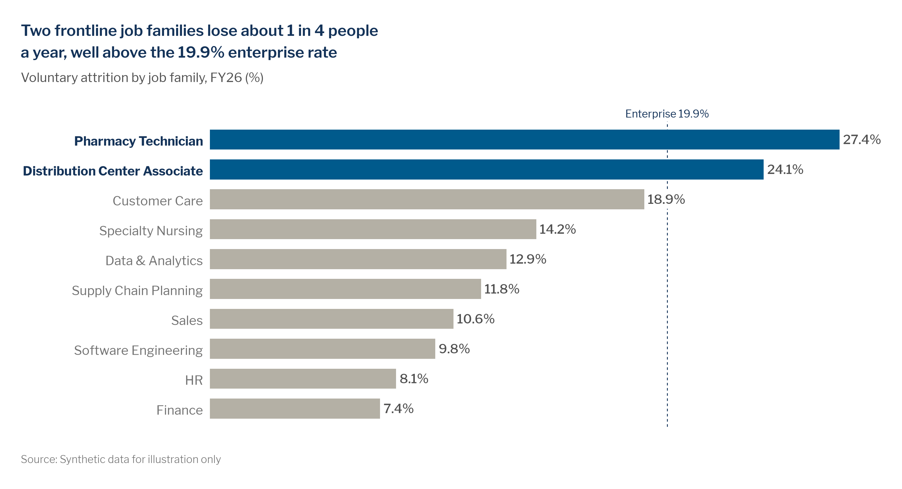
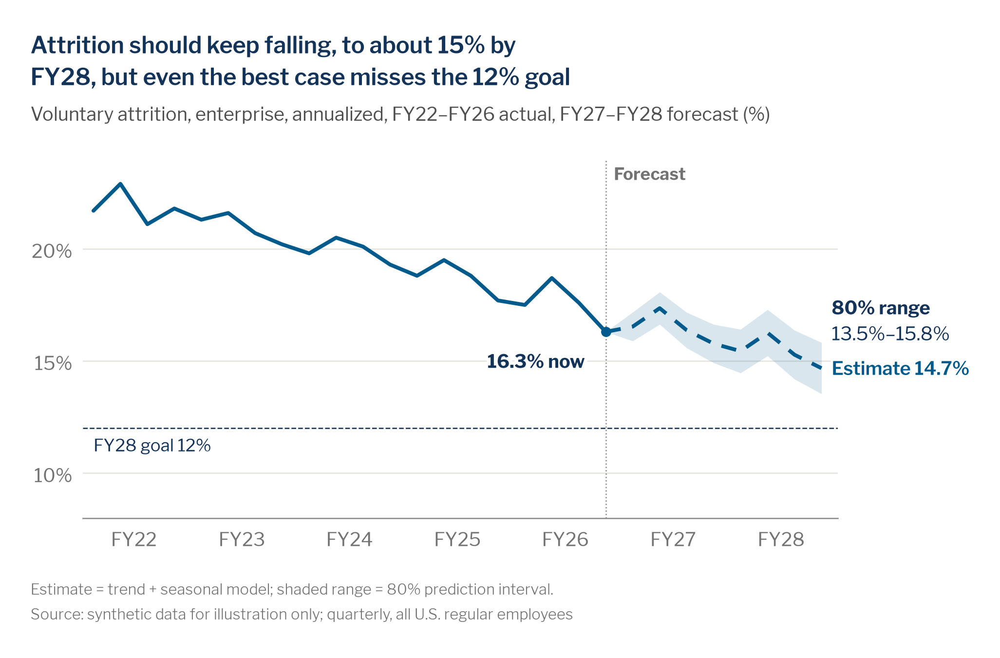
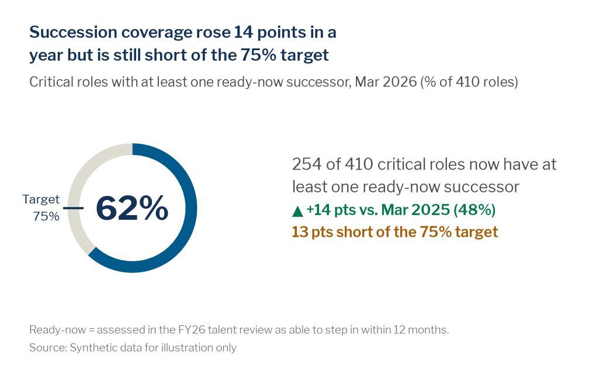
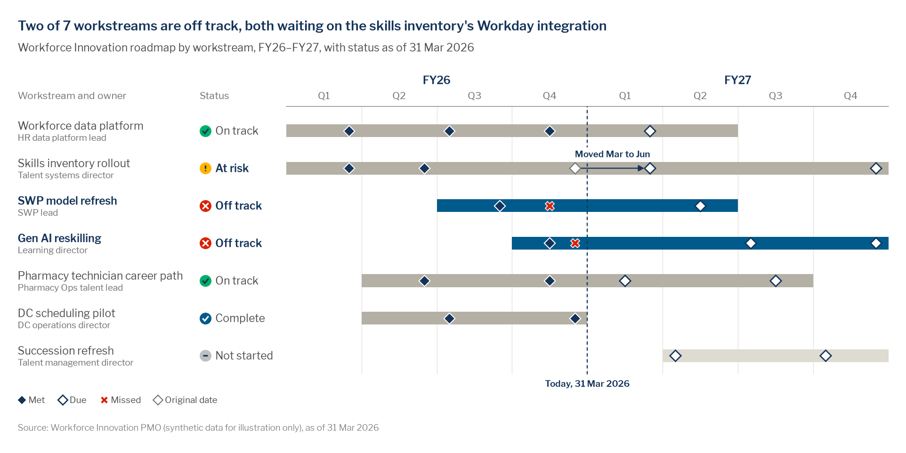
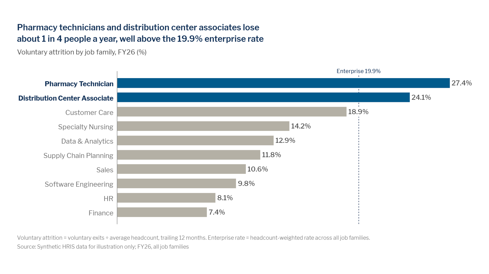
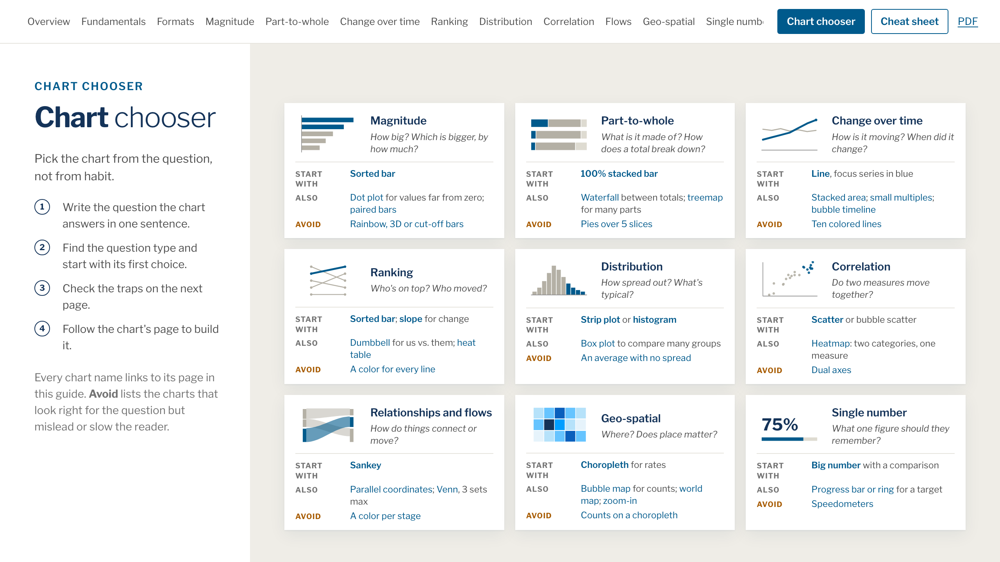

# Data Viz Starter Kit · McKesson Edition, in one screen

**Your own data storytelling team, ready when you are.**

This page is the kit on one screen: a short explainer video and the real outputs it shows. What the kit is and why it exists: the [README](../README.md).

## The video (4:47)

The explainer, *Exec-ready by 3*, follows an analyst who has a leader's question and under an hour to answer it: once the usual way, once with the kit.

| Where | Link |
|---|---|
| GitHub Release asset | `data-viz-kit-explainer-video.mp4` on the next release: https://github.com/amccown-mck/Data-Viz-Guide/releases (owner: attach the file to the release, then paste the asset link here) |
| Source | [`video/explainer-exec-ready-by-3/`](../video/explainer-exec-ready-by-3/README.md): scenes, storyboard, narration and the engine that built it ([`video/README.md`](../video/README.md)). Build it and press Space to watch it in Chrome without the mp4 |

The mp4 is 147 MB, over GitHub's 100 MB file limit, so it is never in git.

## What the video shows, as real outputs

Every chart below is real kit output on synthetic data: made with `mckviz` or the Office templates, headline computed from the numbers, passed `mv.lint`.

| | |
|---|---|
| **The highlighted bar.** Grey context, one blue focus, a computed headline, a benchmark line. [`examples/output/bar-highlight.png`](../examples/output/bar-highlight.png)  | **The forecast.** Actuals solid, estimate dashed and labelled, the range shaded, the goal line, the headline from the model. One line (`mv.use()`) took it from default matplotlib to this. [`video/…/assets/fc_after.png`](../video/explainer-exec-ready-by-3/assets/fc_after.png)  |
| **The KPI card.** The number, one sentence, the change with ▲ and green because higher is better, the shortfall in orange. [`demo/kpi-card.png`](kpi-card.png)  | **The roadmap.** Off-track workstreams in blue, the rest grey; ◆ met, ◇ due, ✕ missed, the slip drawn as an arrow, a Today line. [`demo/roadmap.png`](roadmap.png)  |
| **Five options from one pasted table.** The agent scene: option 1 of 5, each with its own computed headline and a clean lint. [`opt1`](../video/explainer-exec-ready-by-3/assets/opt1.png) · [`opt2`](../video/explainer-exec-ready-by-3/assets/opt2.png) · [`opt3`](../video/explainer-exec-ready-by-3/assets/opt3.png) · [`opt4`](../video/explainer-exec-ready-by-3/assets/opt4.png) · [`opt5`](../video/explainer-exec-ready-by-3/assets/opt5.png)  | **The chart chooser.** Name the question; the chooser names the chart and says why. [`dist/guide/chooser.html`](../dist/guide/chooser.html) (also a [one-page PDF](../dist/print/chart-chooser.pdf))  |

**The starter deck and workbook.** Native, editable Office charts on the brand theme: [`McKesson-DataViz-Starter.pptx`](../dist/office/McKesson-DataViz-Starter.pptx) (14 slides: bar, line, waterfall, stacked, KPI, roadmap, tracker, dumbbell, slope, bubble), [`McKesson-DataViz.potx`](../dist/office/McKesson-DataViz.potx) (the template) and [`McKesson-DataViz-Charts.xlsx`](../dist/office/McKesson-DataViz-Charts.xlsx) (the chart workbook). Set-up: [`docs/office-setup.md`](../docs/office-setup.md).

## Where to go next

- **The guide:** [`dist/guide/index.html`](../dist/guide/index.html), or the [PDF](../dist/guide/McKesson-DataViz-Guide.pdf).
- **Python:** `pip install "mckviz @ git+https://github.com/amccown-mck/Data-Viz-Guide@v1.1.0#subdirectory=python"`, then `import mckviz as mv; mv.use()`.
- **Agents:** the `mck-chart` skill ([`dist/skills/mck-chart/`](../dist/skills/mck-chart/)) and [`AGENTS.md`](../AGENTS.md).
- **Everything else:** the [README](../README.md).

`make_demo.py` renders the KPI card and the roadmap here (`python demo/make_demo.py` from the repo root); the other outputs are linked from where the kit builds them.
