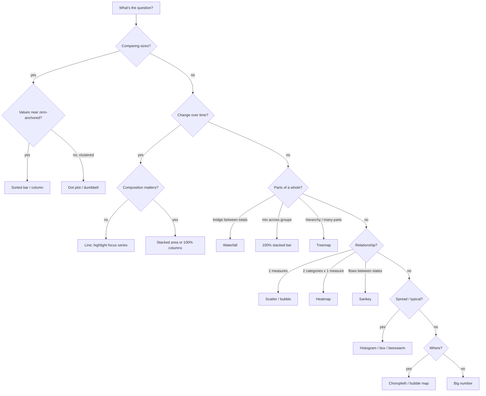

# Choosing a chart

Pick the chart from the **question**, not from habit. First name the question type, then choose from the short list. Each chart links to its cookbook page (spec, do/don't, code for each platform).

## Step 1 — What kind of question is it?

| Question type | The reader wants to know… | Workforce examples |
|---|---|---|
| **Magnitude** | How big? Which is bigger, by how much? | Headcount by function; attrition by job family; open reqs by site |
| **Part-to-whole** | What is it made of? How does a total break down? | Workforce mix (FT/PT/contingent); labor cost bridge FY25→FY26; skills portfolio |
| **Change over time** | How is it moving? When did it change? | Monthly attrition trend; SWP demand vs. supply forecast; hiring velocity |
| **Ranking / change in rank** | Who's on top? Who moved? | Top skills in postings 2023→2026; sites ranked by time-to-fill |
| **Distribution** | How spread out? What's typical? Where are the outliers? | Span of control; pay within band (compa-ratio); tenure; performance ratings |
| **Correlation** | Do two measures move together? | Engagement vs. attrition by team; gen-AI exposure vs. pay; manager tenure vs. team turnover |
| **Relationships & flows** | How do things connect or move between states? | Internal mobility between job families; hiring source → role; skill overlaps |
| **Geo-spatial** | Where? | Talent availability by metro; workforce by DC location; remote-work distribution |
| **Single number** | Just the headline figure | "75% of roles have a successor ready" |
| **Plans and status** | What happens when, who owns it, is it on track? | Reskilling program roadmap; initiative tracker for the steering committee; milestones by quarter |

## Step 2 — Choose from the short list

This table mirrors the chart chooser in the guide (`dist/guide/chooser.html`); keep the two in step. **Avoid** lists charts that look right for the question but mislead or slow the reader.

| Question type | Start with | Also | Avoid |
|---|---|---|---|
| Magnitude | [Sorted bar](cookbook/bar.md) | [Dot plot](cookbook/dot-plot-dumbbell.md) for values far from zero; paired bars; [proportional bubbles](cookbook/bubble-chart.md) for huge ranges | Rainbow, 3D or cut-off bars |
| Part-to-whole | [100% stacked bar](cookbook/stacked-bar.md) | [Waterfall](cookbook/waterfall.md) between totals; [treemap](cookbook/treemap.md) for many parts | Pies or [donuts](cookbook/donut-pie.md) over 5 slices |
| Change over time | [Line](cookbook/line.md), focus series in blue | [Stacked area](cookbook/stacked-area.md); [small multiples](cookbook/small-multiples.md); [bubble timeline](cookbook/bubble-timeline.md) for events | Ten colored lines |
| Ranking | [Sorted bar](cookbook/bar.md); [slope](cookbook/slope-bump.md) for change in rank | [Dumbbell](cookbook/dot-plot-dumbbell.md) for us vs. them; [heat table](cookbook/tables.md) | A color for every line |
| Distribution | [Strip plot or histogram](cookbook/distribution.md) | Box plot to compare many groups | An average with no spread |
| Correlation | [Scatter or bubble scatter](cookbook/scatter-bubble.md) | [Heatmap](cookbook/heatmap.md): two categories, one measure | [Dual axes](cookbook/dual-axis.md) |
| Relationships & flows | [Sankey](cookbook/sankey.md) | [Parallel coordinates](cookbook/parallel-coordinates.md); [Venn](cookbook/venn.md), 3 sets max | A color per stage |
| Geo-spatial | [Choropleth](cookbook/maps.md) for rates | Bubble map for counts; world map; zoom-in with a locator | Counts on a choropleth |
| Single number | [Big number](cookbook/kpi-big-number.md) with a comparison | Progress bar or ring for a target | Speedometers |
| Plans and status | [Roadmap](cookbook/plans-status.md) (Gantt bars by workstream, milestones as markers) | [Initiative tracker](cookbook/plans-status.md) (a table with a status column); status pills: color + symbol + word (`mv.STATUS`, [color.md §4](color.md#4-status-colors-red-amber-green)) | Red/amber/green by color alone, or on data series |

## Step 3 — Sanity checks

- **More than ~12 categories?** Use horizontal bars sorted by value, or group the long tail into "Other".
- **Values tightly clustered far from zero** (e.g., engagement scores of 66–77)? Don't truncate bars — use a dot plot or show the **difference from benchmark**.
- **Two measures with different units over time?** Don't reach for dual axes — use two aligned charts, or index both to 100.
- **Comparing many groups on the same measure over time?** Use small multiples with a shared scale, and highlight the focus group in each.
- **The audience will explore it themselves?** That's a dashboard — see [formats.md](formats.md#dashboards-power-bi--fabric).
- **Tempted by a pie with 8 slices?** Use a sorted bar.

## Quick decision tree

