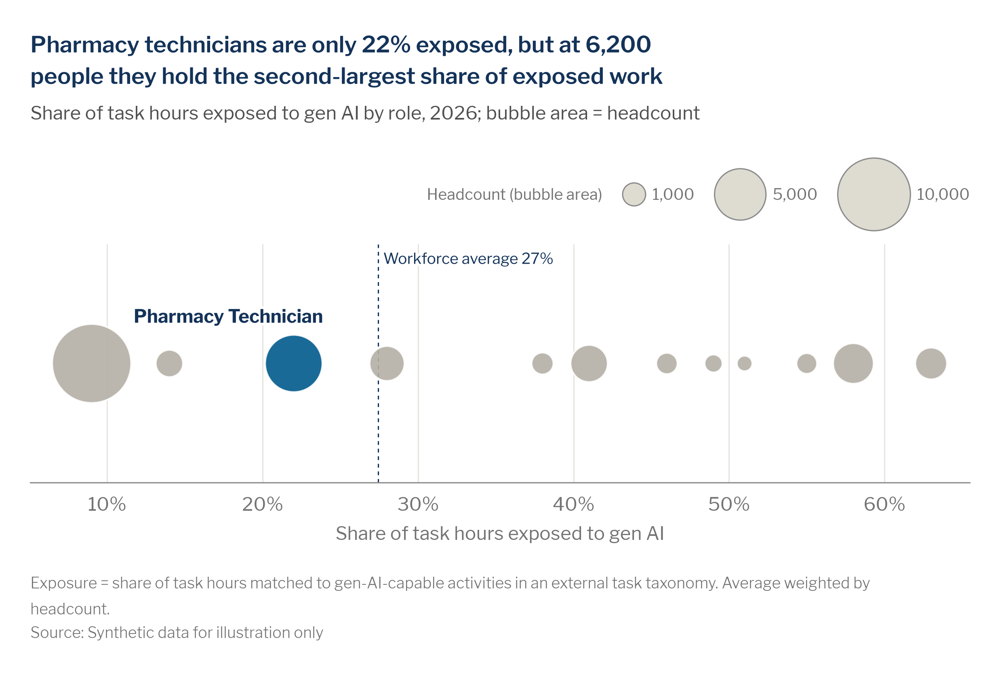

# Bubble strip

> **Question type:** Magnitude
> **Use for:** categories on one measure when how many people each one covers matters as much as its value (exposure by role, with headcount as bubble area) · **Avoid when:** only the rate matters → use a [sorted bar](bar.md)



## When to use
- One measure per category (a rate, a score, a share) and a **count** per category (headcount, open requisitions) that varies a lot: the largest at least about 5 times the smallest.
- The headline is about **how many people** a value reaches, not only the value: "only 22% exposed, but 6,200 people", "the three slowest sites hire a third of our associates".
- You want to show how **close** the categories sit on the measure (a cluster near the average, a few far out) and which of them are big.
- Many categories (up to ~40) where a ranked bar would run long: name only what the headline needs and the extremes.

## When not to use
- The count doesn't matter to the story → use a [sorted bar](bar.md), or a [dot plot](dot-plot-dumbbell.md) when the values are clustered.
- Two measures per category (exposure **and** pay) → use a [bubble scatter](scatter-bubble.md).
- Each mark is a **person**, not a category → use a [strip plot](distribution.md): people are anonymous dots, never sized or named.
- The count is the story on its own ("where most of the people are") → use a [treemap](treemap.md) or a sorted bar of the count.

## McKesson spec

| Element | Rule |
|---|---|
| Color | Grey `chart.context` `#B4B0A5` for every bubble, the categories the headline names in `chart.focus` `#005A8C`, one exception in `chart.accent` navy `#143359`. With no focus, all bubbles `chart.focus`. ~90% opacity and a 1 px white outline. Shade a range that matters (`surface.subtle` `#EFEDE7`) behind the bubbles; draw a reference (the average, a target) as a dashed `chart.total` `#143359` line, 0.75 pt. |
| Labels | Name only the focus bubbles in bold navy with a white halo, above or below the bubble; with no focus, name all of up to 8 bubbles, else the three largest and the two ends. A name that can't sit next to its bubble goes a step farther out with a hairline leader. Name the zone and the reference line in place at the top. A **size key** with 2–3 round values sits above the plot, at the top right (`mv.size_key`). Say "bubble area = headcount" in the subtitle. |
| Axes / gridlines | One value axis at the bottom with its unit, light vertical gridlines in `chart.grid` `#E6E4DE`, no y axis. The axis need not start at zero: position, not length, carries the value. |
| Sort / order | Position is the value. Bubbles pack along the line without overlapping: the largest first, each as near the line as it fits. Draw the largest first so small bubbles stay visible. |
| Proportions | **Area ∝ count**, never diameter, on one scale for every bubble and the key. Shrink all bubbles alike if the row doesn't fit; never one alone. A strip suits a wide, short plot (a half slide, or the slide's chart area). |
| Limits | ≤ ~40 bubbles. Highlight only what the headline names. Suppress any category with **n < 10** people. |

## Do / don't

| Do | Don't |
|---|---|
| Use a bubble strip when the count changes the story | Size bubbles when everyone is about the same size: the reader looks for a difference that isn't there |
| Scale **area** to the count and add a 2–3 step key above the plot | Scale the diameter, or put the key among the bubbles where it reads as data |
| Pack bubbles so none overlap, and keep each at its value | Jitter bubbles randomly up and down, which suggests a second measure |
| Name the headline's bubbles and the extremes | Name every one of 30 bubbles |
| Mark the average or target with a dashed navy line, named at the top | Leave the reader to guess what "high" means |

## Workforce examples
- **Role level, internal + external taxonomy (SWP / gen AI):** *Headline:* "Pharmacy technicians are only 22% exposed, but at 6,200 people they hold the second-largest share of exposed work". *Subtitle:* "Share of task hours exposed to gen AI by role, 2026; bubble area = headcount". *Data:* [`assets/data/automation_exposure.csv`](../../assets/data/automation_exposure.csv) (built below).
- **Site level, internal (talent acquisition):** *Headline:* "The three slowest-hiring distribution centers employ a third of our associates". *Subtitle:* "Median days to fill by distribution center, H1 2026; bubble area = associates". *Data:* ATS requisitions and HRIS headcount by site. Shade 45+ days, color the three sites blue.

## Build it

### Python — matplotlib + `mckviz`
```python
# verified runnable (from the repo root)
import tempfile
from pathlib import Path

import matplotlib
matplotlib.use("Agg")
import matplotlib.pyplot as plt
import pandas as pd

import mckviz as mv

mv.use()

df = pd.read_csv(Path("assets/data/automation_exposure.csv"))
df = df[df.headcount >= 10]                                              # n >= 10
avg = (df.genai_exposure_pct * df.headcount).sum() / df.headcount.sum()  # headcount-weighted

fig, ax = plt.subplots(figsize=(10, 4.2))                                # wide and short: one row
mv.bubble_strip(ax, df.genai_exposure_pct, df.headcount, df.role,
                focus={"Pharmacy Technician"},                           # what the headline names
                size_label="Headcount",                                  # key above the plot
                ref=avg, ref_label=f"Workforce average {avg:.0f}%",
                xfmt="{x:.0f}%", xlabel="Share of task hours exposed to gen AI")
mv.titles(fig, "Pharmacy technicians are only 22% exposed, but at 6,200 people they hold the second-largest share "
               "of exposed work", "Share of task hours exposed to gen AI by role, 2026; bubble area = headcount")
mv.source(fig, "Source: Synthetic data for illustration only",
          footnote="Exposure = share of task hours matched to gen-AI-capable activities in an external task taxonomy. "
                   "Average weighted by headcount.")
mv.save(fig, Path(tempfile.gettempdir()) / "ck_bubble-strip.png", dpi=200)
```
`mv.bubble_strip` works the layout out from the data: the axis range, the packing, one size scale for the bubbles and the key, and each name, the zone label and the line label placed clear of the bubbles at the size the chart is finally drawn (on a slide too, as a picture: `fig, ax = mv.office.picture_figure()`). Change the data, `focus` and the labels; leave the positions to it. `zone=(50, None), zone_label="High exposure: 50%+"` shades a range, `accent=` adds one navy exception, `detail="{x:.0f}%, {size:,.0f} people"` a line of values under each name, and `label=` names bubbles beyond the focus.

### Python — Plotly / HTML
Plotly has no packing layout, so close values overlap. For an interactive page, draw one `go.Scatter` with `x` = the measure, `y` = 0, `marker={"size": df.headcount, "sizemode": "area", "sizeref": 2 * df.headcount.max() / 50 ** 2, "line": {"color": "white", "width": 1}, "opacity": 0.9}`, colors from `mv.pl_highlight(df.role, focus=...)`, the names in the hover text, and the y axis hidden. When bubbles overlap, use the matplotlib PNG instead.

### Excel and PowerPoint
1. Insert a **Bubble** chart: X = the measure, Y = 0 for every category, Size = the count; **Size represents: Area of bubbles**.
2. Fill every bubble `#B4B0A5` and the headline's in `#005A8C`, 10% transparency, white 1 pt border. Hide the vertical axis and its gridlines; keep light vertical gridlines `#E6E4DE`.
3. Label the focus bubbles with **Value From Cells** (the names), above. Add the average as a dashed `#143359` line (a second XY series of two points).
4. Excel can't pack bubbles off the line. When close values overlap, build the PNG with mckviz and place it on the slide.

### Power BI
- A **Scatter chart** with the measure on X, a constant 0 column on Y and the count as **Size**. Turn the Y axis off, color the focus categories with a conditional-formatting measure (`#005A8C` / `#B4B0A5`), and put the names in the tooltip. Close values overlap; filter to what the headline needs, or use a sorted bar.

## QA specifics
- [ ] Bubble **area** follows the count, on one scale for every bubble and the key.
- [ ] No two bubbles overlap, and no name, key or line label sits on a bubble (`mv.lint` warns: `label-on-data`, `label-overlap`).
- [ ] The key sits above the plot, and the subtitle says what the area means.
- [ ] Only the headline's bubbles are blue and named (plus the extremes when nothing is in focus).
- [ ] No category under 10 people.

## Inspiration
- [p084 — Print](https://github.com/amccown-mck/Data-Viz-Guide/blob/main/reference/inspiration-mckinsey/pages/p084-print.md) (a beeswarm with direct row labels and the count per row)
