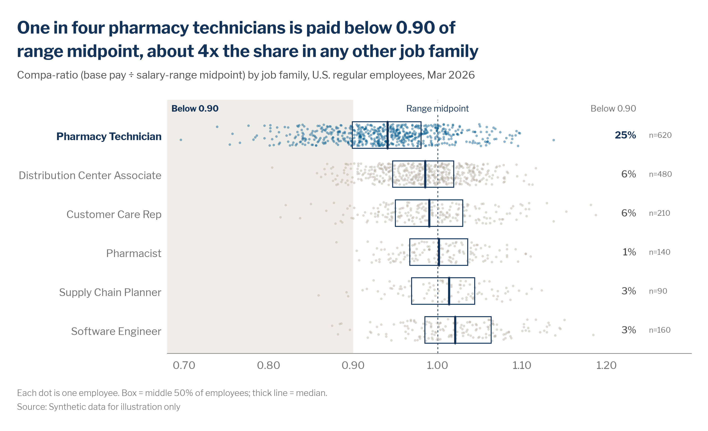

# Distributions: histogram, box plot, strip and beeswarm

> **Question type:** Distribution
> **Use for:** showing how spread out a measure is across people, teams or sites, what is typical, and where the outliers sit (pay position, span of control, tenure, time to fill) · **Avoid when:** you only have one number per category → use a [bar](bar.md) or [dot plot](dot-plot-dumbbell.md)



## When to use
- The **spread** is the message, not the average. "Average compa-ratio is 0.97" hides a quarter of the people who sit below 0.90. An average without its spread is the most common way workforce charts mislead.
- **Pick the form by how many groups you compare:**
  - **Histogram:** one group, shown in detail. It shows the shape (skew, a long tail, two peaks). Examples: span of control across all people managers, or days to fill across all requisitions.
  - **Strip plot / beeswarm:** 2–8 groups with up to a few thousand people. Every person is a dot, so the reader sees both the shape and the n. This is the default when the audience will ask "how many people is that?"
  - **Box plot:** many groups (8–20), or tens of thousands of people per group. It summarizes each group as a median, the middle 50% and the whiskers. Overlay it on a strip plot when the audience doesn't read box plots fluently. That is most audiences outside analytics.
- **Variants:**
  - **Threshold histogram:** color the bins beyond a policy line (spans above 15, compa-ratio below 0.90, tenure under 1 year).
  - **Range bars:** each group's 10th–90th percentile as a bar with the median marked. This is a simpler box plot for executive decks.
  - **Ridgeline / small-multiple histograms:** 3–6 groups whose shapes differ. Use the same x scale and bins in every panel (see [small multiples](small-multiples.md)).

## When not to use
- One value per category (median pay by job family) → use a sorted [bar](bar.md), or a [dot plot](dot-plot-dumbbell.md) when the values are far from zero.
- How a distribution shifted between two dates, for many groups → use a [dumbbell](dot-plot-dumbbell.md) of the medians, and footnote the spread.
- Two measures per person (tenure × compa-ratio) → use a [scatter](scatter-bubble.md). With thousands of people, use a binned [heatmap](heatmap.md).
- Groups with **fewer than 10 people**. Never plot individual dots for them. Merge them into a larger group, or leave them out and footnote it.

## McKesson spec

| Element | Rule |
|---|---|
| Color | All marks `chart.context` `#B4B0A5`, and the group or bins the headline is about in `chart.focus` `#005A8C`. Highlight at most 2 groups. Draw box outlines and median lines in Navy `#143359`. Show the policy line or benchmark (1.00 midpoint, the span limit, the target) as `chart.total` `#143359`, dashed, 0.75 pt, labelled in place. Shade the zone of interest (below 0.90, above the limit) in Light Sand `#EFEDE7` behind the data. Dots are 6–8 px² with 40–50% opacity, so overlaps read as density. Never use a different color per group. |
| Labels | Label the share or count that matters at the end of each row ("25%"), and put the **n** for each group next to it in `text.muted`. Name the zone and the reference line in place. Explain the box once in a footnote ("Box = middle 50%; line = median"); don't use a legend. Bold the focus group's label in Navy. |
| Axes / gridlines | Keep the value axis: its tick labels are the only way to read positions. No gridlines on strip and box plots (the reference line does that job). A histogram's count axis gets light `chart.grid` gridlines and no axis line, and its baseline is `chart.axis` `#8C8C8C`. Put units in the subtitle, or as a short x-axis title on histograms. |
| Sort / order | Sort groups by **median**, putting the focus group nearest the zone of interest, or use their natural order (job levels, tenure bands). Keep the same order across a deck. |
| Proportions | Histogram bins have **equal widths** and touch (a 1 px white seam). Put a bin edge exactly on the policy threshold, and use one bin per value for counts (spans, ratings). Use 15–40 bins; never use the software's default bin count without checking it. In a strip plot, keep the jitter band at ≤ 60% of the row height so the rows stay separate. |
| Limits | Use ≤ 8 groups for strips and beeswarms and ≤ 20 for boxes. Every group has **n ≥ 10**, with n shown. Dots are anonymous: no names or IDs in labels or tooltips. Tooltips show the bin or group, never an individual's pay or rating. Don't clip outliers silently. Widen the axis, or cap the axis and footnote how many points were capped. |

## Do / don't

| Do | Don't |
|---|---|
| Show every person as a dot when n is in the hundreds, with the box drawn on top | Show a bar of averages with error bars for "distribution" |
| Put a bin edge on the policy line (15.5 for "more than 15") | Let a bin straddle the threshold, so the colored share is wrong |
| Write the number of people in the zone ("25% below 0.90") at the row end | Make the reader count dots or estimate box quartiles |
| Show n for every group, and drop or merge groups under 10 | Plot 4 dots for a small team, where each dot is a findable person |
| Use one x scale across all rows and panels | Rescale each small-multiple histogram to fill its panel |
| Footnote what the box and whiskers mean | Assume the audience reads quartiles and 1.5 × IQR whiskers |

## Workforce examples
- **Individual → job family, internal (strip + box):** *Headline:* "One in four pharmacy technicians is paid below 0.90 of range midpoint, about 4x the share in any other job family". *Subtitle:* "Compa-ratio (base pay ÷ salary-range midpoint) by job family, U.S. regular employees, Mar 2026". *Data:* [`assets/data/compa_ratio_individuals.csv`](../../assets/data/compa_ratio_individuals.csv) (HRIS base pay ÷ range midpoint; 1,700 synthetic employees). Built below.
- **Manager level, internal (threshold histogram):** *Headline:* "About 1 in 8 people managers runs a team wider than the 15-report design limit". *Subtitle:* "People managers by number of direct reports, U.S., Mar 2026 (number of managers)". *Data:* HRIS position hierarchy. One bin per span value, with the bins above 15 in focus blue (Plotly snippet below).
- **Requisition level, internal + external (box plots, SWP):** *Headline:* "Specialty nursing requisitions take twice as long to fill as the market median, and the slowest quarter take over 100 days". *Subtitle:* "Days from requisition approval to accepted offer, by job family, H1 2026; dashed line = external market median". *Data:* ATS filled requisitions joined to an external time-to-fill benchmark. Use box plots for 12 job families, with specialty nursing in focus blue.

## Build it

### Python — matplotlib + `mckviz`
```python
# verified runnable (from the repo root)
import tempfile
from pathlib import Path

import matplotlib
matplotlib.use("Agg")
import matplotlib.pyplot as plt
import numpy as np
import pandas as pd
from matplotlib.patches import Rectangle
from matplotlib.ticker import StrMethodFormatter

import mckviz as mv

mv.use()
C = mv.colors

df = pd.read_csv(Path("assets/data/compa_ratio_individuals.csv"))
stats = df.groupby("job_family").compa_ratio.agg(n="size", median="median", low=lambda s: (s < 0.9).mean() * 100)
stats = stats[stats.n >= 10]                                          # never plot groups under the minimum n
order = stats.sort_values("median", ascending=False).index            # lowest median at the bottom
focus = stats.low.idxmax()
rng = np.random.default_rng(1)                                        # fixed jitter: the chart is reproducible

fig, ax = plt.subplots(figsize=(10, 5.6))
top = len(order) - 0.45
ax.axvspan(0.68, 0.90, color=C.surface_subtle, lw=0, zorder=0)       # the zone the headline is about
ax.text(0.685, top, "Below 0.90", fontsize=9, color=C.annotation, fontweight="bold", va="bottom")
ax.axvline(1.0, color=C.total, lw=0.75, ls=(0, (3, 3)), zorder=1)
ax.text(1.0, top, "Range midpoint", fontsize=9, color=C.annotation, ha="center", va="bottom",
        bbox=dict(fc="white", ec="none", pad=1), zorder=4)
for y, fam in enumerate(order):
    x = df.compa_ratio[df.job_family == fam]
    col = C.focus if fam == focus else C.context
    ax.scatter(x, y + rng.uniform(-0.28, 0.28, len(x)), s=7, color=col, alpha=0.45, lw=0, zorder=2)
    q1, med, q3 = x.quantile([0.25, 0.5, 0.75])                       # box = middle 50%, thick line = median
    ax.add_patch(Rectangle((q1, y - 0.34), q3 - q1, 0.68, fill=False, ec=C.headline, lw=1, zorder=3))
    ax.plot([med, med], [y - 0.34, y + 0.34], color=C.headline, lw=2.25, zorder=3)
    s = stats.loc[fam]
    ax.text(1.235, y, f"{s.low:.0f}%", va="center", ha="right", fontsize=10,
            color=C.headline if fam == focus else C.text, fontweight="bold" if fam == focus else "medium")
    ax.text(1.25, y, f"n={int(s.n):,}", va="center", ha="left", fontsize=8, color=C.text_muted)
ax.text(1.235, top, "Below 0.90", fontsize=9, ha="right", va="bottom", color=C.text_muted)

ax.set_yticks(range(len(order)), order)
ax.set_ylim(-0.6, len(order) - 0.1)
ax.set_xlim(0.68, 1.30)                                               # wide enough that no one is clipped
ax.set_xticks(np.arange(0.7, 1.21, 0.1))
ax.xaxis.set_major_formatter(StrMethodFormatter("{x:.2f}"))
mv.clean_axes(ax, keep=("bottom",), grid=None)
ax.tick_params(length=0)
for lbl in ax.get_yticklabels():
    if lbl.get_text() == focus:
        lbl.set_fontweight("bold")
        lbl.set_color(C.headline)

ratio = stats.low[focus] / stats.drop(focus).low.max()                # recompute the headline's multiplier
mv.titles(fig, f"One in four pharmacy technicians is paid below 0.90 of range midpoint, about {ratio:.0f}x the share "
               "in any other job family",
          "Compa-ratio (base pay ÷ salary-range midpoint) by job family, U.S. regular employees, Mar 2026")
mv.source(fig, "Source: Synthetic data for illustration only",
          footnote="Each dot is one employee. Box = middle 50% of employees; thick line = median.")
mv.save(fig, Path(tempfile.gettempdir()) / "ck_distribution_strip.png", dpi=200)
```
- **Box plot only** (many groups or large n): drop the `scatter` call and add whiskers at the 10th and 90th percentiles with `ax.plot([p10, q1], [y, y])` and `ax.plot([q3, p90], [y, y])`. Footnote them ("whiskers = 10th–90th percentile"). Don't use the default 1.5 × IQR whiskers, which few readers can interpret.
- **Beeswarm** (dots that don't overlap): replace the random jitter with a swarm layout, such as the `stripplot`/`swarmplot` functions in seaborn, then recolor them with `mv.highlight`. Beeswarms work up to ~300 dots per row. Above that, keep the jitter.

### Python — Plotly / HTML
```python
# verified: builds without error
import tempfile
from pathlib import Path

import numpy as np
import plotly.graph_objects as go

import mckviz as mv

mv.use()  # registers + activates the "mck" Plotly template
C = mv.colors

rng = np.random.default_rng(11)                                       # 1,380 people managers, synthetic
span = np.r_[rng.poisson(7, 900), rng.poisson(13, 380), rng.poisson(24, 100)].clip(1, 40)
limit = 15                                                            # design guideline: at most 15 direct reports
edges = np.arange(0.5, 41, 1)                                         # spans are whole numbers: one bin per value
counts, _ = np.histogram(span, bins=edges)
mids = (edges[:-1] + edges[1:]) / 2
over = (span > limit).mean() * 100

fig = go.Figure(go.Bar(
    x=mids, y=counts, width=1, marker_color=[C.focus if m > limit else C.context for m in mids],
    marker_line={"color": "white", "width": 1},                       # bins touch, 1 px white seam
    hovertemplate="%{x:.0f} direct reports<br>%{y:,} managers<extra></extra>"))
fig.add_vline(x=limit + 0.5, line={"color": C.total, "width": 1, "dash": "dot"})
fig.add_annotation(x=limit + 0.5, y=1, yref="paper", yanchor="bottom", xanchor="left", showarrow=False,
                   text=f" <b>{over:.0f}% of managers</b> have more than {limit} direct reports",
                   font={"color": C.annotation})
fig.update_layout(bargap=0, width=960, height=520)
fig.update_xaxes(title_text="Direct reports per manager", tickvals=np.arange(5, 41, 5), range=[0, 41], showgrid=False)
fig.update_yaxes(title_text=None, showgrid=True, rangemode="tozero")
mv.pl_finish(fig, f"About 1 in {round(100 / over)} people managers runs a team wider than the {limit}-report design limit",
             "People managers by number of direct reports, U.S., Mar 2026 (number of managers)",
             source_text="Source: Synthetic data for illustration only",
             footnote="Direct reports = active regular employees reporting directly to the manager.")
fig.write_html(Path(tempfile.gettempdir()) / "ck_distribution_hist.html", include_plotlyjs="cdn")
```
Pre-bin with `np.histogram` and draw `go.Bar`, as above, rather than `go.Histogram`. That way you control the bin edges, and you can color the bins past the threshold. For strips and boxes in Plotly, use `go.Box(x=..., y=..., orientation="h", boxpoints="all", jitter=0.6, pointpos=0, marker={"size": 4, "opacity": 0.45}, line={"color": C.headline}, fillcolor="rgba(0,0,0,0)")`, with one trace per group, colored by `mv.pl_highlight`. Turn off hover on the individual points (`hoverinfo="skip"` on a separate scatter trace, or `hoveron="boxes"`), so no one can read a single person's pay. In HTML pages, use the chart-card pattern in [`gallery_plotly.py`](https://github.com/amccown-mck/Data-Viz-Guide/blob/main/examples/python/gallery_plotly.py).

### Excel and PowerPoint
1. Install the theme once (see [bar.md › Excel and PowerPoint](bar.md#excel-and-powerpoint), step 1).
2. **Histogram:** don't use Excel's automatic histogram bins. Make a bin column (1, 2, … 40, or 0.70, 0.72, … for ratios) and count with `=COUNTIFS(Data[Span], ">=" & A2, Data[Span], "<" & A3)`, so you control the edges. Then **Insert › Column › 2-D Clustered Column**.
3. Set **Format Data Series › Gap Width 0%**, **Border › Solid line, White, 0.75 pt**. Fill all bars Hex `B4B0A5`, then click each bin past the threshold twice and fill it Hex `005A8C`. Alternatively, split the counts into two columns ("within limit" and "over limit") and set the series overlap to 100%. Then the colors update when the data refreshes.
4. Delete the legend and chart title. Make the gridlines `#E6E4DE`, 0.5 pt, and delete the value-axis line. Add the threshold as a dashed `#143359` line (a shape, or a scatter series with error bars) and a text box: "**13% of managers** have more than 15 direct reports".
5. **Box plot:** Excel's **Insert › Statistic Chart › Box and Whisker** works, but turn off **Show outlier points** and **Show mean markers**. Set the whiskers in a footnote, and set the box fill to none and the line to `#143359`. For a strip plot, use **XY Scatter** with x = the value and y = the group index plus `RAND()*0.5-0.25`. Then freeze the values (Copy › Paste Values), so the jitter doesn't change on every recalculation.
6. In PowerPoint, paste as a native chart, add the headline in the title placeholder and the subtitle at 14 pt `#505050`. Build-up: show the grey histogram first, then recolor the over-limit bins and add the annotation.

### Power BI
- Apply [`assets/powerbi/mckesson-dataviz-theme.json`](../../assets/powerbi/mckesson-dataviz-theme.json).
- **Histogram:** create bins with **New group › Bin type: Size of bins** (1 for spans) on the measure column, then use a **Clustered column chart** with the bins on the X-axis. Set **Columns › Spacing › Inner padding = 0**. Color the bins with **fx › Rules** (bin > 15 → `#005A8C`, else `#B4B0A5`). Add the threshold through **Analytics › X-axis constant line**.
- **Box / strip:** there is no native box plot. Use the certified **Box and Whisker chart by MAQ Software** visual, or a **Scatter chart** with the group on Y and a jitter column in Power Query. Turn tooltips off for the individual points.
- Enforce the minimum n: drop groups with `COUNTROWS() < 10` with a visual-level filter on a measure, and never place an employee ID in the tooltip fields.

### R — ggplot2 (optional)
```r
library(ggplot2); library(dplyr); library(readr)
source("assets/r/theme_mck.R")

df <- read_csv("assets/data/compa_ratio_individuals.csv")
stats <- df |> group_by(job_family) |>
  summarise(n = n(), median = median(compa_ratio), low = mean(compa_ratio < 0.9) * 100) |>
  filter(n >= 10)
focus <- stats$job_family[which.max(stats$low)]
df <- df |> filter(job_family %in% stats$job_family) |>
  mutate(job_family = factor(job_family, levels = stats$job_family[order(-stats$median)]))

set.seed(1)
ggplot(df, aes(compa_ratio, job_family)) +
  annotate("rect", xmin = -Inf, xmax = 0.90, ymin = -Inf, ymax = Inf, fill = mck_colors$surface_subtle) +
  geom_vline(xintercept = 1, colour = mck_colors$total, linetype = "dashed", linewidth = 0.3) +
  geom_jitter(aes(colour = job_family == focus), height = 0.28, width = 0, size = 0.8, alpha = 0.45) +
  geom_boxplot(fill = NA, colour = mck_colors$headline, outlier.shape = NA, coef = 0, width = 0.68) +
  geom_text(data = stats, aes(x = 1.235, y = job_family, label = sprintf("%.0f%%", low)), hjust = 1,
            colour = mck_colors$text, size = 3.4) +
  scale_colour_manual(values = c(`TRUE` = mck_colors$focus, `FALSE` = mck_colors$context), guide = "none") +
  scale_x_continuous(limits = c(0.68, 1.25), breaks = seq(0.7, 1.2, 0.1)) +
  labs(title = "One in four pharmacy technicians is paid below 0.90 of range midpoint, about 4x the share in any other job family",
       subtitle = "Compa-ratio (base pay ÷ salary-range midpoint) by job family, U.S. regular employees, Mar 2026",
       caption = "Each dot is one employee. Box = middle 50%; line = median.\nSource: Synthetic data for illustration only",
       x = NULL, y = NULL) +
  theme_mck() +
  theme(panel.grid = element_blank())
```

## QA specifics
- [ ] The form matches the group count: a histogram for one group, a strip or beeswarm for ≤ 8 groups, boxes for more.
- [ ] Histogram bins are equal-width, touch, and have an edge exactly on the threshold. The colored share in the headline is computed from the same rule (`> 15`, `< 0.90`).
- [ ] Every group shows its n, and no group or bin with n < 10 is plotted. Tooltips never expose an individual's value or identity.
- [ ] No points are clipped. If the axis is capped, a footnote says how many points sit beyond it.
- [ ] The box and whisker definitions are footnoted. The reference line is labelled in place.
- [ ] One x scale across all rows or panels. Groups are sorted by median or by a natural order.

## Inspiration
The source guide has no distribution page. This page applies its general rules (focus vs. context, direct labels, honest scales) to the charts that people analytics needs most.
- [p084 — Print](https://github.com/amccown-mck/Data-Viz-Guide/blob/main/reference/inspiration-mckinsey/pages/p084-print.md) (a beeswarm with direct row labels and the count per row)
- [p027 — Choosing a chart](https://github.com/amccown-mck/Data-Viz-Guide/blob/main/reference/inspiration-mckinsey/pages/p027-choosing-a-chart.md)
- [p049 — Bubble scatterplot](https://github.com/amccown-mck/Data-Viz-Guide/blob/main/reference/inspiration-mckinsey/pages/p049-bubble-scatterplot.md) (many individual marks; focus vs. context)
- [p055 — Heatmaps best practice](https://github.com/amccown-mck/Data-Viz-Guide/blob/main/reference/inspiration-mckinsey/pages/p055-heatmaps-best-practice.md) (even class breaks, which apply to histogram bins too)
