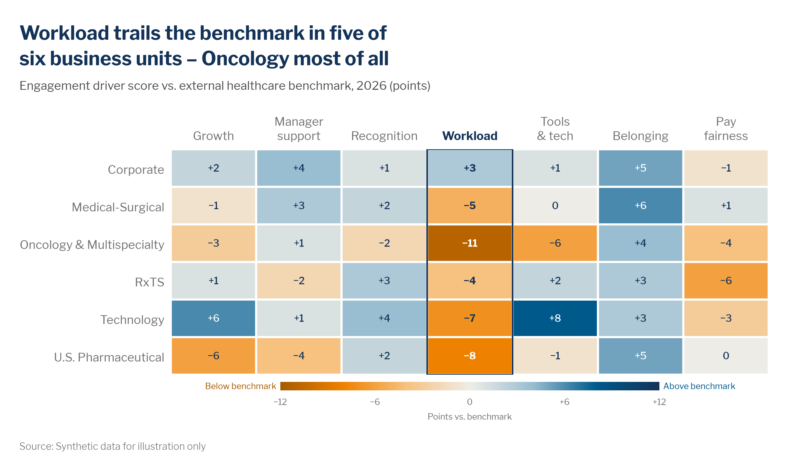

# Heatmaps and heat tables

> **Question type:** Correlation · Distribution (one measure across two categorical dimensions)
> **Use for:** spotting patterns, clusters and outliers in one measure across two categorical dimensions (business unit × engagement driver, job family × region, metro × quarter) · **Avoid when:** the reader needs to compare a handful of values precisely → use a [bar chart](bar.md) or [dot plot](dot-plot-dumbbell.md)



## When to use
- **One measure, two category dimensions**, and the story is a **pattern**: a column that is weak everywhere, a row that is strong on everything, one hot cell. Color lets the eye scan 30–150 cells at once.
- **Sequential heatmap:** the reference value sits at **one end** of the range (zero, or the lowest possible value). Counts, days, rates and shares fit here: open requisitions, time-to-fill, attrition rate, share of task hours exposed to gen AI. Darkest = highest.
- **Diverging heatmap:** the data has a **meaningful middle**, such as 0 vs. a benchmark, variance to plan, change vs. last year, or 1.00 compa-ratio. Two hues split the cells that sit below the midpoint from those above it.
- **Heat table:** the values are printed in every cell and color is a second cue. Use it in reports, appendices and Power BI matrices, where readers need the exact numbers but should still see the pattern first.
- **Variants:**
  - **Calendar / period heatmap:** rows × weeks or months, e.g., unplanned absence by site and week, or hiring volume by month and year.
  - **Binned density:** two continuous measures with thousands of people (tenure × compa-ratio). Bin them into a 2D grid instead of drawing an overplotted [scatter](scatter-bubble.md).

## When not to use
- A few values that need precise comparison → use a [bar chart](bar.md) or a [dot plot](dot-plot-dumbbell.md). Color hue and lightness are read less accurately than length or position.
- A trend over time for 1–4 series → use a [line chart](line.md). A heatmap hides the slope.
- Two continuous measures per entity, with fewer than a few hundred entities → use a [scatter](scatter-bubble.md).
- Places → use a [map](maps.md). Parts of a whole → use a [100% stacked bar](stacked-bar.md).
- The columns carry different units (%, days, $K) → color each column on its own scale and say so, or use a [table](tables.md). Never put one color scale across mixed units.
- The spread of individual people is the point → use a [distribution](distribution.md) chart.

## McKesson spec

| Element | Rule |
|---|---|
| Color | **Sequential:** `color.sequential.blue` in 6 steps, `#E6F3FB` `#B6E2FA` `#66C4FF` `#009EFF` `#0A5FBC` `#143359`, light = low and dark = high. Blue is the default for any single measure. Use `sequential.orange` (`#FFF3E0` → `#6B3A00`) only when darker explicitly means worse (risk, e.g., flight risk), and say so in the key. **Diverging:** `color.diverging.orange_blue`, `#A75B00` `#EF8200` `#F7C180` **`#EFEDE7`** `#99BDD1` `#005A8C` `#143359`. The midpoint (0, the benchmark, the target) is always Light Sand `#EFEDE7`, and the range is **symmetric** around it. Orange is the unfavorable side. When higher is worse (attrition, days to fill vs. market), flip the sign of the measure or reverse the ramp, so orange still means "worse". Show zero, null and suppressed cells in `chart.context_light` `#DEDBD1`, and set that swatch apart in the key. Never use rainbow or red–green ramps. |
| Labels | Heat tables print every value, 9–11 pt Medium. Pick the text color per cell with `mv.text_on(fill)`: white on dark fills, Navy `#143359` on light ones. Deltas get a sign and a true minus (`+3`, `−11`). The unit goes in the subtitle. Column headers sit **on top**, horizontal and wrapped to 2 lines (never rotated). To highlight a row or column, outline it in a 1.5 pt Navy `#143359` box, bold its header, and bold its values. Don't recolor the cells. |
| Axes / gridlines | No axis lines, tick marks or gridlines. Separate the cells with **2 px white gutters** (matplotlib minor grid `lw=2`, Plotly `xgap=ygap=2`, Excel white borders). Put a stepped key in a horizontal strip (top-right above the grid, or under it), labelled at the class breaks or the class centers. Diverging keys add end labels such as "Below benchmark" in `#A75B00` and "Above benchmark" in `#005A8C`. |
| Sort / order | **Rank the rows** by row average or by the focus column, so the pattern emerges. Alphabetical order hides it. Rank the columns too, unless they have a natural order (months, tenure bands, job levels, survey item order). Keep the same order everywhere the same matrix appears. |
| Proportions | Cells are square to about 2:1 wide, and at least ~28 px tall on screen so the values fit. On mobile, transpose so the longer dimension runs down the screen, and keep fewer, larger labels (headline, key, row names). |
| Limits | Use **5–7 classes with equal steps** for slides and print. Continuous scales are fine for interactive charts. Diverging scales use an odd number of classes, so the middle class holds the midpoint. One scale per chart, and the same scale across charts that are compared. Up to ~15 rows × ~12 columns on a slide. Highlight ≤ 1 row or column (2 at most). **Suppress any cell with n < 10** people (or requisitions or respondents): show it as `#DEDBD1` with "n<10" and add a footnote. |

## Do / don't

| Do | Don't |
|---|---|
| Center a diverging scale on a meaningful value and keep it symmetric (−10.5 to +10.5) | Let the software center the scale on the data's midrange, so 0 lands on a colored step |
| Keep a neutral `#EFEDE7` class for "about zero" | Force every cell into "above" or "below" by dropping the zero step |
| Use 5–7 classes with even breaks (every 3 points, every 15 days) | Use uneven, hand-picked breaks (1, 2, 4, 10, 30+) that distort the pattern |
| Rank the rows by value | Sort the rows alphabetically by default |
| Use white text on dark cells and navy on light ones (`mv.text_on`) | Put one fixed text color on every cell, so half the values disappear |
| Outline the focus column and bold its header | Add a third hue (navy accent, orange) to "highlight" cells inside the ramp |
| Gray out and label any cell with n < 10 | Show a 3-person team's score, even as a color |
| Show the stepped key once, with readable end labels | Use a long continuous color bar with 10 tick labels |

## Workforce examples
- **Business unit, internal survey + external benchmark (diverging):** *Headline:* "Workload trails the benchmark in five of six business units – Oncology most of all". *Subtitle:* "Engagement driver score vs. external healthcare benchmark, by business unit, 2026 (points)". *Data:* [`examples/data/engagement_vs_benchmark.csv`](https://github.com/amccown-mck/Data-Viz-Guide/blob/main/examples/data/engagement_vs_benchmark.csv), with the engagement survey scored against an external healthcare norm. The rows are ranked by average gap and the Workload column is outlined (snippet below).
- **Job family × region, internal ATS (sequential heat table, SWP):** *Headline:* "Clinical roles take 71+ days to fill in every region, and the West is slowest for 5 of 8 job families". *Subtitle:* "Median days from requisition approval to accepted offer, by job family and region, H1 2026". *Data:* ATS filled requisitions, with cells of fewer than 10 requisitions suppressed. Six 15-day classes, rows ranked by average days and the clinical rows bolded (Plotly snippet below).
- **Metro × role family, external labor market (diverging):** *Headline:* "Posted pay for pharmacy technicians is rising 4+ points faster than the national rate in 5 of our 12 largest hiring metros". *Subtitle:* "Year-over-year change in posted pay vs. the national rate, by role family and metro, top 12 McKesson hiring metros, Q2 2026 (percentage points)". *Data:* external job-postings feed, with the midpoint 0 = the national rate. Rank the rows by the pharmacy-technician column, outline that column, and footnote the postings threshold used for each cell.

## Build it

### Python — matplotlib + `mckviz`
```python
# verified runnable (from the repo root)
import tempfile
from pathlib import Path

import matplotlib
matplotlib.use("Agg")
import matplotlib.pyplot as plt
import numpy as np
import pandas as pd
from matplotlib.colors import BoundaryNorm, ListedColormap, to_hex
from matplotlib.patches import Rectangle
from matplotlib.ticker import FuncFormatter

import mckviz as mv

mv.use()
C = mv.colors

drivers = ["Growth", "Manager support", "Recognition", "Workload", "Tools & tech", "Belonging", "Pay fairness"]
df = pd.read_csv(Path("examples/data/engagement_vs_benchmark.csv"))
m = df.pivot(index="business_unit", columns="driver", values="delta_vs_benchmark_pts")[drivers]
m = m.loc[m.mean(axis=1).sort_values(ascending=False).index]         # rank rows, don't alphabetize
focus = "Workload"
below = int((m[focus] < 0).sum())
worst = m[focus].idxmin()

bounds = np.arange(-10.5, 10.6, 3)                                   # 7 even 3-pt classes, symmetric; middle = 0 ±1
cmap = ListedColormap(mv.DIVERGING)
norm = BoundaryNorm(bounds, cmap.N, clip=True)

fig, ax = plt.subplots(figsize=(10, 5.4))
im = ax.imshow(m.values, cmap=cmap, norm=norm, aspect="auto")
for (i, j), val in np.ndenumerate(m.values):
    fill = to_hex(cmap(norm(val)))
    ax.text(j, i, mv.signed(val), ha="center", va="center", fontsize=9, color=mv.text_on(fill),
            fontweight="bold" if drivers[j] == focus else "medium")

ax.set_xticks(range(len(drivers)), [d.replace(" ", "\n", 1) for d in drivers])
ax.set_yticks(range(len(m)), m.index)
ax.xaxis.tick_top()
ax.set_xticks(np.arange(-0.5, m.shape[1]), minor=True)              # white gutters between cells
ax.set_yticks(np.arange(-0.5, m.shape[0]), minor=True)
ax.grid(which="minor", color="white", lw=2)
ax.grid(which="major", visible=False)
ax.tick_params(which="both", length=0)
for s in ax.spines.values():
    s.set_visible(False)
w = drivers.index(focus)
ax.add_patch(Rectangle((w - 0.5, -0.5), 1, m.shape[0], fill=False, ec=C.headline, lw=1.5, zorder=3))
ax.get_xticklabels()[w].set_fontweight("bold")
ax.get_xticklabels()[w].set_color(C.headline)

cb = fig.colorbar(im, ax=ax, orientation="horizontal", fraction=0.035, pad=0.03, aspect=45, ticks=np.arange(-9, 10, 3))
cb.outline.set_visible(False)
cb.ax.xaxis.set_major_formatter(FuncFormatter(lambda v, _: mv.signed(v)))
cb.ax.tick_params(labelsize=8, length=0, colors=C.text_muted)
cb.ax.text(-0.01, 0.5, "Below benchmark", transform=cb.ax.transAxes, ha="right", va="center", fontsize=8,
           color=C.negative_text)
cb.ax.text(1.01, 0.5, "Above benchmark", transform=cb.ax.transAxes, ha="left", va="center", fontsize=8, color=C.focus)

mv.titles(fig, f"Workload trails the benchmark in {below} of {len(m)} business units \u2013 {worst.split(' &')[0]} most of all",
          "Engagement driver score vs. external healthcare benchmark, by business unit, 2026 (points)")
mv.source(fig, "Source: Synthetic data for illustration only",
          footnote="Rows ranked by average gap across drivers. Cells with fewer than 10 respondents are suppressed.")
mv.save(fig, Path(tempfile.gettempdir()) / "ck_heatdist_heatmap.png", dpi=200)
```
- **Sequential:** use `cmap = ListedColormap(mv.SEQUENTIAL["blue"])` with even breaks such as `bounds = np.arange(15, 106, 15)` (6 classes for 6 colors).
- **Continuous** (interactive or exploratory work): use `cmap=mv.diverging_cmap(), vmin=-lim, vmax=lim` or `cmap=mv.sequential_cmap("blue")`. Compute the text color with `mv.text_on(to_hex(cmap((val + lim) / (2 * lim))))`.
- **Suppressed cells:** pass `np.ma.masked_where(n < 10, values)` and build the colormap with `.with_extremes(bad=C.context_light)`. Then write "n<10" in `C.text_muted` on top.

### Python — Plotly / HTML
```python
# verified: builds without error
import tempfile
from pathlib import Path

import numpy as np
import pandas as pd
import plotly.graph_objects as go

import mckviz as mv

mv.use()  # registers + activates the "mck" Plotly template
C = mv.colors

rng = np.random.default_rng(7)
families = {"Pharmacist": 84, "RN, Specialty": 78, "Software Engineer": 61, "Pharmacy Technician": 54,
            "Supply Chain Planner": 49, "Account Executive": 45, "Customer Care Rep": 31, "Warehouse Associate": 24}
regions = {"Northeast": 4, "Southeast": -3, "Central": -6, "Mountain": 2, "West": 7}
m = pd.DataFrame({r: [base + eff + rng.normal(0, 3) for base in families.values()] for r, eff in regions.items()},
                 index=list(families)).round()
m.loc["Software Engineer", "Mountain"] = np.nan                      # fewer than 10 requisitions -> suppressed
m = m.loc[m.mean(axis=1).sort_values(ascending=False).index]        # slowest job family on top

bounds = np.arange(15, 106, 15)                                     # 6 even 15-day classes
ramp = mv.SEQUENTIAL["blue"]
scale = [[s, c] for i, c in enumerate(ramp) for s in (i / len(ramp), (i + 1) / len(ramp))]   # stepped, not smooth
clinical = ["Pharmacist", "RN, Specialty"]
lo = m.loc[clinical].min().min()
west = int((m.idxmax(axis=1) == "West").sum())

fig = go.Figure(go.Heatmap(
    z=m.values, x=m.columns, y=m.index, zmin=bounds[0], zmax=bounds[-1], colorscale=scale, xgap=2, ygap=2,
    colorbar={"title": {"text": "Median days", "side": "top"}, "tickvals": bounds, "thickness": 12, "len": 0.6,
              "outlinewidth": 0, "y": 1, "yanchor": "top"},
    hovertemplate="%{y} \u00b7 %{x}<br>%{z:.0f} median days to fill<extra></extra>"))
for i, fam in enumerate(m.index):                                   # cell text: white on dark, navy on light
    for j, reg in enumerate(m.columns):
        v = m.loc[fam, reg]
        if np.isnan(v):
            fig.add_shape(type="rect", x0=j - 0.5, x1=j + 0.5, y0=i - 0.5, y1=i + 0.5, layer="below",
                          fillcolor=C.context_light, line={"color": "white", "width": 2})
            fig.add_annotation(x=reg, y=fam, text="n<10", showarrow=False, font={"size": 11, "color": C.text_muted})
            continue
        k = min(int((v - bounds[0]) // 15), len(ramp) - 1) if v >= bounds[0] else 0
        fig.add_annotation(x=reg, y=fam, text=f"{v:.0f}", showarrow=False,
                           font={"size": 12, "color": mv.text_on(ramp[k])})
fig.update_xaxes(side="top", showgrid=False, showline=False, ticks="")
fig.update_yaxes(autorange="reversed", showgrid=False, ticks="", ticksuffix="  ", tickvals=m.index,
                 ticktext=[f"<b>{f}</b>" if f in clinical else f for f in m.index])
fig.update_layout(plot_bgcolor="white", width=960, height=560)
mv.pl_finish(fig, f"Clinical roles take {lo:.0f}+ days to fill in every region, and the West is slowest for "
                  f"{west} of {len(m)} job families",
             "Median days from requisition approval to accepted offer, by job family and region, H1 2026",
             source_text="Source: Synthetic data for illustration only",
             footnote="Cells with fewer than 10 filled requisitions are suppressed (n<10). Rows ranked by average days.")
fig.write_html(Path(tempfile.gettempdir()) / "ck_heatdist_heatmap.html", include_plotlyjs="cdn")
```
For a **diverging** Plotly heatmap, build the stepped scale from `mv.DIVERGING` and set `zmin=-10.5, zmax=10.5` (symmetric). For a continuous scale, use `colorscale=[[i / 6, c] for i, c in enumerate(mv.DIVERGING)], zmid=0`. Tooltips can carry the n-size ("142 respondents"), but suppressed cells must not show a value or an n in hover: blank `z` and keep `hoverinfo` off for those cells. In HTML pages, use the chart-card pattern in [`gallery_plotly.py`](https://github.com/amccown-mck/Data-Viz-Guide/blob/main/examples/python/gallery_plotly.py), and on narrow screens transpose the matrix so the long dimension scrolls down.

### Excel and PowerPoint
1. Install the theme once. Copy `dist/office/Theme Colors/McKesson Data Viz.xml` to `%APPDATA%\Microsoft\Templates\Document Themes\Theme Colors\` and `dist/office/Theme Fonts/McKesson Data Viz.xml` to `...\Theme Fonts\`. Install Libre Franklin from `fonts/LibreFranklin`. Then apply **Page Layout › Colors / Fonts › McKesson Data Viz**.
2. Lay the data out as a matrix: row labels in column A, column headers in row 1, numbers in the cells. Rank the rows: add a helper column `=AVERAGE(B2:H2)`, then **Data › Sort** by it (largest to smallest) and hide the helper.
3. **Diverging color scale:** select the values, then **Home › Conditional Formatting › Color Scales › More Rules…**. Set **Format Style: 3-Color Scale**.
   - **Minimum:** Type **Number**, Value `-10.5`, Color › **More Colors › Custom › Hex** `A75B00` (or `EF8200` for a lighter low end).
   - **Midpoint:** Type **Number**, Value `0`, Color Hex `EFEDE7`.
   - **Maximum:** Type **Number**, Value `10.5`, Color Hex `005A8C`.
   Use fixed **Number** bounds, not *Lowest/Highest Value*, so the scale stays symmetric and doesn't shift when the data refreshes.
4. **Sequential color scale:** use the same dialog with **Minimum** Number `15`, Hex `E6F3FB`, **Midpoint** Number `60`, Hex `009EFF`, and **Maximum** Number `105`, Hex `143359`.
5. **Binned classes** (preferred on slides and in print): instead of a color scale, add one rule per class with **Conditional Formatting › New Rule › Format only cells that contain › Cell Value › between**, then **Format › Fill › More Colors › Hex**. For the diverging ramp, use ≤ −8 `A75B00`, −7 to −5 `EF8200`, −4 to −2 `F7C180`, −1 to +1 `EFEDE7`, +2 to +4 `99BDD1`, +5 to +7 `005A8C`, ≥ +8 `143359`. Check the order in **Manage Rules** and tick **Stop If True**.
6. **Cell text** (mirrors `mv.text_on`): add two rules, **Cell Value ≤ −8 › Format › Font › White** and **Cell Value ≥ 5 › Font › White**, and set the default font color to Navy `#143359`. Only the two ends of the ramp are dark enough for white text; orange `#EF8200` takes navy. For the sequential ramp, use **Cell Value ≥ 75 › White** (the two darkest classes).
7. Set **Format Cells › Number › Custom** to `+0;"−"0;0`, for signed deltas with a true minus. Use Libre Franklin 10–11 pt, centered.
8. Gutters: select the grid, then **Format Cells › Border › Color: White**, choose the thickest line style, and apply **Outline** and **Inside**. Turn off **View › Gridlines**. Make the columns equal width and the rows about 24 px tall.
9. Suppressed cells: type `n<10` and add a rule **Format only cells that contain › Specific Text › containing "n<"** with **Fill** `DEDBD1` and **Font** `737373`. Add a footnote.
10. Highlight: give the focus column a **Thick Outside Border** in Navy `#143359`, and bold its header and values. Build the key from 7 small cells with the class fills, with labels underneath and "Below benchmark" / "Above benchmark" at the ends.
11. **PowerPoint:** copy the range and use **Home › Paste › Paste Special › Microsoft Excel Worksheet Object** (stays editable) or **Picture (Enhanced Metafile)** (crisp and fixed). For small grids (≤ 6 × 8), you can also build a native table with **Insert › Table**, then **Table Design › Shading** (hex per cell) and **Borders** (white, 2¼ pt). The headline goes in the title placeholder (26 pt Bold McKesson Blue `#005A8C`), the subtitle at 14 pt `#505050`, and the footnote and source at 9 pt Libre Franklin Light `#737373`. Build-up: values on neutral cells first, then the color, then the focus outline and callout.

### Power BI
- Apply [`dist/powerbi/mckesson-dataviz-theme.json`](https://github.com/amccown-mck/Data-Viz-Guide/blob/main/dist/powerbi/mckesson-dataviz-theme.json) (**View › Themes › Browse for themes**).
- Use a **Matrix** visual: **Rows** = business unit, **Columns** = driver, **Values** = the measure. Turn row and column subtotals off.
- **Format › Cell elements › Background color › fx.** For a smooth scale, choose **Format style: Gradient**, tick **Add a middle color**, and set **Minimum** (Custom, `-10.5`) `#A75B00`, **Center** (Custom, `0`) `#EFEDE7` and **Maximum** (Custom, `10.5`) `#005A8C`. For binned classes, choose **Format style: Rules** and add one range per class with the same hex values as in Excel. Sequential: Gradient from `#E6F3FB` to `#143359`, with a center of `#009EFF`.
- **Font color › fx › Rules:** value ≤ −8 → `#FFFFFF`, value ≥ 5 → `#FFFFFF`, otherwise `#143359`. **Grid:** horizontal and vertical gridlines white, 2 px. **Values:** centered.
- Enforce the minimum n in the measure, so cells and tooltips blank out: `Gap vs benchmark (safe) = IF([Respondents] < 10, BLANK(), [Gap vs benchmark])`. Rank the rows by sorting on a row-average measure.

### R — ggplot2 (optional)
```r
library(ggplot2); library(dplyr); library(readr)
source("dist/r/theme_mck.R")

drivers <- c("Growth", "Manager support", "Recognition", "Workload", "Tools & tech", "Belonging", "Pay fairness")
df <- read_csv("examples/data/engagement_vs_benchmark.csv") |>
  mutate(driver = factor(driver, levels = drivers),
         business_unit = reorder(business_unit, delta_vs_benchmark_pts, mean),   # ranked: highest mean on top
         lab = ifelse(delta_vs_benchmark_pts == 0, "0",
                      sub("-", "\u2212", sprintf("%+d", as.integer(delta_vs_benchmark_pts)))),
         txt = ifelse(delta_vs_benchmark_pts <= -8 | delta_vs_benchmark_pts >= 5,   # mirrors mv.text_on()
                      "white", mck_colors$headline))
w <- which(drivers == "Workload")

ggplot(df, aes(driver, business_unit, fill = delta_vs_benchmark_pts)) +
  geom_tile(colour = "white", linewidth = 1) +
  geom_text(aes(label = lab, colour = txt), size = 3.2,
            fontface = ifelse(df$driver == "Workload", "bold", "plain")) +
  annotate("rect", xmin = w - 0.5, xmax = w + 0.5, ymin = 0.5, ymax = nlevels(df$business_unit) + 0.5,
           fill = NA, colour = mck_colors$headline, linewidth = 0.6) +
  scale_colour_identity() +
  scale_fill_mck_div(limits = c(-10.5, 10.5), breaks = seq(-9, 9, 3)) +   # symmetric around 0
  # binned: scale_fill_stepsn(colours = mck_diverging, breaks = seq(-7.5, 7.5, 3), limits = c(-10.5, 10.5))
  # sequential: scale_fill_mck_seq(limits = c(15, 105))
  scale_x_discrete(position = "top", labels = \(x) sub(" ", "\n", x)) +
  labs(title = "Workload trails the benchmark in five of six business units – Oncology most of all",
       subtitle = "Engagement driver score vs. external healthcare benchmark, by business unit, 2026 (points)",
       caption = "Rows ranked by average gap. Cells with fewer than 10 respondents are suppressed.\nSource: Synthetic data for illustration only",
       x = NULL, y = NULL) +
  theme_mck() +
  theme(panel.grid = element_blank(), axis.line.x = element_blank(),
        legend.position = "bottom", legend.justification = "right", legend.key.height = unit(6, "pt"))
```

## QA specifics
- [ ] The scale type matches the data: sequential when the reference value is at one end, diverging when there's a meaningful midpoint. A diverging midpoint is the real reference (0, the benchmark, the target), is shown in `#EFEDE7`, and the range is symmetric.
- [ ] 5–7 classes with equal breaks (or a continuous scale on interactive charts only). The key shows the classes, the zero / suppressed swatch, and end labels for diverging scales.
- [ ] Rows (and non-natural columns) are ranked by value, not alphabetical, and in the same order wherever this matrix appears.
- [ ] Every printed value is readable on its fill (`mv.text_on`): no navy on dark blue, no white on Light Sand. Deltas carry a sign and a true minus.
- [ ] The focus row or column is outlined and its header bolded. No extra hues inside the ramp. The headline's counts ("five of six") are computed from the data.
- [ ] No cell with n < 10 shows a color, a value or a tooltip: it's grey, labelled "n<10" and footnoted.

## Inspiration
- [p053 — Sequential heatmap](https://github.com/amccown-mck/Data-Viz-Guide/blob/main/reference/inspiration-mckinsey/pages/p053-sequential-heatmap.md)
- [p054 — Diverging heatmap](https://github.com/amccown-mck/Data-Viz-Guide/blob/main/reference/inspiration-mckinsey/pages/p054-diverging-heatmap.md)
- [p055 — Heatmaps best practice](https://github.com/amccown-mck/Data-Viz-Guide/blob/main/reference/inspiration-mckinsey/pages/p055-heatmaps-best-practice.md)
- [p070 — Screen sizes](https://github.com/amccown-mck/Data-Viz-Guide/blob/main/reference/inspiration-mckinsey/pages/p070-screen-sizes.md)
