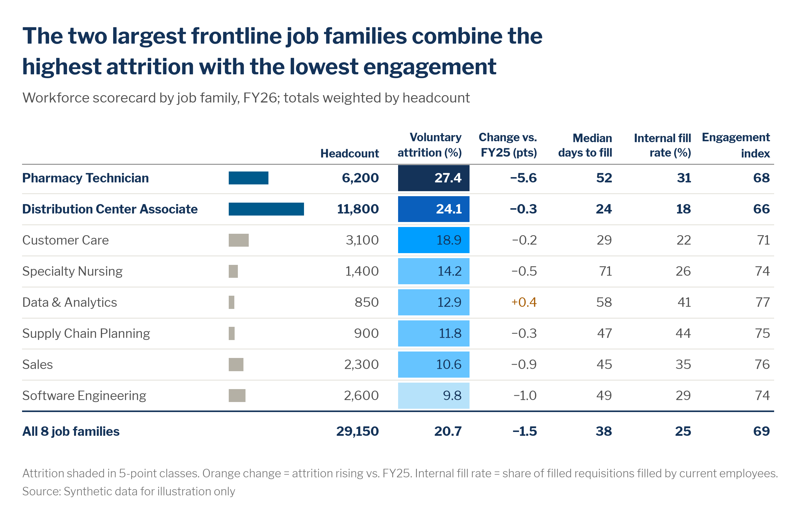

# Tables and heat tables

> **Question type:** Ranking · Magnitude (when the reader needs exact values across several measures)
> **Use for:** looking up and comparing exact values across several measures and categories, such as scorecards, appendices and leadership packs, with one pattern made visible by shading or inline bars · **Avoid when:** there is one message about one measure → use a [bar](bar.md), [dot plot](dot-plot-dumbbell.md) or [heatmap](heatmap.md)



## When to use
- The reader will **look things up**: "What's our time to fill in Sales?" Tables beat charts when the audience needs exact numbers, several measures with **different units**, or values they will copy into their own work.
- **Formatted table:** plain numbers with good typography. Use it for appendices, data annexes, and definitions next to a chart.
- **Heat table / scorecard:** a table where **one or two columns** carry color, or an inline bar, so the pattern jumps out before anyone reads a number. This is the default for leadership scorecards and quarterly workforce packs.
- **Variants:**
  - **Inline bars:** a short bar inside a cell for a size measure (headcount, cost), so the reader sees scale without a separate chart.
  - **Delta column:** change vs. the prior period or plan with a sign, and color on the unfavorable direction only.
  - **Full heat table:** every cell shaded on **one** common scale (one measure × two dimensions). That is a [heatmap](heatmap.md) with numbers. See that page for diverging scales.

## When not to use
- The point is a single comparison or trend → make the chart, and put the table in the appendix. A slide with a 10 × 8 table and no highlight has no message.
- One measure across two category dimensions, where the pattern matters more than the values → use a [heatmap](heatmap.md).
- More than ~12 rows × ~7 columns on a slide → cut columns down to the ones the headline needs, and move the full table to an appendix or an interactive tool.
- Live presentations. Nobody reads a table from the back of the room. Use a [bar](bar.md) or [KPI](kpi-big-number.md) and hand out the table.

## McKesson spec

| Element | Rule |
|---|---|
| Color | Text is `text.primary` `#505050`. Headers and totals are Navy `#143359`, bold. Shade **at most 2 columns**, each on its **own** scale. Use `sequential.blue` (`#E6F3FB` → `#143359`) by default for any single measure, light to dark. Use `sequential.orange` (`#FFF3E0` → `#6B3A00`) only when darker explicitly means worse (a risk score, vacancy against a threshold) and say so in the key or footnote. Use `diverging.orange_blue` for gaps to a benchmark (orange = below) (see [heatmap.md](heatmap.md)). Cell text uses `mv.text_on(fill)`. Inline bars are `chart.context` `#B4B0A5`, with the focus rows' bars in `chart.focus` `#005A8C`. In delta columns, color only the unfavorable direction, in `semantic.negative_text` `#A75B00`, and leave favorable values in the default text color. Suppressed cells use `chart.context_light` `#DEDBD1`, with "n<10" in `text.muted`. Never fill whole rows with zebra stripes, and never use red/amber/green "traffic lights". |
| Labels | Header row: bold, bottom-aligned and wrapped to ≤ 2 lines, with the **unit in the header** ("Voluntary attrition (%)", "Change vs. FY25 (pts)"), so the cells hold bare numbers. Numbers are **right-aligned** in tabular (lining) figures, with the same decimals down a column, thousands separators, a true minus (−) and an explicit +. Text columns are left-aligned. Focus rows (the ones the headline names) are bold Navy across the whole row. |
| Axes / gridlines | No vertical lines and no boxes around cells. Use a 0.75 pt `chart.axis` `#8C8C8C` rule under the header, hairline `chart.grid` `#E6E4DE` rules between rows (or white space alone for ≤ 6 rows), and a 1.25–1.5 pt Navy `#143359` rule above the total row. A heat column's cells may touch vertically. |
| Sort / order | Sort rows by the column the headline is about (largest risk on top), or keep a natural order (org hierarchy, job level, time). The **total / average row goes last**, labelled with what it covers ("All eight job families"), and is weighted correctly (by headcount, not a simple mean of rates). Order columns as the reader's eye should travel: identifier → size → the focus measure → supporting measures. |
| Proportions | Row height about 1.6–1.8 × the text size. Column widths fit the content; don't stretch the numbers across a wide slide. The table and its headline share one left edge. Inline bars take ≤ 15% of the table width and start from a common left edge. |
| Limits | ≤ 12 rows and ≤ 7 data columns on a slide. ≤ 2 shaded columns. Focus rows only for what the headline names. **Suppress any cell based on fewer than 10 people**, and never sort or total so that a suppressed value can be worked out by subtraction (for example, a total row with only one suppressed cell). |

## Do / don't

| Do | Don't |
|---|---|
| Put units in the column header and bare numbers in the cells | Repeat "%" or "days" in every cell |
| Right-align numbers with the same decimals per column | Center numbers, or mix 12.9 and 13 in one column |
| Shade the one or two columns that carry the message | Apply a color scale to every column ("Christmas tree" conditional formatting) |
| Bold the focus rows across the whole row | Highlight random individual cells in yellow |
| Use horizontal hairlines only | Draw full grid borders around every cell |
| Weight the total row by headcount and say so in the subtitle | Average the rates in the column ("average of averages") |
| Use a single-hue blue ramp, or orange–blue only when below vs. above benchmark is the message | Use red/amber/green traffic lights |
| Write a headline that says what the table shows | Title it "Workforce scorecard" and let the reader find the point |

## Workforce examples
- **Firm level, internal (scorecard):** *Headline:* "The two largest frontline job families combine the highest attrition with the lowest engagement". *Subtitle:* "Workforce scorecard by job family, FY26; totals weighted by headcount". *Data:* [`assets/data/job_family_scorecard.csv`](../../assets/data/job_family_scorecard.csv) (HRIS, ATS and engagement survey). Total row label: "All 8 job families". Attrition is shaded in 5-point blue classes, headcount gets inline bars, and the change column flags rises in orange text, because a rise is worse (built below).
- **Team level, internal (manager pack):** *Headline:* "Three of nine DC teams have more than 1 in 5 roles open going into peak season". *Subtitle:* "Open roles, overtime and engagement by distribution-center team, Sep 2026". *Data:* HRIS positions, timekeeping and the pulse survey. The vacancy-rate column is shaded in `sequential.orange`, because darker means more open roles going into peak (worse); the key says so. Teams with fewer than 10 respondents show "n<10" in the engagement column.
- **Sector level, external (benchmark annex):** *Headline:* "We pay below market for four of eight benchmark roles, most for specialty nurses (−6.9%)". *Subtitle:* "Median base pay vs. external market median, by role, 2026 ($K; gap %)". *Data:* [`assets/data/pay_vs_market.csv`](../../assets/data/pay_vs_market.csv) and an external pay survey. Only the gap column carries the diverging scale, centered on 0.

## Build it

### Python — matplotlib + `mckviz` (static image for slides and PDFs)
```python
# verified runnable (from the repo root)
import tempfile
from pathlib import Path

import matplotlib
matplotlib.use("Agg")
import matplotlib.pyplot as plt
import pandas as pd

import mckviz as mv

mv.use()

df = pd.read_csv(Path("assets/data/job_family_scorecard.csv")).sort_values("vol_attrition_pct", ascending=False)
focus = set(df.job_family[df.vol_attrition_pct > 20])                # the rows the headline names (two at most)
lowest_eng = set(df.nsmallest(2, "engagement_index").job_family)      # check the headline before writing it
assert focus == lowest_eng == set(df.nlargest(2, "headcount").job_family)

cols = [mv.Col("headcount", "Headcount", "bar", agg="sum"),           # inline bar: scale without a second chart
        mv.Col("vol_attrition_pct", "Voluntary\nattrition (%)", "heat", fmt="{:.1f}"),   # the one shaded column
        mv.Col("attrition_change_pts", "Change vs.\nFY25 (pts)", "delta", worse="up"),  # a rise is worse: orange
        mv.Col("median_days_to_fill", "Median\ndays to fill", fmt="{:.0f}"),
        mv.Col("internal_fill_pct", "Internal fill\nrate (%)", fmt="{:.0f}"),
        mv.Col("engagement_index", "Engagement\nindex", fmt="{:.0f}")]
fig, ax = plt.subplots(figsize=(10, 5))                               # mv.table fits the height to the rows
t = mv.table(ax, df, "job_family", cols, focus=focus, weights="headcount",
             total_label=f"All {len(df)} job families")               # totals weighted, not an average of rates
mv.titles(fig, "The two largest frontline job families combine the highest attrition with the lowest engagement",
          "Workforce scorecard by job family, FY26; totals weighted by headcount")
mv.source(fig, "Source: Synthetic data for illustration only",
          footnote=" ".join(t.notes) + " Orange change = attrition rising vs. FY25. "
                   "Internal fill rate = share of filled requisitions filled by current employees.")
mv.save(fig, Path(tempfile.gettempdir()) / "ck_table_scorecard.png", dpi=200)
```

`mv.table` draws the spec above: units in the headers and bare, right-aligned numbers in the cells, a rule under the header and hairlines between rows, at most two shaded columns (each on its own scale: `scale="blue"`, `"orange"` when darker means worse, `"diverging"` around `center=` for a gap to a benchmark) and bold focus rows, the unfavorable direction of a change column in orange text, a navy rule above a weighted total row, and "n<10" for rows under ten people (`n=`). `t.notes` holds the footnote text for the shading, the weighting and any suppression.
A drawn table is right for a fixed image (a slide picture, a PDF report). If people will edit or copy the numbers, build a native Excel or PowerPoint table instead (below).

### Python — HTML table (reports, intranet pages, emails)
```python
# verified: builds without error
import html
import tempfile
from pathlib import Path

import numpy as np
import pandas as pd

import mckviz as mv

C = mv.colors
df = pd.read_csv(Path("assets/data/job_family_scorecard.csv")).sort_values("vol_attrition_pct", ascending=False)
focus = set(df.job_family[df.vol_attrition_pct > 20])
ramp = mv.SEQUENTIAL["blue"]                                          # 6 even 5-pt classes: 0-5, 5-10, ... 25+
bar_max = df.headcount.max()


def heat(v):
    fill = ramp[min(int(v // 5), len(ramp) - 1)]
    return f' style="background:{fill};color:{mv.text_on(fill)}"'


def row(r):
    cls = ' class="is-focus"' if r.job_family in focus else ""
    width = round(48 * r.headcount / bar_max)
    delta = mv.signed(r.attrition_change_pts, 1)
    delta_style = f' style="color:{C.negative_text}"' if r.attrition_change_pts > 0 else ""
    return (f"<tr{cls}><th scope=\"row\">{html.escape(r.job_family)}</th>"
            f"<td class=\"num\"><span class=\"bar\" style=\"width:{width}px\"></span>{r.headcount:,.0f}</td>"
            f"<td class=\"num\"{heat(r.vol_attrition_pct)}>{r.vol_attrition_pct:.1f}</td>"
            f"<td class=\"num\"{delta_style}>{delta}</td>"
            f"<td class=\"num\">{r.median_days_to_fill:.0f}</td>"
            f"<td class=\"num\">{r.internal_fill_pct:.0f}</td>"
            f"<td class=\"num\">{r.engagement_index:.0f}</td></tr>")


w = lambda c: np.average(df[c], weights=df.headcount)
total = (f"<tr class=\"is-total\"><th scope=\"row\">All {len(df)} job families</th>"
         f"<td class=\"num\">{df.headcount.sum():,.0f}</td><td class=\"num\">{w('vol_attrition_pct'):.1f}</td>"
         f"<td class=\"num\">{mv.signed(w('attrition_change_pts'), 1)}</td><td class=\"num\">{w('median_days_to_fill'):.0f}</td>"
         f"<td class=\"num\">{w('internal_fill_pct'):.0f}</td><td class=\"num\">{w('engagement_index'):.0f}</td></tr>")
heads = ["Job family", "Headcount", "Voluntary attrition (%)", "Change vs. FY25 (pts)", "Median days to fill",
         "Internal fill rate (%)", "Engagement index"]
thead = "".join(f'<th scope="col"{"" if i == 0 else " class=num"}>{h}</th>' for i, h in enumerate(heads))

css = Path("assets/web/mck-viz.css").resolve().as_uri()                 # in production, link your hosted copy
page = f"""<!doctype html><html lang="en"><head><meta charset="utf-8">
<meta name="viewport" content="width=device-width, initial-scale=1">
<link href="https://fonts.googleapis.com/css2?family=Libre+Franklin:wght@300;400;500;600;700&display=swap" rel="stylesheet">
<link rel="stylesheet" href="{css}"></head><body>
<figure class="mck-chart">
  <h2 class="mck-headline">The two largest frontline job families combine the highest attrition with the lowest engagement</h2>
  <p class="mck-subtitle">Workforce scorecard by job family, FY26; totals weighted by headcount</p>
  <div style="overflow-x:auto"><table class="mck-table">
    <thead><tr>{thead}</tr></thead>
    <tbody>{"".join(row(r) for r in df.itertuples())}{total}</tbody>
  </table></div>
  <figcaption class="mck-footnote">Attrition shaded in 5-point classes. Orange change = attrition rising vs. FY25.
  Internal fill rate = share of filled requisitions filled by current employees.<br>
  Source: Synthetic data for illustration only</figcaption>
</figure></body></html>"""
(Path(tempfile.gettempdir()) / "ck_table_scorecard.html").write_text(page, encoding="utf-8")
```
The `.mck-table` classes in [`assets/web/mck-viz.css`](../../assets/web/mck-viz.css) do the typography: horizontal rules only, right-aligned tabular figures, `is-focus` rows, an `is-total` row with a navy rule, `is-muted` suppressed cells, and `.bar` inline bars. Put the bar **after** the number inside a `.bars` box (`6,200<span class="bars"><span class="bar" style="width:52%"></span></span>`), so every bar grows from one left edge; give the total row an empty `.bars` so its number lines up. On screens narrower than 600 px, the first column sticks while the numbers scroll sideways. Use real `<table>` markup with `<th scope>`, so screen readers can navigate it. Don't use a picture of a table on the web. If you have jinja2 installed, `df.style` (pandas Styler) can produce the same markup: set `.set_table_attributes('class="mck-table"')` and apply colors with `.map(...)` on the shaded column only. Plotly's `go.Table` works inside dashboards, but it can't do inline bars or sticky columns, so prefer HTML.

### Excel and PowerPoint
1. Install the theme once (see [bar.md › Excel and PowerPoint](bar.md#excel-and-powerpoint), step 1). Use Libre Franklin 10–11 pt.
2. **Don't use Format as Table's banded styles.** Select the range, then **Home › Styles › Format as Table › Clear**, or start from plain cells. Turn off **View › Gridlines**.
3. Borders: header row **Bottom Border**, thin, `#8C8C8C`. Data rows: **Bottom Border**, hairline, `#E6E4DE`. Total row: **Top Border**, medium, `#143359`. No vertical borders.
4. Number formats (**Format Cells › Number › Custom**): counts `#,##0`, rates `0.0`, deltas `+0.0;"−"0.0;0.0` (true minus), indexes `0`. Right-align every number column, **and its header**. Wrap the header text (**Alignment › Wrap text**, vertical alignment Bottom).
5. **Heat column:** select only that column's values, then **Conditional Formatting › New Rule › Format only cells that contain › Cell Value › between** with one rule per class: 0–5 `E6F3FB`, 5–10 `B6E2FA`, 10–15 `66C4FF`, 15–20 `009EFF`, 20–25 `0A5FBC`, ≥ 25 `143359`. Add a font-color rule (**Cell Value ≥ 20 › Font › White**: only the two darkest classes take white text) and set the default text color to Navy `#143359` for that column.
6. **Inline bars:** **Conditional Formatting › Data Bars › More Rules**: **Solid Fill** `B4B0A5`, **Minimum Number 0**, **Bar direction Left-to-right**. Tick **Show Bar Only** in a helper column next to the number, so the bar never sits under the digits.
7. **Delta column:** add a rule **Cell Value > 0 › Font** `A75B00` (when a rise is unfavorable). Leave the other direction in the default color.
8. Focus rows: bold the whole row and set the font to Navy `#143359`. The total row is bold Navy and uses `=SUMPRODUCT(rates, headcount)/SUM(headcount)` for rates, never `AVERAGE`.
9. **PowerPoint:** for ≤ 8 × 6 tables, build a native table (**Insert › Table**). Then go to **Table Design › Table Styles › Clear Table** and redo the borders (step 3) with **Table Design › Draw Borders**. Set **Layout › Cell Margins › Narrow** and right-align the number columns. For bigger tables, paste from Excel as **Picture (Enhanced Metafile)** for a fixed layout, or link it. The headline goes in the title placeholder. Build-up: the plain table first, then the shaded column, then the focus rows in bold.

### Power BI
- Apply [`assets/powerbi/mckesson-dataviz-theme.json`](../../assets/powerbi/mckesson-dataviz-theme.json). Use a **Table** visual (or a **Matrix** when there is a hierarchy).
- **Format › Style presets › None.** **Grid:** vertical gridlines off, horizontal gridlines `#E6E4DE`, 1 px. **Column headers:** bold, `#143359`, word wrap on, header alignment right for numbers. **Values › Alternate background color** = white (no zebra).
- **Cell elements › Background color › fx › Rules** on the shaded measure only, using the 6 blue classes and hex codes from the Excel steps. **Font color › fx › Rules:** ≥ 20 → `#FFFFFF`. Use **Data bars** for headcount with a positive bar `#B4B0A5` and **Show bar only** off.
- **Totals:** turn them on and make sure each rate measure is a weighted DAX measure (`DIVIDE(SUM(Exits), SUM(AvgHeadcount))`), not an implicit average.
- Enforce the minimum n in the measure: `Engagement (safe) = IF([Respondents] < 10, BLANK(), [Engagement])`. Check that the totals don't let anyone recover a blanked cell by subtraction.

### R — gt (optional)
```r
library(gt); library(dplyr); library(readr)
source("assets/r/theme_mck.R")

df <- read_csv("assets/data/job_family_scorecard.csv") |> arrange(desc(vol_attrition_pct))
focus <- df$job_family[df$vol_attrition_pct > 20]

df |>
  gt(rowname_col = "job_family") |>
  cols_label(headcount = "Headcount", vol_attrition_pct = "Voluntary attrition (%)",
             attrition_change_pts = "Change vs. FY25 (pts)", median_days_to_fill = "Median days to fill",
             internal_fill_pct = "Internal fill rate (%)", engagement_index = "Engagement index") |>
  fmt_number(headcount, decimals = 0) |>
  fmt_number(vol_attrition_pct, decimals = 1) |>
  fmt_number(attrition_change_pts, decimals = 1, force_sign = TRUE) |>
  data_color(vol_attrition_pct, method = "bin", palette = mck_sequential, bins = seq(0, 30, 5)) |>
  tab_style(style = cell_text(color = mck_colors$negative_text),
            locations = cells_body(attrition_change_pts, rows = attrition_change_pts > 0)) |>
  tab_style(style = cell_text(weight = "bold", color = mck_colors$headline),
            locations = list(cells_body(rows = job_family %in% focus), cells_stub(rows = job_family %in% focus))) |>
  tab_header(title = "The two largest frontline job families combine the highest attrition with the lowest engagement",
             subtitle = "Workforce scorecard by job family, FY26; totals weighted by headcount") |>
  tab_source_note("Source: Synthetic data for illustration only") |>
  opt_table_font(font = "Libre Franklin") |>
  opt_table_lines(extent = "none") |>
  tab_options(column_labels.border.bottom.color = mck_colors$axis, table_body.hlines.color = mck_colors$grid,
              table_body.hlines.style = "solid", heading.align = "left")
```

## QA specifics
- [ ] The table has an insight headline, not a label ("Workforce scorecard"). The rows it names are bold across the whole row.
- [ ] Units are in the headers. Numbers are right-aligned with the same decimals per column, separators, a true minus and an explicit +.
- [ ] Horizontal rules only: a rule under the header, hairlines between rows, a navy rule over the total. No vertical lines, zebra stripes or cell boxes.
- [ ] ≤ 2 shaded columns, each on its own sensible scale (blue by default, orange only when darker means worse and the key says so, diverging for gaps). No traffic lights. The cell text is readable on every fill.
- [ ] The total row is weighted correctly and says what it covers.
- [ ] Cells under the minimum n are suppressed, and no suppressed value can be recovered from the totals.
- [ ] Web tables use real `<table>` markup with header scopes, and stay readable at 390 px (sticky first column, or fewer columns).

## Inspiration
The source guide has no table page. This page applies its typography, color-role and highlight rules to tables, and borrows the heat-table pattern from its heatmap pages.
- [p053 — Sequential heatmap](https://github.com/amccown-mck/Data-Viz-Guide/blob/main/reference/inspiration-mckinsey/pages/p053-sequential-heatmap.md)
- [p055 — Heatmaps best practice](https://github.com/amccown-mck/Data-Viz-Guide/blob/main/reference/inspiration-mckinsey/pages/p055-heatmaps-best-practice.md)
- [Hierarchy and understanding (hi-res)](https://github.com/amccown-mck/Data-Viz-Guide/blob/main/reference/inspiration-mckinsey/pages/hires-hierarchy-and-understanding.md) (takeaway headline over a neutral title)
