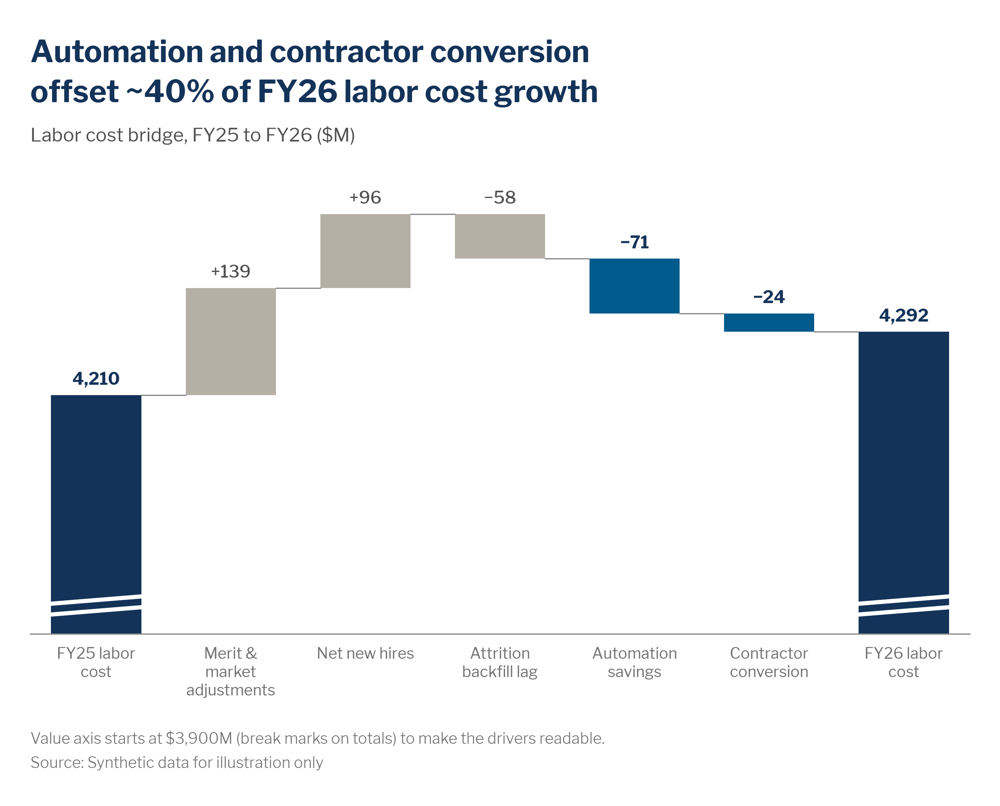

# Waterfall (bridge) charts

> **Question type:** Part-to-whole · Change over time
> **Use for:** explaining how a starting total becomes an ending total through additive drivers, or how one total breaks down into its contributors · **Avoid when:** the drivers aren't additive, or you're showing a trend over many periods → use a [bar chart](bar.md) or a [line](line.md)



## When to use
- **Bridges between two totals:** FY25 → FY26 labor cost, opening → closing headcount, plan → actual FTE. The reader sees which drivers pushed the total up and which pulled it down, and by how much.
- **Breaking down one total into its contributors** (distribution waterfall): the total bar comes first, then each component steps down to zero. For example, the 2030 capability gap split by sourcing lever.
- **Subtotals** at natural checkpoints, such as "Gross growth" before offsets or "Supply after attrition" before planned moves. Use at most 2 subtotals.
- **Variants:**
  - **Vertical** (default): up to ~8 drivers with short labels.
  - **Horizontal:** long driver names, or narrow and mobile layouts. Start at the top and end at the bottom.
  - **Distribution waterfall:** the total first, then its components, with no ending total.

## When not to use
- The drivers don't add up to the change (rates, ratios, averages, e.g., "drivers of the attrition-rate change" with no additive decomposition) → use a sorted [bar chart](bar.md) of impacts and say so.
- You only have the two totals → use a [bar chart](bar.md) or a [dumbbell](dot-plot-dumbbell.md).
- A trend over many periods → use a [line](line.md). A changing mix over time → use a [stacked area](stacked-area.md) chart.
- Parts of a whole with no sequence or net → use a [stacked bar](stacked-bar.md) or a [donut](donut-pie.md). Moves *between* categories (job family → job family) → use a [Sankey](sankey.md).
- More than ~8 meaningful drivers → group the small ones into "Other drivers", or split the chart into a summary bridge plus a detail chart.

## McKesson spec

| Element | Rule |
|---|---|
| Color | Pick **one** pattern per chart. **Highlight (default):** start, end and subtotal bars in `chart.total` `#143359`; all drivers in `chart.context` `#B4B0A5`; only the 1–2 drivers the headline names in `chart.focus` `#005A8C` (or one navy `chart.accent` `#143359` exception). Orange is not a highlight here: it belongs to the semantic pattern. **Semantic:** use this when "good vs. bad" *is* the message (variance to plan, cost bridges). Favorable drivers get `semantic.positive` `#00AF68` (text `#007A48`) and unfavorable ones `semantic.negative` `#EF8200` (text `#A75B00`). Judge "favorable" from the audience's point of view: a cost reduction is favorable, but a headcount reduction is not automatically favorable. Say what the colors mean in the subtitle or a top-left key. Never use red vs. green, and never color increases vs. decreases "just because". |
| Labels | Label every bar. Drivers get an explicit **+** or a true **−** (`mv.signed`), Medium 12 pt / 13 px `#505050`, with highlighted drivers bold in the matching text color (`#143359` for blue or navy, `#A75B00` for orange in the semantic pattern). Totals get **bold Navy, no sign**, and their category labels are bold too. Place labels above the bar top (or beside the bar end for horizontal waterfalls). The unit goes in the subtitle. Wrap category labels onto 2 lines; never rotate them. **Exception:** with many tiny steps beside one huge one, drop the direct labels and keep a light value axis with gridlines in `chart.grid` `#E6E4DE`. |
| Axes / gridlines | No value axis and no gridlines when bars are labelled. Keep a thin baseline in `chart.axis` `#8C8C8C`, 0.75 pt. **Connectors:** thin horizontal lines at the running total from one bar to the next, `#8C8C8C`, 0.75 pt (or lighter). Never heavy or black. |
| Sort / order | Start total → drivers → end total. Order the drivers by **logic** (the process sequence, e.g., hires → transfers in → exits → transfers out), or group the increases first and the decreases second, largest first within each group. Keep the same driver order across periods, scenarios and the deck. Horizontal waterfalls run top to bottom. |
| Proportions | Bar : gap ≈ **2 : 1** (`chart.bar.band_fill` = 0.67, Excel **Gap Width 50%**). Totals and drivers have the **same width**. A waterfall is the **only** bar chart that may start above zero: do it only when the totals dwarf the drivers, mark breaks on the total bars, and say so in a footnote. Every driver must still be fully visible. |
| Limits | ≤ ~8 drivers (group the tail into "Other drivers" in `#B4B0A5`), ≤ 2 subtotals, ≤ 2 highlighted drivers. The drivers **must reconcile**: start + Σ drivers = end, to the rounding shown. Headcount bridges: no driver cell may describe fewer than **10 people**. Merge small movements (e.g., rehires) into "Other movements". |

## Do / don't

| Do | Don't |
|---|---|
| Color only the driver(s) the headline names and keep the rest grey, with totals in navy | Give every driver its own color, or color by sign when sign isn't the message |
| Use green vs. orange from the audience's point of view when good vs. bad is the point | Use red vs. green for decreases vs. increases |
| Draw thin, light grey connectors at the running total | Draw thick or black connectors that compete with the bars |
| Label drivers with +/− and totals in bold without a sign | Leave the reader to subtract bar heights off an axis |
| Mark the break and footnote it when the axis can't start at zero | Silently truncate, or crop a driver bar |
| Use a horizontal waterfall for long driver names or mobile | Rotate category labels 45° |
| Reconcile the drivers to the end total before shipping | Show a "plug" or rounding gap the reader can see but nobody explains |
| On live slides, build up: start total → drivers one group at a time → end total and callout | Reveal all drivers and the callout in one click |

## Workforce examples
- **Firm, internal:** *Headline:* "Automation and contractor conversion offset ~40% of FY26 labor cost growth". *Subtitle:* "Labor cost bridge, FY25 to FY26 ($M)". *Data:* [`assets/data/labor_cost_bridge.csv`](https://github.com/amccown-mck/Data-Viz-Guide/blob/main/examples/data/labor_cost_bridge.csv), finance labor-cost actuals reconciled to HRIS movements. The two named drivers are blue, the other drivers grey and the totals navy, with the axis truncated at $3,900M and footnoted.
- **Team, internal:** *Headline:* "Voluntary exits cancelled out nearly all of FY26 hiring at our distribution centers". *Subtitle:* "Distribution Center Associate headcount bridge, Apr 2025 to Mar 2026 (employees)". *Data:* HRIS movement records (hires, rehires, transfers in/out, voluntary and involuntary exits). Use a horizontal waterfall with *Voluntary exits* in orange (a loss of headcount, so orange means worse), the other movements grey and the opening/closing headcount navy. Any movement under 10 people goes into "Other movements".
- **SWP, internal + external:** *Headline:* "Reskilling and internal moves close about a third of the 2030 Data & AI gap; the rest must be hired or borrowed". *Subtitle:* "Data & AI capability gap by sourcing lever, 2030, base scenario (FTE)". *Data:* the 617-FTE gap (demand − internal supply) from [`assets/data/data_ai_supply_demand.csv`](https://github.com/amccown-mck/Data-Viz-Guide/blob/main/examples/data/data_ai_supply_demand.csv), the SWP scenario model for *Build* / *Move* / *Automate*, and external postings-per-candidate data for Data & AI roles in our hiring metros to size *Buy* / *Borrow*. Use a distribution waterfall: the gap total first, then the levers stepping down to zero, with *Build* and *Move* in blue. Footnote it as an estimate.

## Build it

### Python — matplotlib + `mckviz`
```python
# verified runnable (from the repo root)
import matplotlib
matplotlib.use("Agg")
import matplotlib.pyplot as plt
import pandas as pd

import mckviz as mv

mv.use()
df = pd.read_csv("assets/data/labor_cost_bridge.csv")
focus = {"Automation savings", "Contractor conversion"}           # only the drivers the headline names

fig, ax = plt.subplots(figsize=(10, 5.6))
wf = mv.waterfall(ax, df.step, df.value_musd, df.kind, focus=focus, floor=3900)   # totals navy, deltas grey, focus blue
# floor= truncates the value axis: break marks on the totals, and wf.note says so for the footnote

growth = df.value_musd[(df.kind == "delta") & (df.value_musd > 0)].sum()
offset = -df.value_musd[df.step.isin(focus)].sum()
mv.titles(fig, f"Automation and contractor conversion offset ~{offset / growth:.0%} of FY26 labor cost growth",
          "Labor cost bridge, FY25 to FY26 ($M)")
mv.source(fig, "Source: Synthetic data for illustration only", footnote=wf.note)
mv.lint(fig, strict=True)
mv.save(fig, "out/waterfall.png", dpi=200)
```
`mv.waterfall` covers the variants:
- **Subtotal:** add a row with `kind == "total"` whose value is the running total at that point.
- **Horizontal:** `horizontal=True` (steps read top to bottom, connectors vertical).
- **Distribution waterfall:** pass the components as deltas and the whole as the last total, with `fmt=lambda v, k: f"{v:,.0f}"` (contributions to a total carry no +/− signs).
- **Semantic coloring:** `semantic="down"` when an increase is unfavorable (cost), `"up"` when it is favorable (headcount, revenue): green for better, orange for worse, each label with ▲/▼. Say "green = cost reduction" in the subtitle.
- Everything else (`ax`, the returned `wf.bars`, `wf.tops`, `wf.labels`) stays open for markers and callouts.

### Python — Plotly / HTML
```python
# verified: builds without error
from pathlib import Path

import pandas as pd
import plotly.graph_objects as go

import mckviz as mv

mv.use()  # registers + activates the "mck" Plotly template
C = mv.colors
FLOOR = 3900

df = pd.read_csv(Path("assets/data/labor_cost_bridge.csv"))
measure = ["absolute"] + ["relative"] * (len(df) - 2) + ["total"]
deltas = df.value_musd[df.kind == "delta"]
saved, grew = -deltas[deltas < 0].sum(), deltas[deltas > 0].sum()

fig = go.Figure(go.Waterfall(
    x=df.step, y=df.value_musd.where(df.index < len(df) - 1, 0), measure=measure,   # last bar = computed total
    text=[f"<b>{v:,.0f}</b>" if k == "total" else mv.signed(v) for v, k in zip(df.value_musd, df.kind)],
    textposition="outside", cliponaxis=False,
    increasing={"marker": {"color": C.negative}},       # cost up = unfavorable to this audience
    decreasing={"marker": {"color": C.positive}},       # cost down = favorable
    totals={"marker": {"color": C.total}},
    connector={"line": {"color": C.axis, "width": 0.75}},
    hovertemplate="%{x}<br>%{y:,.0f} $M<extra></extra>"))
for i in (0, len(df) - 1):                              # break marks on the truncated totals
    for dy in (0, 14):
        fig.add_shape(type="line", x0=i - 0.36, x1=i + 0.36, y0=FLOOR + 25 + dy, y1=FLOOR + 35 + dy,
                      line={"color": "white", "width": 3})
fig.update_layout(bargap=0.33, showlegend=False)
fig.update_yaxes(visible=False, range=[FLOOR, df.value_musd.max() + 300])
fig.update_xaxes(showgrid=False, tickvals=df.step,
                 ticktext=[f"<b>{s}</b>" if k == "total" else s for s, k in zip(df.step, df.kind)])
net = df.value_musd.iloc[-1] - df.value_musd.iloc[0]
mv.pl_finish(fig, f"Labor cost rose only ${net:,.0f}M as savings offset about two-thirds ({saved / grew:.0%}) of gross growth",
             "Labor cost bridge, FY25 to FY26 ($M); orange = cost increase, green = cost reduction",
             "Source: Synthetic data for illustration only",
             footnote=f"Value axis starts at ${FLOOR:,}M (break marks on totals) to make the drivers readable.")
Path("out").mkdir(exist_ok=True)
fig.write_html("out/waterfall.html", include_plotlyjs="cdn")
```
`go.Waterfall` colors by type (increase / decrease / total), not by bar, so it suits the **semantic** pattern shown here. For the **highlight** pattern, use `go.Bar(x=steps, y=heights, base=bottoms, marker_color=fills)` with the `bottoms`/`heights`/`fills` computed as in the matplotlib snippet, and draw the connectors with `fig.add_shape(type="line", ...)`. Use `orientation="h"` for a horizontal waterfall.

### Excel and PowerPoint
1. Install the theme once. Copy `office/Theme Colors/McKesson Data Viz.xml` to `%APPDATA%\Microsoft\Templates\Document Themes\Theme Colors\` and the Theme Fonts file to `...\Theme Fonts\`. Install Libre Franklin from `fonts/LibreFranklin`. Then apply **Page Layout › Colors › McKesson Data Viz** and **Fonts › McKesson Data Viz** (in PowerPoint: **Design › Variants › Colors / Fonts**).
2. Lay out two columns, *Step* | *Value*. The first row holds the start total, then the signed drivers (negatives as negative numbers), then the end total as a positive value. Check that start + Σ drivers = end.
3. Select the data, then **Insert › Charts › Insert Waterfall, Funnel, Stock, Surface or Radar Chart › Waterfall**.
4. Click the start bar once (selects the series), then again (selects only that point), and choose **Right-click › Set as Total**. Repeat for the end bar and any subtotal. Without this, Excel draws totals as floating increases.
5. Right-click a bar › **Format Data Series › Series Options**. Set **Gap Width 50%** and keep **Show connector lines** ticked. Excel draws the connectors as hairlines; leave them light.
6. Colors. Click a legend entry (*Increase*, *Decrease*, *Total*) to select every bar of that type, then set **Format › Shape Fill**: Total = `#143359`. **Highlight pattern:** Increase and Decrease = `#B4B0A5`, then click the named driver(s) twice and set **Format Data Point › Fill › Solid fill › Hex `005A8C`** (or `143359` for a single navy exception). **Semantic pattern:** Increase/Decrease = `#EF8200` / `#00AF68`, matched to what is favorable for the audience. Then delete the legend and state the color meaning in the subtitle.
7. Data labels are on by default. Select them › **Format Data Labels › Number › Custom** `+#,##0;"−"#,##0;0` (paste the true minus "−"). Then select each total's label alone and set its format to `#,##0`, **Bold**, Navy `#143359`. Use Libre Franklin Medium 12 pt `#505050`, with a highlighted driver's label bold in `#A75B00`.
8. Click the gridlines and press **Delete**. Format the horizontal axis with **Line › Solid line, `#8C8C8C`, 0.75 pt** and **Tick Marks › None**.
9. **Truncated start** (only when the totals dwarf the drivers): before hiding the vertical axis, set **Format Axis › Bounds › Minimum** (e.g., `3900`). Then hide it with **Labels › Label Position › None** and **Line › No line**; don't delete it, or the bound is lost. Draw two short white lines (**Insert › Shapes › Line**, 2.5 pt) across each total bar as break marks, and add the footnote.
10. **Horizontal waterfall, or per-bar control in older Excel:** the built-in Waterfall is vertical only. Instead, build a **Stacked Bar** with three series: *Spacer* (`=` the lower end of each floating bar, **Fill › No fill**), *Up* and *Down*. Set **Gap Width 50%** and **Categories in reverse order**.
11. In PowerPoint, use **Insert › Chart › Waterfall** to get a native, editable chart, and apply steps 4–9 in its data sheet. Put the headline in the title placeholder (26 pt Bold McKesson Blue `#005A8C`) and the source at 9 pt Libre Franklin Light `#737373`, bottom-left. Save the formatted chart with **Right-click › Save as Template** (`.crtx`).
12. Build-up on a live slide: the Waterfall chart type only animates as one object. Duplicate the slide instead: step 1 shows the start total only (drivers set to **No fill**), step 2 adds the grey drivers, step 3 adds the highlight, end total and callout. **Transitions › Morph** smooths the steps.

### Power BI
- Import [`assets/powerbi/mckesson-dataviz-theme.json`](../../assets/powerbi/mckesson-dataviz-theme.json) via **View › Themes › Browse for themes**.
- Use the native **Waterfall chart**: Category = driver, Y-axis = value. Add a `Step order` column and set it via **Column tools › Sort by column**, so the drivers keep their logical order. The visual adds the **Total** bar automatically. For a year-over-year bridge, put the fiscal year in **Category** and the driver in **Breakdown**.
- Under **Format visual › Columns › Sentiment colors**, set Increase / Decrease / Total. For a cost bridge, use `#EF8200` / `#00AF68` / `#143359` (semantic). For the highlight look, set Increase and Decrease both to `#B4B0A5`. Turn **Data labels** on, and the **Y-axis** and **Gridlines** off.
- The native visual can't color single bars, start above zero with break marks, or hold mid-chart subtotals. When you need those, use a **stacked column** with a transparent `Spacer` measure and a `Driver` measure. Color the driver bars with **Columns › Colors › fx** (Field value) on a measure such as `Bar Color = IF(SELECTEDVALUE(Bridge[Step]) IN {"Automation savings", "Contractor conversion"}, "#005A8C", "#B4B0A5")`.
- Headcount bridges: blank any movement under 10 people in the measure (`IF([Movers] < 10, BLANK(), [Movers])`), and add a reconciliation card (start + drivers − end = 0) on the QA page.

### R — ggplot2 (optional)
```r
library(ggplot2); library(dplyr); library(readr); library(stringr)
source("assets/r/theme_mck.R")

focus <- c("Automation savings", "Contractor conversion")
df <- read_csv("assets/data/labor_cost_bridge.csv") |>
  mutate(id    = row_number(),
         delta = if_else(kind == "total", 0, value_musd),
         end   = if_else(kind == "total", value_musd, first(value_musd) + cumsum(delta)),
         start = if_else(kind == "total", 0, lag(end)),
         label = if_else(kind == "total", scales::comma(value_musd),
                         paste0(if_else(value_musd > 0, "+", "\u2212"), scales::comma(abs(value_musd)))),
         step  = factor(step, levels = step))
fills <- mck_highlight(levels(df$step), focus = focus)
fills[df$kind == "total"] <- mck_colors$total
totals <- df$id[df$kind == "total"]

ggplot(df) +
  geom_rect(aes(xmin = id - 0.335, xmax = id + 0.335, ymin = pmin(start, end), ymax = pmax(start, end), fill = step)) +
  geom_segment(data = filter(df, id < max(id)), aes(x = id + 0.335, xend = id + 0.665, y = end, yend = end),
               color = mck_colors$axis, linewidth = 0.3) +
  geom_text(aes(id, pmax(start, end), label = label), vjust = -0.6, size = 3.6,
            fontface = if_else(df$kind == "total" | df$step %in% focus, "bold", "plain"),
            color = case_when(df$kind == "total" ~ mck_colors$headline, df$step %in% focus ~ mck_colors$headline,
                              TRUE ~ mck_colors$text)) +
  annotate("segment", x = totals - 0.36, xend = totals + 0.36, y = 3925, yend = 3935,   # break marks
           color = "white", linewidth = 1.2) +
  scale_fill_manual(values = fills, guide = "none") +
  scale_x_continuous(breaks = df$id, labels = str_wrap(df$step, 13)) +
  coord_cartesian(ylim = c(3900, 4480), expand = FALSE) +   # truncated start: footnote it
  labs(title = "Automation and contractor conversion offset ~40% of FY26 labor cost growth",
       subtitle = "Labor cost bridge, FY25 to FY26 ($M)",
       caption = "Value axis starts at $3,900M (break marks on totals) to make the drivers readable.\nSource: Synthetic data for illustration only",
       x = NULL, y = NULL) +
  theme_mck() +
  theme(axis.text.y = element_blank(), panel.grid = element_blank())
```

### HTML / JavaScript — Plotly + `mck-viz.js`
The **highlight** pattern from the Workforce examples: a headcount bridge from zero, totals navy, the one named driver orange (a loss), the rest grey, thin connectors at the running total. Plain bars with `base` give per-bar colors; on phones the same data redraws as a horizontal waterfall. Copy `assets/web/mck-viz.css` and `assets/web/mck-viz.js` next to the page (offline or locked-down intranet: also `assets/web/vendor/plotly.min.js`, see [formats.md](../formats.md#web-and-html-articles-microsites-internal-tools)). `mck-viz.js` carries the tokens, the Plotly template and the helpers (`mck.tok`, `mck.fmtNum`, `mck.plotlyLayout`, ...), so no hex value is typed in the page.

```html
<!doctype html>
<html lang="en">
<head>
<meta charset="utf-8">
<meta name="viewport" content="width=device-width, initial-scale=1">
<title>Headcount bridge</title>
<link href="https://fonts.googleapis.com/css2?family=Libre+Franklin:wght@300;400;500;600;700&display=swap" rel="stylesheet">
<link rel="stylesheet" href="mck-viz.css">   <!-- assets/web/mck-viz.css, copied next to this page -->
<script src="mck-viz.js"></script>           <!-- assets/web/mck-viz.js: tokens, helpers and the Plotly template -->
<script src="https://cdn.plot.ly/plotly-4.1.1.min.js" charset="utf-8"></script>   <!-- offline: vendor/plotly.min.js -->
<style>
  body { margin: 0; padding: 24px 16px; background: var(--mck-surface-subtle); }
  .mck-chart { margin: 0 auto; }
  .mck-plot { aspect-ratio: var(--mck-aspect-web-inline); }
  @media (max-width: 600px) { body { padding: 0; } .mck-plot { aspect-ratio: var(--mck-aspect-mobile); } }
</style>
</head>
<body>
<figure class="mck-chart" aria-labelledby="wf-headline">
  <h2 class="mck-headline" id="wf-headline">Voluntary exits cancelled out nearly all of FY26 hiring at our distribution centers</h2>
  <p class="mck-subtitle">Distribution Center Associate headcount bridge, Apr 2025 to Mar 2026 (employees)</p>
  <div class="mck-plot" id="wf-chart" role="img" aria-label="Waterfall chart. Headcount went from 11,800 to 11,660.
       4,350 hires were offset by 4,080 voluntary exits; transfers in added 420, rehires and other 160;
       involuntary exits removed 610 and transfers out 380."></div>
  <table class="sr-only" id="wf-table"></table>
  <noscript><p class="mck-subtitle">Headcount 11,800 to 11,660: hires +4,350, transfers in +420, rehires and other +160,
    voluntary exits −4,080, involuntary exits −610, transfers out −380.</p></noscript>
  <figcaption class="mck-footnote">Movements under 10 people are merged into "Rehires &amp; other".<br>
    Source: Synthetic data for illustration only</figcaption>
</figure>
<script>
const { tok, fmtNum } = mck;
const steps = [   // DATA: label, value; the first and last rows are totals, the rest are movements
  ["Opening<br>Apr 2025", 11800], ["Hires", 4350], ["Transfers<br>in", 420], ["Rehires<br>& other", 160],
  ["Voluntary<br>exits", -4080], ["Involuntary<br>exits", -610], ["Transfers<br>out", -380], ["Closing<br>Mar 2026", null],
];
const STORY = "Voluntary<br>exits";                            // the one driver the headline names: orange = a loss
let run = 0;
const bars = steps.map(([label, v], i) => {                   // base + height for each bar; the closing total is computed
  const total = i === 0 || v === null;
  if (total) { run = i === 0 ? v : run; return { label, total, base: 0, h: run, v: run }; }
  const b = { label, total, base: v < 0 ? run + v : run, h: Math.abs(v), v };
  run += v;
  return b;
});
const color = b => b.total ? tok("chart-total") : b.label === STORY ? tok("semantic-negative") : tok("chart-context");
const ink = b => b.total ? tok("chart-total") : b.label === STORY ? tok("semantic-negative-text") : tok("text-primary");
const text = b => b.total ? `<b>${fmtNum(b.v, { kind: "plain" })}</b>`
                          : b.label === STORY ? `<b>${fmtNum(b.v, { kind: "plain", sign: true })}</b>`
                          : fmtNum(b.v, { kind: "plain", sign: true });           // explicit + and a true minus
const peak = Math.max(...bars.map(b => b.base + b.h));        // headroom above the tallest bar for its label
const narrow = window.matchMedia("(max-width: 600px)");

function draw() {
  const h = narrow.matches;                                   // phones: a horizontal waterfall, top to bottom
  const cat = bars.map(b => (h ? b.label.replace("<br>", " ") : b.label));
  const pos = (c, val) => (h ? { y: c, x: val } : { x: c, y: val });
  const half = (1 - mck.plotlyLayout("waterfall").bargap) / 2;
  const connectors = bars.slice(0, -1).map((b, i) => {        // thin grey line at the running total
    const level = b.total ? b.h : b.v < 0 ? b.base : b.base + b.h;
    const a = i + half, z = i + 1 - half;
    return h ? { type: "line", y0: a, y1: z, x0: level, x1: level, line: { color: tok("chart-axis"), width: 0.75 } }
             : { type: "line", x0: a, x1: z, y0: level, y1: level, line: { color: tok("chart-axis"), width: 0.75 } };
  });
  const trace = { type: "bar", orientation: h ? "h" : "v", ...pos(cat, bars.map(b => b.h)), base: bars.map(b => b.base),
    marker: { color: bars.map(color) }, text: bars.map(text), textposition: "outside",
    textfont: { color: bars.map(ink) }, hoverinfo: "skip" };
  const ticks = cat.map((c, i) => (bars[i].total ? `<b>${c}</b>` : c));
  const layout = h
    ? mck.plotlyLayout("bar", { xaxis: { range: [0, peak * 1.25] }, yaxis: { tickvals: cat, ticktext: ticks },
                                margin: { r: 24 }, shapes: [mck.zeroLine("x"), ...connectors] })
    : mck.plotlyLayout("waterfall", { xaxis: { tickvals: cat, ticktext: ticks }, yaxis: { range: [0, peak * 1.08] },
                                      shapes: [mck.zeroLine("y"), ...connectors] });
  Plotly.react("wf-chart", [trace], layout, mck.plotConfig);
}
narrow.addEventListener("change", draw);
mck.srTable("wf-table", "Distribution Center Associate headcount bridge, FY26", ["Step", "Employees"],
            bars.map(b => [b.label.replace("<br>", " "), b.total ? fmtNum(b.v, { kind: "plain" }) : fmtNum(b.v, { kind: "plain", sign: true })]));
mck.ready(draw);
</script>
</body>
</html>
```
For the **semantic** pattern, `{type: "waterfall", measure: ["absolute", "relative", ..., "total"]}` is enough: the template already colors increases, decreases and totals. Labels come from `mck.fmtNum(v, {kind: "plain", sign: true})`, so drivers get an explicit + and a true minus.

## QA specifics
- [ ] The drivers reconcile: start + Σ drivers = end (and every subtotal) to the rounding shown. Label totals are recomputed, not typed.
- [ ] Totals are navy and bold without a sign. Drivers carry an explicit + or a true −. Total category labels are bold.
- [ ] One color pattern only: highlight (grey drivers, ≤ 2 named drivers in blue, or one in navy; never orange) **or** semantic (green/orange from the audience's point of view, explained in the subtitle). No red/green.
- [ ] Connectors are thin and light grey, and sit exactly at the running total. Bars are ≈ 2 : 1 bar : gap, and totals are the same width as drivers.
- [ ] If the axis starts above zero, the total bars carry break marks, a footnote says where it starts, and no driver is cropped.
- [ ] ≤ ~8 drivers, logically ordered and consistent across the deck. Headcount movements under 10 people are merged into "Other".

## Inspiration
- [p037 — Waterfall chart](https://github.com/amccown-mck/Data-Viz-Guide/blob/main/reference/inspiration-mckinsey/pages/p037-waterfall-chart.md)
- [p038 — Waterfall chart variants](https://github.com/amccown-mck/Data-Viz-Guide/blob/main/reference/inspiration-mckinsey/pages/p038-waterfall-chart-variants.md)
- [p039 — Waterfall chart best practice](https://github.com/amccown-mck/Data-Viz-Guide/blob/main/reference/inspiration-mckinsey/pages/p039-waterfall-chart-best-practice.md)
