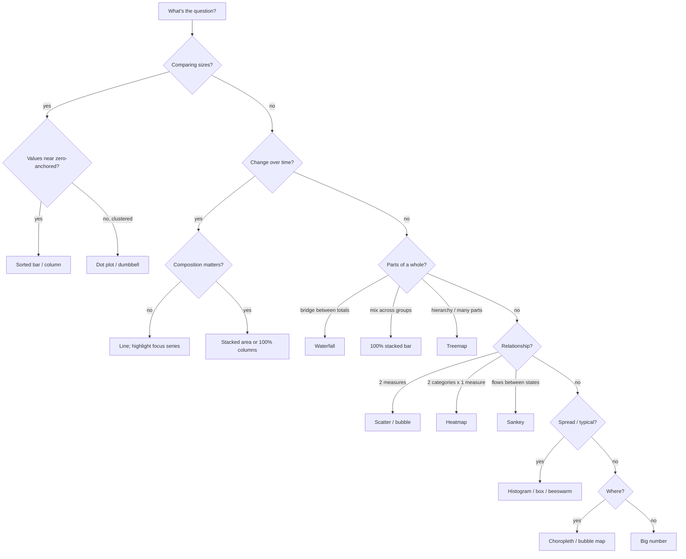

# Choosing a chart

Pick the chart from the **question**, not from habit. First name the question type, then choose from the short list. Each chart links to its cookbook page (spec, do/don't, code for each platform).

## Step 1 — What kind of question is it?

| Question type | The reader wants to know… | Workforce examples |
|---|---|---|
| **Magnitude** | How big? Which is bigger, by how much? | Headcount by function; attrition by job family; open reqs by site |
| **Part-to-whole** | What is it made of? How does a total break down? | Workforce mix (FT/PT/contingent); labor cost bridge FY25→FY26; skills portfolio |
| **Change over time** | How is it moving? When did it change? | Monthly attrition trend; SWP demand vs. supply forecast; hiring velocity |
| **Ranking / change in rank** | Who's on top? Who moved? | Top skills in postings 2023→2026; sites ranked by time-to-fill |
| **Distribution** | How spread out? What's typical? Where are the outliers? | Span of control; pay within band (compa-ratio); tenure; performance ratings |
| **Correlation** | Do two measures move together? | Engagement vs. attrition by team; gen-AI exposure vs. pay; manager tenure vs. team turnover |
| **Relationships & flows** | How do things connect or move between states? | Internal mobility between job families; hiring source → role; skill overlaps |
| **Geo-spatial** | Where? | Talent availability by metro; workforce by DC location; remote-work distribution |
| **Single number** | Just the headline figure | "75% of roles have a successor ready" |

## Step 2 — Choose from the short list

| Question type | First choice | Also good | Use with care |
|---|---|---|---|
| Magnitude | [Bar / column](cookbook/bar.md) | [Dot plot](cookbook/dot-plot-dumbbell.md) (non-zero baselines), [proportional bubbles](cookbook/bubble-chart.md) (huge ranges) | Pictograms/infographics |
| Part-to-whole | [100% stacked bar](cookbook/stacked-bar.md) | [Waterfall](cookbook/waterfall.md) (bridges), [treemap](cookbook/treemap.md) (hierarchies, many parts) | [Donut / pie](cookbook/donut-pie.md) (≤ 5 parts, one whole) |
| Change over time | [Line](cookbook/line.md) | [Column](cookbook/bar.md) (few periods, discrete), [stacked area](cookbook/stacked-area.md) (composition + total), [small multiples](cookbook/small-multiples.md) | [Bubble timeline](cookbook/bubble-timeline.md) (events) |
| Ranking | [Sorted bar](cookbook/bar.md) | [Slope / bump](cookbook/slope-bump.md) (change in rank between 2+ points) | Tables with heat (see [tables](cookbook/tables.md)) |
| Distribution | [Histogram / box / beeswarm](cookbook/distribution.md) | [Dot plot](cookbook/dot-plot-dumbbell.md) | Averages alone (hide the spread) |
| Correlation | [Scatter / bubble scatter](cookbook/scatter-bubble.md) | [Heatmap](cookbook/heatmap.md) (two categorical dimensions) | [Dual axis](cookbook/dual-axis.md) (avoid if possible) |
| Relationships & flows | [Sankey](cookbook/sankey.md) (flows between states) | [Parallel coordinates](cookbook/parallel-coordinates.md) (multi-attribute profiles) | [Venn](cookbook/venn.md) (≤ 3 sets) |
| Geo-spatial | [Choropleth](cookbook/maps.md) (rates by area) | [Bubble map](cookbook/maps.md) (counts by location) | [Dot density](cookbook/maps.md) |
| Single number | [KPI / big number](cookbook/kpi-big-number.md) | Ring/progress gauge (for % of a target) | Speedometers, 3D gauges |

## Step 3 — Sanity checks

- **More than ~12 categories?** Use horizontal bars sorted by value, or group the long tail into "Other".
- **Values tightly clustered far from zero** (e.g., engagement 71–78)? Don't truncate bars — use a dot plot or show the **difference from benchmark**.
- **Two measures with different units over time?** Don't reach for dual axes — use two aligned charts, or index both to 100.
- **Comparing many groups on the same measure over time?** Use small multiples with a shared scale, and highlight the focus group in each.
- **The audience will explore it themselves?** That's a dashboard — see [formats.md](formats.md#dashboards-power-bi--fabric).
- **Tempted by a pie with 8 slices?** Use a sorted bar.

## Quick decision tree

