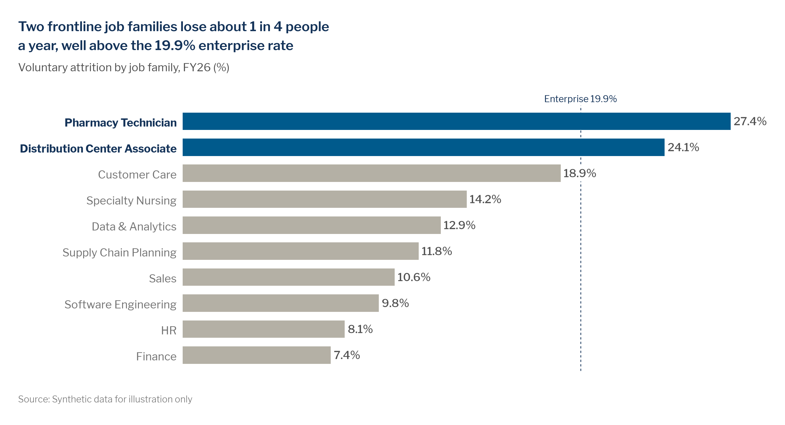

# Bar and column charts

> **Question type:** Magnitude · Ranking
> **Use for:** comparing size across categories, and ranking them · **Avoid when:** values sit close together far from zero, so you'd have to truncate the bars → use a [dot plot](dot-plot-dumbbell.md)



## When to use
- To compare **how big** each category is, either relatively ("which is bigger") or absolutely ("by how much"). Bar length is proportional to value.
- **Sorted horizontal bars** are the default for ranking categories (job families, sites, skills). Long labels stay readable, and the layout works on narrow and mobile screens.
- **Columns** (vertical) work for a few discrete periods (≤ ~8, e.g., FY22–FY26 net hires) or for short category names.
- **Variants:**
  - **Grouped bars:** 2–3 series side by side within each category (e.g., FY25 vs. FY26 time-to-fill by job family).
  - **Diverging bars:** the values cross zero (e.g., net headcount change by function).
  - **Butterfly:** two groups measured on the same items, back to back (e.g., hires vs. exits by job family; the share disagreeing vs. agreeing on a survey item).

## When not to use
- Values are tightly clustered far from zero (engagement 71–78, compa-ratio 0.94–1.06) → use a [dot plot / dumbbell](dot-plot-dumbbell.md). Never truncate the bars.
- The largest value is more than ~20× the smallest, so the small bars disappear → use [proportional bubbles](bubble-chart.md) or split the chart.
- Parts of a whole → use a [stacked / 100% stacked bar](stacked-bar.md). For a bridge between two totals → use a [waterfall](waterfall.md).
- A trend over many periods → use a [line](line.md). For a change in rank between two dates → use a [slope / bump chart](slope-bump.md).
- The spread across individual people (pay within a band, tenure) → use a [distribution](distribution.md) chart.

## McKesson spec

| Element | Rule |
|---|---|
| Color | Pick one of the three highlight patterns. **Focus:** all bars `chart.context` `#B4B0A5` and the headline bars `chart.focus` `#005A8C`. **Uniform + accent:** all bars `chart.focus_light` `#66C4FF` and the single exception `chart.accent` navy `#143359`. Highlight at most **2** bars. Never give each bar its own color. Draw benchmark or target lines in `chart.total` `#143359`, dashed, 0.75 pt, and label them. For diverging bars, use `semantic.negative` orange `#EF8200` (text `#A75B00`) for unfavorable values (orange means worse, so never use it as a plain highlight) and `#005A8C` or `semantic.positive` `#00AF68` for favorable ones; when only the unfavorable side is the message ("these families run above the rate"), the favorable side may be context grey `#B4B0A5` instead, so the orange is the only highlight. Never use red vs. green. |
| Labels | Put direct value labels at the bar end (outside end) in the label role: 12 pt / 13 px, Medium, `#505050`. Bold the focus category label and set it in Navy `#143359`. The unit goes in the subtitle; only `%` repeats on labels. Use a true minus (−) and an explicit + on deltas. Category labels never rotate: if they don't fit under columns, switch to horizontal bars. |
| Axes / gridlines | When bars carry labels, remove the value axis **and** the gridlines. Keep a thin **zero baseline** in `chart.axis` `#8C8C8C`, 0.75 pt. No tick marks. Use gridlines in `chart.grid` `#E6E4DE` only when the bars aren't labelled (e.g., grouped bars with 3 series). |
| Sort / order | Horizontal bars run largest at the top. Columns run left to right in time order, or sorted by value. Keep a natural order (tenure bands, job levels, survey scale) wherever one exists. Keep the same order for the same categories across the whole deck, and across every step of a build-up. |
| Proportions | Bar width : gap ≈ **2 : 1** (`chart.bar.band_fill` = 0.67). That is Excel **Gap Width 50%**, Plotly `bargap≈0.33` and ggplot2 `width = 0.67`. In grouped bars, bars within a cluster touch (or have a 1 px white gap), and the gap between clusters is about one bar width. |
| Limits | The value axis starts at **0**, always. Up to ~12 categories; beyond that, sort and group the tail into "Other" in `#B4B0A5`. Grouped bars take ≤ 3 series. Suppress any category with **n < 10** people (merge it into "Other" and footnote it). |

## Do / don't

| Do | Don't |
|---|---|
| Use one color for all bars and recolor only the bar(s) the headline names, with the category label bolded | Give every bar a different color ("rainbow" bars) |
| Make bars about twice as wide as the gaps | Use thin, stick-like bars that make the eye read the empty space |
| Label values on the bars and delete the value axis and gridlines | Show value labels **and** a gridded axis, or gridlines with no labels on a simple bar chart |
| Start at zero; if the differences only show on a narrow range, switch to a dot plot or line | Truncate the value axis so small differences look huge |
| Use horizontal bars for long job-family or site names | Rotate category labels 45° or 90° |
| Sort by value unless the categories have a natural order | Sort alphabetically by default |
| Label the benchmark line in place ("Enterprise 19.9%") | Make the reader find the benchmark in a legend or footnote |
| On live slides, build up in 2–5 steps: all bars grey with labels first, then the highlight, then the benchmark and callout | Reveal the full, annotated chart in one click |

## Workforce examples
- **Firm, internal:** *Headline:* "Two frontline job families lose about 1 in 4 people a year, well above the 19.9% enterprise rate". *Subtitle:* "Voluntary attrition by job family, FY26 (%)". *Data:* [`examples/data/attrition_by_job_family.csv`](../../examples/data/attrition_by_job_family.csv), HRIS exits ÷ average headcount.
- **Team, internal:** *Headline:* "Three distribution centers run spans above 1:25, well past the 1:18 design target". *Subtitle:* "Average span of control by distribution center, Mar 2026 (direct reports per supervisor)". *Data:* HRIS position hierarchy. Use horizontal bars sorted by span, the over-target sites in focus blue and the target as a navy dashed line.
- **Sector, external:** *Headline:* "Pharmacy technician postings outnumber qualified candidates nearly 2 to 1 in our three largest hiring metros". *Subtitle:* "Job postings per available candidate, pharmacy technicians, top 10 McKesson hiring metros, Q2 2026 (ratio)". *Data:* external job-postings and candidate-profile data. Highlight the three largest hiring metros and add a 1.0 reference line labelled "Balanced market".

## Build it

### Python — matplotlib + `mckviz`
```python
# verified runnable (from the repo root)
from pathlib import Path

import matplotlib
matplotlib.use("Agg")
import matplotlib.pyplot as plt
import pandas as pd

import mckviz as mv

mv.use()

df = pd.read_csv(Path("examples/data/attrition_by_job_family.csv"))
ent = df.enterprise_rate_pct.iloc[0]
focus = set(df.job_family[df.vol_attrition_pct > 20])      # only what the headline names

fig, ax = plt.subplots(figsize=(10, 5.6))
mv.bar(ax, df.job_family, df.vol_attrition_pct, focus=focus, benchmark=ent,
       benchmark_label=f"Enterprise {ent:.1f}%", fmt="{:.1f}%")             # sorted with the story on top

mv.titles(fig, f"Two frontline job families lose about 1 in 4 people a year, well above the {ent:.1f}% enterprise rate",
          "Voluntary attrition by job family, FY26 (%)")
mv.source(fig, "Source: Synthetic data for illustration only",
          footnote="Voluntary attrition = voluntary exits \u00f7 average headcount, trailing 12 months.")
mv.save(fig, "out/bar-highlight.png", dpi=200)
```
`mv.bar` sorts with the story on top: largest first, or smallest first when the highlighted bars are the small ones (a "lagging" headline), the same order as `mv.office.bar_slide`, so the chart and its slide agree (`sort="descending"`, `"ascending"`, or `False` for a natural order). It draws the bars at the 2 : 1 bar-to-gap ratio, the value at each bar's end (bold for the highlighted ones, with a white backing where a label meets the benchmark line), the labelled dashed benchmark, a zero baseline and no value axis, and refuses a third highlight. To show one navy exception against all-light-blue bars instead, use `mv.bar(ax, labels, values, accent="Pharmacy Technician", uniform=True)`. For grouped bars, offset each series by `±width/2` with `width = 0.67 / n_series`, color the series with `mv.categorical(n)`, and put a top-left legend or label the first cluster.

**Diverging bars** (deviation from a benchmark): pass the gaps, not the raw values, and name the unfavorable side. `mv.diverging_bars` paints that side orange and the other focus blue, labels the bar ends with a true minus, bolds the unfavorable category names and pads the limits so the labels on negative bars never run into the names.
```python
# verified runnable (from the repo root)
from pathlib import Path

import matplotlib
matplotlib.use("Agg")
import matplotlib.pyplot as plt
import pandas as pd

import mckviz as mv

mv.use()

df = pd.read_csv(Path("examples/data/attrition_by_job_family.csv"))
ent = df.enterprise_rate_pct.iloc[0]
df["gap_pts"] = df.vol_attrition_pct - ent                                # deviation from the benchmark
df = df.sort_values("gap_pts", ascending=False)                           # first row on top

fig, ax = plt.subplots(figsize=(10, 5.6))
ns = mv.diverging_bars(ax, df.job_family, df.gap_pts, worse="above", suffix=" pts",
                       zero_label=f"Enterprise {ent:.1f}%")               # orange = above the rate = worse
top, n_above = df.iloc[0], int(ns.worse.sum())
mv.titles(fig, f"{top.job_family} attrition runs {top.gap_pts:.1f} pts above the enterprise rate, "
               f"the widest gap of {len(df)} job families",
          f"Voluntary attrition minus the {ent:.1f}% enterprise rate, by job family, FY26 (percentage points)")
mv.source(fig, "Source: Synthetic data for illustration only",
          footnote=f"{n_above} job families are above the enterprise rate. Voluntary attrition = voluntary exits "
                   "\u00f7 average headcount, trailing 12 months.")
mv.save(fig, "out/bar-diverging.png", dpi=200)
```

### Python — Plotly / HTML
```python
# verified: builds without error
from pathlib import Path

import pandas as pd
import plotly.graph_objects as go

import mckviz as mv

mv.use()  # registers + activates the "mck" Plotly template
C = mv.colors

df = pd.read_csv(Path("examples/data/attrition_by_job_family.csv")).sort_values("vol_attrition_pct")
ent = df.enterprise_rate_pct.iloc[0]
focus = df.job_family[df.vol_attrition_pct > 20]
fig = go.Figure(go.Bar(
    x=df.vol_attrition_pct, y=df.job_family, orientation="h",
    marker_color=mv.pl_highlight(df.job_family, focus=focus),
    text=[f"{v:.1f}%" for v in df.vol_attrition_pct], textposition="outside", cliponaxis=False,
    customdata=df.headcount,
    hovertemplate="%{y}<br>%{x:.1f}% attrition<br>%{customdata:,} employees<extra></extra>"))
fig.add_vline(x=ent, line={"color": C.total, "width": 1, "dash": "dot"})
fig.add_annotation(x=ent, y=1, yref="paper", yanchor="bottom", text=f"Enterprise {ent:.1f}%", showarrow=False)
fig.update_layout(bargap=0.33)                                   # bar:gap ~ 2:1
fig.update_xaxes(visible=False, range=[0, df.vol_attrition_pct.max() * 1.15])
fig.update_yaxes(showgrid=False, ticksuffix="  ", tickvals=df.job_family,
                 ticktext=[f"<b>{j}</b>" if j in set(focus) else j for j in df.job_family])
mv.pl_finish(fig, f"Two frontline job families lose about 1 in 4 people a year, well above the {ent:.1f}% enterprise rate",
             "Voluntary attrition by job family, FY26 (%)", "Source: Synthetic data for illustration only",
             footnote="Voluntary attrition = voluntary exits \u00f7 average headcount, trailing 12 months.")
Path("out").mkdir(exist_ok=True)
fig.write_html("out/bar-highlight.html", include_plotlyjs="cdn")
```
For HTML pages, prefer the chart-card pattern in [`examples/python/gallery_plotly.py`](../../examples/python/gallery_plotly.py): the headline, subtitle and source go in HTML, and the figure carries only the data. Hover text may show headcount, but never for groups with n < 10.

### Excel and PowerPoint
**From Python, in one call:** `mckviz.office.bar_slide` builds this slide as a native, editable chart on the kit's template (needs `python-pptx`): sorted from the top, no gridlines, the plot starting right after the labels, the value at each bar's end, the benchmark as a dashed line across all bars (a label that would sit on it moves inside its bar), and the headline, subtitle and source on the grid. Right-click › Edit Data changes the numbers, and the labels follow.
```python
# verified runnable (from the repo root)
import pandas as pd
from mckviz import office

df = pd.read_csv("examples/data/attrition_by_job_family.csv")
prs = office.deck()                                   # McKesson theme, Libre Franklin, the slide grid
office.bar_slide(prs, df.job_family, df.vol_attrition_pct, focus={"Pharmacy Technician", "Distribution Center Associate"},
                 benchmark=19.9, benchmark_label="Enterprise 19.9%", fmt="{:.1f}%",
                 headline="Two frontline job families lose about 1 in 4 people a year, well above the 19.9% enterprise rate",
                 subtitle="Voluntary attrition by job family, FY26 (%)",
                 source="Source: Synthetic data for illustration only")
office.save(prs, "out/bar-highlight.pptx")            # one save per deliverable
```
For a few periods or stages in their natural order, `office.column_slide` takes the same arguments (no `sort`) and draws columns: the value on top of each, the benchmark across all columns, named at its right end.
```python
# verified runnable (from the repo root)
import pandas as pd
from mckviz import office

df = pd.read_csv("examples/data/internal_fill_by_fy.csv")
prs = office.deck()
office.column_slide(prs, df.fiscal_year, df.internal_fill_pct, focus={"FY26"}, fmt="{:.0f}%",
                    headline="Internal candidates filled 29% of roles in FY26, the highest in five years",
                    subtitle="Share of open roles filled by internal candidates, FY22–FY26 (%)",
                    source="Source: Synthetic data for illustration only")
office.save(prs, "out/column.pptx")
```
By hand:
1. Install the theme once. Copy `dist/office/Theme Colors/McKesson Data Viz.xml` to `%APPDATA%\Microsoft\Templates\Document Themes\Theme Colors\` and the Theme Fonts file to `...\Theme Fonts\`. Install Libre Franklin from `fonts/LibreFranklin`. Then apply **Page Layout › Colors › McKesson Data Viz** and **Fonts › McKesson Data Viz** (in PowerPoint: **Design › Variants › Colors / Fonts**). Accent 1 = `#005A8C` (focus), Accent 2 = `#143359` (navy accent), Accent 3 = `#009EFF` (bright blue); light blue `#66C4FF` and context grey `#B4B0A5` via **More Colors › Hex**.
2. Sort the data by value, select it, then **Insert › Charts › Insert Column or Bar Chart › 2-D Clustered Bar**. Excel draws the first row at the bottom, so either sort ascending or set **Format Axis › Axis Options › Categories in reverse order**.
3. Right-click a bar › **Format Data Series › Series Options › Gap Width 50%**. This gives bar : gap ≈ 2 : 1. For grouped bars, also set **Series Overlap 0%**.
4. **Fill › Solid fill › More Colors › Hex B4B0A5** for all bars. Then click the focus bar a second time to select only that point, and set **Fill › Hex 005A8C** (or `143359` for the single navy accent; for the uniform + accent pattern, make all bars `66C4FF` first).
5. Click the gridlines and press **Delete**. Click the value axis and press **Delete**. Delete the legend and the default chart title (the headline goes in the slide title or a text box).
6. **Chart Elements (+) › Data Labels › Outside End**. Set **Format Data Labels › Number › Custom** to `0.0"%"`, with the label font Libre Franklin Medium 12 pt in `#505050`. Select the focus bar's label alone and set it **Bold**, Navy `#143359`.
7. On the category axis, set **Format Axis › Tick Marks › None** and **Line › Solid line, `#8C8C8C`, 0.75 pt**: this is the zero baseline. Excel can't bold a single axis label, so bold the focus category with an overlaid text box, or hide the axis labels and use **Data Labels › Value From Cells**.
8. For a benchmark line, add a series with the benchmark value, change its chart type to **XY Scatter with Straight Lines** (or use error bars), and format it `#143359`, 0.75 pt, dashed. Label it in place.
9. In PowerPoint, insert the chart as a **native, editable chart** (Home › Paste › Use Destination Theme & Embed Workbook). Put the headline in the title placeholder (26 pt Bold McKesson Blue `#005A8C`) and the subtitle at 14 pt `#505050`. Put the source line at 9 pt Libre Franklin Light `#737373`, bottom-left. Save the formatted chart with **Right-click › Save as Template** (`.crtx`) to reuse it.
10. Build-up on a live slide: duplicate the slide. Step 1: all bars grey with labels. Step 2: the focus bars recolored. Step 3: add the benchmark line and callout. Alternatively, use **Animations › Wipe › Effect Options › From Left, By Category**.

### Power BI
- Import [`dist/powerbi/mckesson-dataviz-theme.json`](../../dist/powerbi/mckesson-dataviz-theme.json) via **View › Themes › Browse for themes**.
- Use the **Clustered bar chart** and sort by the measure (**⋯ › Sort axis › descending**). Turn **Data labels** on (Outside end), the **X-axis** off and the **Gridlines** off.
- Highlight with **Format › Bars › Colors › fx** (Format style: *Field value*) on a measure such as `Bar Color = IF([Attrition %] > 0.20, "#005A8C", "#B4B0A5")`.
- Benchmark: **Analytics pane › Constant line** (or X-axis constant line), `#143359`, dashed, with its data label on.
- Enforce the minimum n in the measure, so cards, tooltips and drill-downs inherit it: `Attrition % (safe) = IF([Headcount] < 10, BLANK(), [Attrition %])`.

### R — ggplot2 (optional)
```r
library(ggplot2); library(dplyr); library(readr)
source("dist/r/theme_mck.R")

df <- read_csv("examples/data/attrition_by_job_family.csv") |>
  mutate(job_family = reorder(job_family, vol_attrition_pct))
focus <- as.character(df$job_family[df$vol_attrition_pct > 20])

ggplot(df, aes(vol_attrition_pct, job_family, fill = job_family)) +
  geom_col(width = 0.67) +
  geom_vline(xintercept = 19.9, color = mck_colors$total, linetype = "dashed", linewidth = 0.3) +
  geom_text(aes(label = sprintf("%.1f%%", vol_attrition_pct)), hjust = -0.15, size = 3.6, color = mck_colors$text) +
  scale_fill_manual(values = mck_highlight(levels(df$job_family), focus = focus), guide = "none") +
  scale_x_continuous(expand = expansion(mult = c(0, 0.12))) +
  labs(title = "Two frontline job families lose about 1 in 4 people a year, well above the 19.9% enterprise rate",
       subtitle = "Voluntary attrition by job family, FY26 (%)",
       caption = "Source: Synthetic data for illustration only", x = NULL, y = NULL) +
  theme_mck() +
  theme(axis.text.x = element_blank(), panel.grid = element_blank(), axis.line.x = element_blank(),
        axis.line.y = element_line(color = mck_colors$axis, linewidth = 0.3))
```

## QA specifics
- [ ] The value axis starts at **0** and the zero baseline is visible. Bars are never truncated or broken.
- [ ] Bar : gap ≈ 2 : 1 (Excel Gap Width ≈ 50%). No hairline bars.
- [ ] At most 2 highlighted bars, exactly the ones the headline names, with their category labels bolded. No per-bar rainbow colors.
- [ ] When values are labelled, the value axis and gridlines are gone. When they aren't, light gridlines and the unit are in the subtitle.
- [ ] Sorted by value (largest at the top for horizontal bars), or in a stated natural order, consistent across the deck.
- [ ] The benchmark/target line is labelled in place and defined in a footnote. No category is shown with n < 10.
- [ ] No value label sits on the benchmark line: when a value is within about 2 points of the benchmark (18.9% next to 19.9%), the label gets a white backing (`bbox=dict(fc="white", ec="none", pad=1)`) drawn above the line, or the line breaks around it. Render and look; a lint does not catch this.

## Inspiration
- [p028 — Bar chart](../../reference/inspiration-mckinsey/pages/p028-bar-chart.md)
- [p030 — Bar chart variants](../../reference/inspiration-mckinsey/pages/p030-bar-chart-variants.md)
- [p031 — Bar chart best practice](../../reference/inspiration-mckinsey/pages/p031-bar-chart-best-practice.md)
- [Bar chart spreads (hi-res)](../../reference/inspiration-mckinsey/pages/hires-bar-chart-spreads.md)
- [p081 — Presentations](../../reference/inspiration-mckinsey/pages/p081-presentations.md)
- [p082 — Presentations](../../reference/inspiration-mckinsey/pages/p082-presentations.md)
