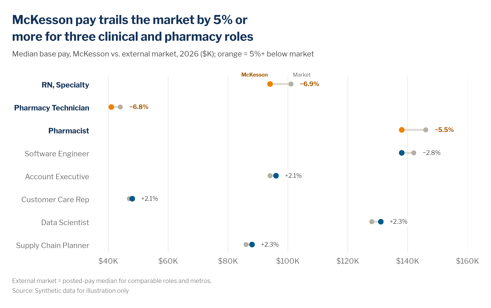

# Dot plots and dumbbell (gap) charts

> **Question type:** Magnitude · Ranking · Distribution (compact)
> **Use for:** comparing values that sit far from zero, or the gap between two values per category · **Avoid when:** the total size from zero is the point → use a [bar chart](bar.md)



## When to use
- **Dot plot:** one value per category when the values are **clustered far from zero** (engagement index 68–82, compa-ratio 0.92–1.08, proficiency on a 1–5 scale). A bar chart would need a truncated axis; a dot encodes **position**, not length, so a non-zero range is honest.
- **Dumbbell:** **two values per category** where the **gap** is the message: McKesson vs. market, before vs. after a program, plan vs. actual, this year vs. last year, team vs. company.
- Many categories (8–15) in a compact space, including narrow and mobile layouts.
- A dot plot with a labelled benchmark line instead of a table of scores.

## When not to use
- The size from zero matters (headcount, cost, counts) → use a [bar chart](bar.md).
- More than 2–3 time points per category → use a [line chart](line.md). For a change in **rank** → use a [slope / bump chart](slope-bump.md).
- The spread across individual people is the point → use a [histogram / box / beeswarm](distribution.md).
- Only the difference matters, and it crosses zero → use a diverging bar of the delta ([bar.md](bar.md)).
- Gaps smaller than a dot's diameter: the dots overlap → show the delta instead.

## McKesson spec

| Element | Rule |
|---|---|
| Color | Comparator dot (market, before, benchmark): `chart.context` `#B4B0A5`. Focus dot (McKesson, after, actual): `chart.focus` `#005A8C`. Exception rows the headline calls out: focus dot in `chart.accent` navy `#143359`, or in `semantic.negative` orange `#EF8200` when the exception is worse (below market, below benchmark), as in the pay example below. Orange never marks a plain highlight. Connector: `chart.context_light` `#DEDBD1`. Benchmark line on a dot plot: `chart.total` `#143359`, dashed, 0.75 pt, labelled. Use semantic colors (`#00AF68` favorable / `#EF8200` unfavorable) only when direction = good/bad is the message. |
| Labels | Name the two dot types **once**, above the top row ("Market", "McKesson") instead of a legend. Put the gap label at the right end of each row as a signed value with a true minus (`−6.9%`, `+2.1%`), using `semantic.negative_text` `#A75B00` bold for the exceptions and `#505050` otherwise. Bold the exception rows' category labels and set them in Navy `#143359`. |
| Axes / gridlines | A **non-zero value range is allowed**: pick round bounds that just contain the data. Show the value axis with tick labels (dots aren't value-labelled) and light **vertical** gridlines in `chart.grid` `#E6E4DE`, 0.75 pt. No baseline, no tick marks, no y-axis line. Small multiples share the same range. |
| Sort / order | Sort by the gap (largest unfavorable first) or by the focus value. Keep a natural order (job level, survey item order) where it exists. Use the same order across the deck. |
| Proportions | Comparator dot ≈ 7 px (matplotlib `s≈55`), focus dot ≈ 8–9 px (`s≈70`), connector 3 pt with round caps, drawn behind the dots. Row pitch ≥ 2× the dot diameter. |
| Limits | 2 values per row (3 at most, e.g., min / median / max as a range). ≤ ~15 rows; beyond that, filter or use small multiples. ≤ 2 highlighted groups. Each dot is based on **n ≥ 10** people; footnote any suppressed rows. |

## Do / don't

| Do | Don't |
|---|---|
| Switch to dots when values cluster far from zero | Truncate a bar chart's axis to make small differences visible |
| Draw a light connector so the eye reads the **gap** | Use two separate unconnected dot series and a legend |
| Label the dot types once on the top row | Add a legend box for two series |
| Write the gap at the row end with an explicit sign (`+2.1%`, `−6.9%`) | Make the reader subtract axis positions |
| Sort by the gap or the focus value | Sort alphabetically by default |
| Use grey for the comparator and blue for the focus (navy for an exception, orange only if it is below the comparator) | Use two equally strong colors so neither reads as "us" |
| State the comparator in the subtitle or footnote (market definition, benchmark source, cohort n) | Leave "market" or "benchmark" undefined |

## Workforce examples
- **Firm vs. external market:** *Headline:* "McKesson pay trails the market by 5% or more for three clinical and pharmacy roles". *Subtitle:* "Median base pay, McKesson vs. external market, 2026 ($K)". *Data:* [`examples/data/pay_vs_market.csv`](../../examples/data/pay_vs_market.csv): internal compensation vs. external posted-pay medians for matched roles and metros.
- **Team, internal (dot plot):** *Headline:* "Two distribution-center teams score 8+ points below the company engagement index of 76". *Subtitle:* "Employee engagement index by DC team, Q2 2026 (0–100)". *Data:* engagement survey, teams with n ≥ 10 respondents. Range 60–90, with a company line in navy, dashed and labelled.
- **Individual → cohort, internal (before/after):** *Headline:* "The first Data Academy cohort lifted SQL proficiency from 1.8 to 3.1, the largest gain of any skill". *Subtitle:* "Average assessed proficiency before vs. after the program, cohort 1 (n = 48), 1–5 scale". *Data:* pre- and post-program skill assessments (LMS). "Before" dots in grey, "after" dots in blue, SQL in navy.

## Build it

### Python — matplotlib + `mckviz`
```python
# verified runnable (from the repo root)
import matplotlib
matplotlib.use("Agg")
import matplotlib.pyplot as plt
import pandas as pd

import mckviz as mv

mv.use()
df = pd.read_csv("examples/data/pay_vs_market.csv").sort_values("gap_pct", ignore_index=True)   # largest shortfall first

fig, ax = plt.subplots(figsize=(10, 5.6))
# Market grey, McKesson blue, orange where McKesson is 5%+ below (worse); gap labels with a true minus;
# bold navy names for the flagged rows; a key naming each dot type once, top left.
db = mv.dumbbell(ax, df.role, df.market_median_k, df.internal_median_k, flag_below=-5, tick_fmt="${:,.0f}K",
                 xlim=(35, 160))                  # non-zero range is fine: position, not length
lag = db.flagged                                  # the exception the headline calls out

mv.titles(fig, f"McKesson pay trails the market by 5% or more for {lag.sum()} clinical and pharmacy roles",
          "Median base pay, McKesson vs. external market, 2026 ($K)")
mv.source(fig, "Source: Synthetic data for illustration only",
          footnote="External market = posted-pay median for comparable roles and metros.")
mv.lint(fig, strict=True)
mv.save(fig, "out/dumbbell.png", dpi=200)
```
`gap="abs"` labels the difference in units instead of percent; `compare_name=` / `value_name=` rename the dots (for example "FY25" / "FY26" for a before-and-after dumbbell). **Dot plot variant:** use a single `ax.scatter(values, rows)` colored with `mv.highlight(rows, focus=...)`, then `ax.axvline(benchmark, color=C.total, lw=0.75, ls=(0, (3, 3)))` with an in-place label. Keep `mv.clean_axes(ax, keep=(), grid="x")`.

### Python — Plotly / HTML
```python
# verified: builds without error
from pathlib import Path

import pandas as pd
import plotly.graph_objects as go

import mckviz as mv

mv.use()  # registers + activates the "mck" Plotly template
C = mv.colors

df = pd.read_csv(Path("examples/data/pay_vs_market.csv")).sort_values("gap_pct", ascending=False, ignore_index=True)
lag = df.gap_pct <= -5
xs, ys = [], []
for r in df.itertuples():                                # one connector per row, separated by None
    xs += [r.market_median_k, r.internal_median_k, None]
    ys += [r.role, r.role, None]
fig = go.Figure()
fig.add_scatter(x=xs, y=ys, mode="lines", line={"color": C.context_light, "width": 4}, hoverinfo="skip",
                showlegend=False)
fig.add_scatter(x=df.market_median_k, y=df.role, mode="markers", name="Market",
                marker={"color": C.context, "size": 10}, hovertemplate="Market: $%{x}K<extra></extra>")
fig.add_scatter(x=df.internal_median_k, y=df.role, mode="markers+text", name="McKesson",
                marker={"color": [C.negative if b else C.focus for b in lag], "size": 12},   # below market = orange
                text=[mv.signed(g, 1, "%") for g in df.gap_pct], textposition="middle right",
                hovertemplate="McKesson: $%{x}K<extra></extra>")
fig.update_layout(legend={"orientation": "h", "x": 0, "y": 1.02, "yanchor": "bottom"})
fig.update_xaxes(range=[35, 160], tickprefix="$", ticksuffix="K", showgrid=True)
fig.update_yaxes(showgrid=False, ticksuffix="  ")
mv.pl_finish(fig, "McKesson pay trails the market by 5% or more for 3 clinical and pharmacy roles",
             "Median base pay, McKesson vs. external market, 2026 ($K)", "Source: Synthetic data for illustration only",
             footnote="External market = posted-pay median for comparable roles and metros.")
Path("out").mkdir(exist_ok=True)
fig.write_html("out/dumbbell.html", include_plotlyjs="cdn")
```

### Excel and PowerPoint
Excel has no native dumbbell; build it from an **XY scatter** once, then save it as a template.
1. Apply the **McKesson Data Viz** theme colors and fonts (Libre Franklin) from `dist/office/` (see [bar.md](bar.md#excel-and-powerpoint)).
2. Set up the sheet with these columns: `Role`, `Market`, `McKesson`, `Row` (1…n), `Plus = MAX(0, Market − McKesson)`, `Minus = MAX(0, McKesson − Market)`, `LabelX = MAX(Market, McKesson) + 3`, `GapPct = (McKesson − Market) / Market`, `GapLabel = IF(GapPct<0,"−","+")&TEXT(ABS(GapPct),"0.0%")` and `AxisX` (the axis minimum, e.g. 35).
3. **Insert › Charts › Scatter (markers only)**. In **Select Data**, add the series *Market* (X = Market, Y = Row) and *McKesson* (X = McKesson, Y = Row).
4. Select *McKesson* › **Chart Elements (+) › Error Bars › More Options**. Delete the vertical error bars. For the horizontal ones, set **Direction: Both**, **End Style: No Cap**, **Error Amount › Custom › Specify Value** (Positive = `Plus`, Negative = `Minus`), and **Line: solid `DEDBD1`, 3 pt, Round cap**.
5. Markers: **Format Data Series › Marker › Built-in › Circle**. Set *Market* to size 7, fill `B4B0A5`, no border, and *McKesson* to size 9, fill `005A8C`, no border. Click an exception point twice and set its fill to `EF8200` (orange, because these roles are below market; use navy `143359` for an exception that isn't worse).
6. Y axis: **Bounds 0.5 to n + 0.5**, **Values in reverse order**, **Labels: None**, no line. Add a helper series at (`AxisX`, `Row`) with no marker. Give it **Data Labels › Value From Cells = Role**, untick Y Value, and set **Position: Left**.
7. Gap labels: add a helper series at (`LabelX`, `Row`) with no marker, with **Data Labels › Value From Cells = GapLabel** at **Position: Right**. Bold the exception labels and set them to `A75B00`.
8. Delete the horizontal gridlines. Keep the vertical gridlines at `E6E4DE`, 0.75 pt. Set the X axis number format to `"$"#,##0"K"` with fixed bounds (e.g., 35–160). Delete the legend and type "Market" and "McKesson" above the top row.
9. **Dot plot:** use one series only. Add a benchmark line as a 2-point scatter series (X = benchmark, Y = 0.5 and n + 0.5), **Scatter with Straight Lines**, `143359`, 0.75 pt, dashed, labelled.
10. **Right-click › Save as Template** (`.crtx`). In PowerPoint, paste as an embedded native chart. The headline goes in the title placeholder; the footnote (market definition) and source go bottom-left at 9 pt Libre Franklin Light.

### Power BI
- Apply [`dist/powerbi/mckesson-dataviz-theme.json`](../../dist/powerbi/mckesson-dataviz-theme.json).
- **Most faithful:** the certified **Deneb** visual with a Vega-Lite spec (`rule` mark for the connector, two `circle` layers, a `text` layer for gaps). Store the spec in the report so it's versioned.
- **Native fallback (vertical dumbbells):** use a **Line chart** with role on the X-axis and *Market* and *McKesson* as values. Set **Lines › Stroke width 0** and turn **Markers** on. In the **Analytics pane › Error bars**, set Upper/Lower bound = `MAX`/`MIN` of the two measures, bar color `#DEDBD1`. Turn off the Y-axis gridlines except light vertical guides.
- Highlight with marker conditional formatting (**fx** on a color measure returning `#EF8200` for below-market rows / `#005A8C` otherwise; `#143359` for an exception that isn't worse).
- Minimum n: `Median Pay (safe) = IF([Headcount] < 10, BLANK(), [Median Pay])`. This applies to tooltips as well.

### R — ggplot2 (optional)
```r
library(ggplot2); library(dplyr); library(readr)
source("dist/r/theme_mck.R")

pay <- read_csv("examples/data/pay_vs_market.csv") |>
  mutate(role = reorder(role, -gap_pct), lag = gap_pct <= -5,
         gap_lbl = sub("-", "\u2212", sprintf("%+.1f%%", gap_pct)))

ggplot(pay, aes(y = role)) +
  geom_segment(aes(x = market_median_k, xend = internal_median_k, yend = role),
               color = mck_colors$context_light, linewidth = 1.4, lineend = "round") +
  geom_point(aes(x = market_median_k), color = mck_colors$context, size = 2.6) +
  geom_point(aes(x = internal_median_k, color = lag), size = 3.2) +
  geom_text(aes(x = pmax(market_median_k, internal_median_k) + 3, label = gap_lbl),
            hjust = 0, size = 3.2, color = ifelse(pay$lag, "#A75B00", mck_colors$text)) +
  scale_color_manual(values = c(`TRUE` = mck_colors$negative, `FALSE` = mck_colors$focus), guide = "none") +
  scale_x_continuous(limits = c(35, 160), labels = function(x) paste0("$", x, "K")) +
  labs(title = "McKesson pay trails the market by 5% or more for three clinical and pharmacy roles",
       subtitle = "Median base pay, McKesson vs. external market, 2026 ($K)",
       caption = "External market = posted-pay median for comparable roles and metros.\nSource: Synthetic data for illustration only",
       x = NULL, y = NULL) +
  theme_mck() +
  theme(panel.grid.major.y = element_blank(), axis.line.x = element_blank(),
        panel.grid.major.x = element_line(color = mck_colors$grid, linewidth = 0.3))
```

## QA specifics
- [ ] A dot/dumbbell is used **because** the values sit far from zero or the gap is the story. No truncated bars anywhere in the deck.
- [ ] The value axis range is round and stated (tick labels visible); small multiples share it.
- [ ] Comparator dots are grey and focus dots blue (exceptions navy, or orange only when below the comparator); the connector is light and sits behind the dots.
- [ ] Dot types are labelled once in place (no legend box); every row has a signed gap label with a true minus.
- [ ] Sorted by the gap or the focus value; the highlighted rows match the headline count exactly (recompute).
- [ ] The comparator (market, benchmark, cohort) is defined in a footnote with its source and n; no row has n < 10.

## Inspiration
- No direct inspiration page. Derived from the zero-baseline and "switch chart type instead of truncating" rules in [p031 — Bar chart best practice](../../reference/inspiration-mckinsey/pages/p031-bar-chart-best-practice.md) and [principles.md](../principles.md#6-honest-scales).
