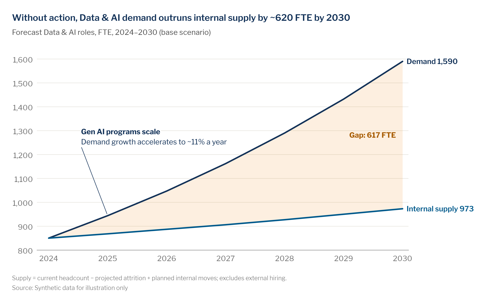

# Line chart

> **Question type:** Change over time
> **Use for:** the trajectory of one or a few measures over evenly spaced periods, including forecasts and scenarios · **Avoid when:** there are only 2 time points (→ use a [slope chart](slope-bump.md)) or the story is the composition of a total (→ use a [stacked area chart](stacked-area.md))



## When to use
- The **trend** matters more than any single period's value: attrition trajectories, hiring velocity, supply vs. demand forecasts.
- You need to show **when** something changed and tie it to an event (reorg, pay reset, system go-live) with a shaded period.
- You're comparing **one focus series against context**, e.g. one job family against the rest, or McKesson against an external benchmark.
- You're extending actuals into a **forecast or scenario range** (SWP base / low / high).
- Time scales can be very short (daily hiring funnel) or long (decade-long workforce shifts), as long as the intervals are even.

## When not to use
- Only two periods, or the story is "who moved up or down" → use a [slope or bump chart](slope-bump.md).
- The story is how a total splits into parts over time → use a [stacked area chart](stacked-area.md). Don't use stacked columns for trends: you can't compare segment growth across bars.
- More than about 4 series that all need to be read → use [small multiples](small-multiples.md) with a shared scale.
- A few discrete periods where the amount is the point (FY24, FY25, FY26 headcount) → use a [column chart](bar.md).
- Two measures with different units → don't use a [dual axis](dual-axis.md). Index both to 100 or use two aligned charts.

## McKesson spec

| Element | Rule |
|---|---|
| Color | Grey everything, then color what the headline names. Focus series: `chart.focus` `#005A8C`. Context series: `chart.context` `#B4B0A5`. At most one secondary highlight in `chart.accent` navy `#143359` (`limits.highlighted_series` = 2). Never orange as a highlight; shade a shortfall or gap in `semantic.negative` `#EF8200` at low opacity. Use `chart.total` `#143359` for benchmark, target or enterprise lines (thin, dashed). Shade periods with `surface.subtle` `#EFEDE7`. Draw forecast bands in the series color at ~15% opacity. If every series must be identified (≤ 4), use the categorical order `#005A8C`, `#00AF9D`, `#143359`, `#009EFF` and label every line, because teal and bright blue are below 3:1 contrast as thin lines. |
| Labels | Label series directly at the line ends instead of using a legend. Stack the labels vertically in end-value order and nudge them apart so they don't collide. The focus label is bold, in the series color. Context labels use `text.muted` `#737373`, because grey `#B4B0A5` text fails 4.5:1 contrast. Show the end value next to the focus label. Label forecasts as "base (low–high)". |
| Axes / gridlines | Light horizontal gridlines `chart.grid` `#E6E4DE` at 0.75 px, no y-axis line, and a baseline in `chart.axis` `#8C8C8C`. No vertical gridlines. The y-axis may start above zero, but then **never fill under the line**. Time ticks are evenly spaced, with the year on the first tick and at each year change (`Q1 '25`, `Q2`, `Q3`, `Q4`, `Q1 '26`). Units go in the subtitle. |
| Sort / order | Time runs left to right at even intervals. Show missing periods as gaps; don't interpolate across them. End labels follow end values top to bottom. If a key is unavoidable (mobile), list it in the same order as the line ends. |
| Proportions | Line weight comes from `chart.line`: focus 2.25 pt on slides (`width_pt`) or 2 px on screens (`width_px`), context 1.25 px (`context_width_px`). That's about 2× the gridline weight. Use straight segments with no smoothing and no markers, except a dot on a labelled point. Keep about 15% of the plot width on the right for end labels. Use 16:9 for a full slide and 4:3 for a half slide. |
| Limits | ≤ 4 colored lines (`limits.lines_before_greying`). Beyond that, grey them out or split into small multiples. ≤ 2 highlighted. At least ~5 time points. Mark the actual/forecast boundary, draw forecasts dashed with a band, and footnote the scenarios. Suppress any series with n < 10. |

## Do / don't

| Do | Don't |
|---|---|
| Push background series to grey and give the message series the one highlight color | Give ~10 series their own hues. The rainbow tangle hides every trend |
| Use a line when the trend matters more than the period amounts | Use stacked columns to show growth over time |
| Leave the area under a line empty when the y-axis doesn't start at zero | Fill under a line on a truncated axis. That turns it into an area chart that implies the wrong magnitude |
| Stack series labels vertically beside the line ends | Put a horizontal legend above the plot that makes the reader bounce between key and lines |
| Shade the period that carries the insight and add a short bold callout (2–5 words + 1 line of why) | Annotate every bump, or explain the event only in the speaker notes |
| Draw the forecast dashed from the last actual point, with a low–high band and a "Forecast" marker | Draw forecasts with the same solid line as actuals, or show a single-number forecast with no range |
| On mobile, keep one highlighted line, move the end labels into a compact key on top and put the callout above the plot | Shrink the desktop chart to fit a phone |
| On live slides, highlight one series and build up in steps: context first, then the focus line, then the forecast | Show a multi-line chart with 7 colored series and dense text beside it |

## Workforce examples
- **Headline:** "Without action, Data & AI demand outruns internal supply by ~620 FTE by 2030" — *Subtitle:* "Forecast Data & AI roles, FTE, 2024–2030 (base scenario)" — data: firm-level SWP model, `examples/data/data_ai_supply_demand.csv` (internal supply = headcount − projected attrition + planned moves).
- **Headline:** "Pharmacy Technician attrition fell ~9 points after the pay and scheduling reset; base case nears 20% by end of 2027" — *Subtitle:* "Voluntary attrition by job family, annualized, Q1 2024–Q4 2026 actual, 2027 forecast (%)" — data: team/job-family level, Workday HCM terminations ÷ average headcount, plus the SWP attrition model's low/base/high scenarios (snippet below).
- **Headline:** "Our share of postings asking for gen AI skills caught up with the healthcare sector in 2026 after lagging by a year" — *Subtitle:* "Share of job postings mentioning gen AI skills, McKesson vs. U.S. healthcare and life sciences, monthly, Jan 2024–Dec 2026 (%)" — data: sector-level external job-postings feed vs. McKesson requisitions (internal + external signal; McKesson line in focus blue, sector in navy `chart.total`).

## Build it

### Python — matplotlib + `mckviz`
`mv.line` draws the spec in one call: grey context and the headline's series in blue (one navy accent at most), labels at the line ends in end-value order instead of a legend, light horizontal gridlines, and room for the labels inside the plot. It also takes a target line, a shaded event and a dashed forecast with a scenario band. With no focus, two to four series each get a categorical color; more than four need a focus or [small multiples](small-multiples.md).

```python
# verified runnable (from the repo root)
import matplotlib

matplotlib.use("Agg")
import matplotlib.pyplot as plt
import numpy as np

import mckviz as mv

mv.use()
NA = np.nan
# Voluntary attrition, annualized %, Q1 2024 - Q4 2026 (12 actual quarters) + 4 forecast quarters (NaN = no actual)
attrition = {
    "Pharmacy Technician": [29.8, 30.5, 31.2, 30.9, 30.1, 29.4, 26.0, 23.2, 22.1, 21.4, 21.0, 20.6,
                            20.3, 20.0, 19.8, 19.6],                     # the last four are the base-case forecast
    "DC Associate":        [25.1, 25.6, 25.9, 25.2, 24.8, 24.6, 24.3, 24.4, 24.0, 24.2, 24.1, 23.9] + [NA] * 4,
    "Customer Care":       [18.6, 18.9, 18.3, 18.1, 18.4, 18.0, 18.2, 18.5, 18.0, 18.1, 18.2, 17.9] + [NA] * 4,
    "Specialty Nursing":   [15.0, 14.8, 14.6, 14.9, 14.4, 14.1, 14.3, 14.0, 14.2, 14.1, 14.2, 14.2] + [NA] * 4,
    "Software Engineering": [12.5, 12.0, 11.4, 10.9, 10.5, 10.2, 10.0, 9.9, 9.8, 9.7, 9.9, 9.8] + [NA] * 4,
}
low = [NA] * 11 + [20.6, 19.6, 18.9, 18.3, 17.8]                         # scenario band, from the last actual
high = [NA] * 11 + [20.6, 21.0, 21.2, 21.4, 21.6]
quarters = [f"Q{q % 4 + 1}" + (f" '{24 + q // 4}" if q % 4 == 0 else "") for q in range(16)]
focus = "Pharmacy Technician"
drop = max(attrition[focus][:6]) - attrition[focus][11]                   # the headline's number, from the data

fig, ax = plt.subplots(figsize=(10, 5.6))
# Quarter labels repeat ("Q3" every year), so periods are 0-based positions: 6-7 = Q3-Q4 2025, 11 = Q4 2026.
mv.line(ax, quarters, attrition, focus={focus}, event=(6, 7, "Pay-band reset + self-scheduling"),
        forecast_from=11, band={focus: (low, high)}, target=20, target_label="Target 20%")
mv.titles(fig, f"Pharmacy Technician attrition fell about {drop:.0f} points after the pay and scheduling reset; "
               "the base case reaches the 20% target in 2027",
          "Voluntary attrition by job family, annualized, Q1 2024–Q4 2026 actual, 2027 forecast (%)")
mv.source(fig, "Source: Synthetic data for illustration only",
          footnote="Forecast band = low/high scenarios from the SWP attrition model; dashed line = base case.")
mv.lint(fig, strict=True)
mv.save(fig, "out/line.png", dpi=200)
```
`mv.line` returns the lines (`.lines[name]`) for a callout with `mv.callout`. The [gallery `line_gap()`](../../examples/python/gallery_matplotlib.py) shows a supply/demand gap with a callout.

### Python — Plotly / HTML
```python
# verified: builds without error
import plotly.graph_objects as go

import mckviz as mv

mv.use()                                                  # registers + activates the "mck" Plotly template
C = mv.colors
actual = {
    "Pharmacy Technician": [29.8, 30.5, 31.2, 30.9, 30.1, 29.4, 26.0, 23.2, 22.1, 21.4, 21.0, 20.6],
    "DC Associate":        [25.1, 25.6, 25.9, 25.2, 24.8, 24.6, 24.3, 24.4, 24.0, 24.2, 24.1, 23.9],
    "Customer Care":       [18.6, 18.9, 18.3, 18.1, 18.4, 18.0, 18.2, 18.5, 18.0, 18.1, 18.2, 17.9],
    "Specialty Nursing":   [15.0, 14.8, 14.6, 14.9, 14.4, 14.1, 14.3, 14.0, 14.2, 14.1, 14.2, 14.2],
}
focus = "Pharmacy Technician"
base, low, high = [20.6, 20.3, 20.0, 19.8, 19.6], [20.6, 19.6, 18.9, 18.3, 17.8], [20.6, 21.0, 21.2, 21.4, 21.6]
# x values must be unique per period ("Q2 '25"), never the abbreviated tick text: on a category axis every "Q2"
# would land on the same position and the lines would fold back on themselves. Abbreviate in ticktext instead.
periods = [f"Q{q % 4 + 1} '{24 + q // 4}" for q in range(16)]
ticks = [p if q % 4 == 0 else p.split()[0] for q, p in enumerate(periods)]   # year on the first tick of each year
x_act, x_fc = periods[:12], periods[11:]              # forecast starts at the last actual point

fig = go.Figure()
fig.add_vrect(x0=5.5, x1=7.5, fillcolor=C.surface_subtle, line_width=0, layer="below",   # category positions
              annotation_text="<b>Pay-band reset + self-scheduling</b>", annotation_position="top left")
fig.add_vline(x=11, line={"color": C.axis, "width": 0.75, "dash": "dot"}, annotation_text="Forecast",
              annotation_position="top right", annotation_font={"color": C.text_muted, "size": 11})
for name, y in actual.items():
    if name != focus:
        fig.add_scatter(x=x_act, y=y, name=name, mode="lines", line={"color": C.context, "width": 1.25},
                        hovertemplate="%{y:.1f}%<extra>" + name + "</extra>")
        fig.add_annotation(x=x_act[-1], y=y[-1], text=name, xanchor="left", xshift=6, showarrow=False,
                           font={"color": C.text_muted, "size": 12})
fig.add_scatter(x=x_fc + x_fc[::-1], y=high + low[::-1], fill="toself", fillcolor=mv.rgba(C.focus, 0.15),
                mode="lines", line_width=0, hoverinfo="skip", showlegend=False)   # mode: no vertex markers
fig.add_scatter(x=x_fc, y=base, mode="lines", line={"color": C.focus, "width": 2, "dash": "dash"},
                customdata=list(zip(low, high)), hovertemplate="Base %{y:.1f}% (%{customdata[0]}\u2013%{customdata[1]})<extra>Forecast</extra>")
fig.add_scatter(x=x_act, y=actual[focus], mode="lines", line={"color": C.focus, "width": 3},
                hovertemplate="%{y:.1f}%<extra>" + focus + "</extra>")
fig.add_annotation(x=x_fc[-1], y=base[-1], text=f"<b>{focus}</b><br>{base[-1]:.1f} base ({low[-1]}\u2013{high[-1]})",
                   xanchor="left", xshift=6, showarrow=False, align="left", font={"color": C.focus, "size": 13})
fig.update_layout(showlegend=False, hovermode="x unified", margin={"r": 170})
fig.update_xaxes(type="category", categoryorder="array", categoryarray=periods, tickvals=periods, ticktext=ticks)
fig.update_yaxes(range=[5, 34])
mv.pl_finish(fig, "Pharmacy Technician attrition fell ~9 points after the pay and scheduling reset",
             "Voluntary attrition by job family, annualized, Q1 2024\u2013Q4 2026 actual, 2027 forecast (%)",
             source_text="Source: Workday HCM, as of 31 Dec 2026; U.S. regular employees",
             footnote="Band = low/high SWP scenarios; dashed = base case.")
fig.show()
```
For pages, use the chart-card pattern in [`gallery_plotly.py`](../../examples/python/gallery_plotly.py): the headline, subtitle and source go in HTML and Plotly draws only the data. `hovermode="x unified"` gives cursor tracking across series. On mobile, swap the end-label annotations for a one-row key on top.

### Excel and PowerPoint
1. **Theme (once per machine):** copy `dist/office/Theme Colors/McKesson Data Viz.xml` to `%APPDATA%\Microsoft\Templates\Document Themes\Theme Colors\` and `dist/office/Theme Fonts/McKesson Data Viz.xml` to `...\Document Themes\Theme Fonts\`. Install Libre Franklin from `fonts/LibreFranklin`.
2. Apply it in **Excel** with **Page Layout → Colors → McKesson Data Viz** and **Page Layout → Fonts → McKesson Data Viz**. In **PowerPoint**, use **Design → Variants ▾ → Colors / Fonts → McKesson Data Viz**. Accent 1 = `#005A8C`, Accent 2 = `#143359`, Accent 3 = `#009EFF`; light blue `#66C4FF` via **More Colors › Hex**.
3. Put periods in the first column and one series per column, then select the range and click **Insert → Insert Line or Area Chart → 2-D Line → Line**.
4. Delete the chart title (the headline goes in the slide title) and click the legend → **Delete**.
5. For each context series, click the line → **Ctrl+1** → **Fill & Line → Line → Solid line → Color → More Colors → Hex `B4B0A5`**, **Width 1 pt**. Press **F4** on the next series to repeat the format.
6. For the focus series, set **Color = Accent 1 (`#005A8C`)** and **Width 2.25 pt**. For every series, set **Marker → Marker Options → None**.
7. To add end labels, click a series, then click its **last point** so only that point is selected. Right-click → **Add Data Label** → right-click the label → **Format Data Labels → Label Options →** check **Series Name** (plus **Value** for the focus line) and uncheck the rest; **Label Position: Right**. Set the font to Libre Franklin 12 pt in the series color (bold for the focus line, `#737373` for context lines).
8. Axes: on the vertical axis, set **Format Axis → Line: No line**. Select the major gridlines and set **Solid line `#E6E4DE`, 0.75 pt**. On the horizontal axis, set **Line `#8C8C8C` 0.75 pt** and **Tick Marks → Major type: None**. Drag the plot area's right edge in to leave room for the labels.
9. **Shaded period:** add a helper column equal to the axis maximum in the shaded periods and blank elsewhere. Then **Change Chart Type → Combo →** set the helper to **Clustered Column**, **Gap Width 0%**, fill `#EFEDE7`, no border. In **Select Data**, move it to the top so it draws behind. In PowerPoint, you can instead set **Format Chart Area → Fill: No fill** and put a `#EFEDE7` rectangle behind the chart (**Arrange → Send to Back**).
10. **Forecast:** put the forecast in its own column, starting at the last actual row so the lines connect, and set **Dash type: Dash**. For the band, add `Low` and `High − Low` columns → **Combo → Stacked Area**. Set `Low` = **No fill** and the band = Accent 1 at **85% transparency**. Label the boundary "Forecast".
11. Paste into PowerPoint with **Home → Paste ▾ → Use Destination Theme & Embed Workbook** so the chart stays editable. Set the headline in the title placeholder (Libre Franklin Bold 26 pt McKesson Blue `#005A8C`), the subtitle at 14 pt `#505050`, and the footnote and source at 9 pt Libre Franklin Light `#737373`, bottom-left.

### Power BI
- Apply the theme: **View → Themes → Browse for themes →** `dist/powerbi/mckesson-dataviz-theme.json`.
- In a **line chart**, set X = Date (continuous), Y = measure and Legend = job family. In **Format → Lines**, use the series selector to set context series to `#B4B0A5` at width 1–2 and the focus series to `#005A8C` at width 3. Turn **Markers** off and **Legend** off, and turn on **Series labels** to label the line ends.
- In the **Analytics pane**, add a **Constant line** (`#143359`, dashed) for targets or the enterprise rate. Use an **X-axis constant line → Shade area** to mark a period. The built-in **Forecast** only works with no Legend field and a continuous date axis. For SWP scenarios, model low/base/high as measures and show them as **Error bars → Shaded area** around the base line.
- Use a dynamic DAX title as the insight headline and suppress small groups: `Attrition % (safe) = IF([Headcount] < 10, BLANK(), [Attrition %])`.

### R — ggplot2 (optional)
```r
library(ggplot2); library(dplyr)
source("dist/r/theme_mck.R")

# Synthetic data for illustration (replace with yours): annualized attrition by job family, Q1 2024 (1) to Q4 2026 (12)
df <- expand.grid(quarter = 1:12, job_family = c("Pharmacy Technician", "Distribution Center Associate",
                                                 "Customer Care", "Software Engineering"), stringsAsFactors = FALSE) |>
  mutate(attrition = case_when(
    job_family == "Pharmacy Technician" ~ 29 - 3 * pmax(0, pmin(quarter, 9) - 6),   # reset in Q3 2025: 29% -> 20%
    job_family == "Distribution Center Associate" ~ 24 + sin(quarter / 2),
    job_family == "Customer Care" ~ 19 - 0.1 * quarter,
    TRUE ~ 10 + 0.5 * cos(quarter / 3)))

focus <- "Pharmacy Technician"
ends  <- df |> group_by(job_family) |> filter(quarter == max(quarter))
ggplot(df, aes(quarter, attrition, group = job_family, colour = job_family)) +
  annotate("rect", xmin = 5.5, xmax = 7.5, ymin = -Inf, ymax = Inf, fill = "#EFEDE7") +
  geom_line(aes(linewidth = job_family == focus)) +
  geom_text(data = ends, aes(label = job_family), hjust = 0, nudge_x = 0.15, size = 3.5) +
  scale_colour_manual(values = mck_highlight(unique(df$job_family), focus = focus), guide = "none") +
  scale_linewidth_manual(values = c(`FALSE` = 0.45, `TRUE` = 1.05), guide = "none") +   # ~1 pt / 2.25 pt
  scale_x_continuous(breaks = c(1, 5, 9), labels = c("Q1 '24", "Q1 '25", "Q1 '26")) +   # quarters as labels, not 1-12
  coord_cartesian(clip = "off") +
  theme_mck() + theme(plot.margin = margin(16, 140, 16, 16)) +
  labs(x = NULL, y = NULL,
       title = "Pharmacy Technician attrition fell ~9 points after the pay and scheduling reset",
       subtitle = "Voluntary attrition by job family, annualized, Q1 2024–Q4 2026 (%)",
       caption = "Source: Workday HCM, as of 31 Dec 2026; U.S. regular employees")
```

## QA specifics
- [ ] No more than 4 colored lines. All other lines are `#B4B0A5`, and the 1–2 highlighted series are exactly the ones the headline names.
- [ ] Every line is labelled at its end (or by a compact top key on mobile), with no colliding labels and no legend. Context labels use `#737373`, not grey `#B4B0A5`.
- [ ] The focus line is 2.25 pt (slides) or 2 px (screen) and context lines are ≤ 1.25 px. No markers and no smoothing.
- [ ] No fill under a line unless the y-axis starts at 0. Periods are evenly spaced and missing data shows as a gap.
- [ ] Every period has its own x value (a date, an index, or a unique label such as `Q2 '25`); the abbreviated `Q2` goes in the tick text only. A line that doubles back on itself means repeated labels were used as x (`mv.lint` flags this as `x-repeats`).
- [ ] Forecasts are dashed, start from the last actual, show a low–high band and a "Forecast" boundary, and the scenarios are defined in the footnote.
- [ ] Each shaded period carries a label, and its start and end match the event dates in the callout.

## Inspiration
- [p043 — Line chart](../../reference/inspiration-mckinsey/pages/p043-line-chart.md)
- [p044 — Line chart best practice](../../reference/inspiration-mckinsey/pages/p044-line-chart-best-practice.md)
- [p069 — Screen sizes](../../reference/inspiration-mckinsey/pages/p069-screen-sizes.md)
- [p070 — Screen sizes](../../reference/inspiration-mckinsey/pages/p070-screen-sizes.md)
- [p083 — Presentations](../../reference/inspiration-mckinsey/pages/p083-presentations.md)
