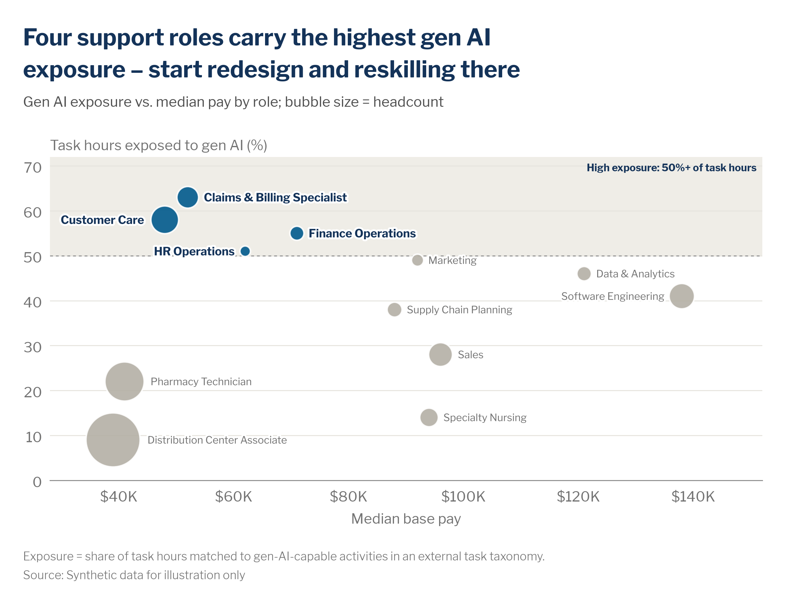

# Scatter and bubble scatterplots

> **Question type:** Correlation
> **Use for:** showing how two measures relate across many entities (roles, teams, sites, metros), with an optional third measure as bubble area · **Avoid when:** the story is one measure ranked or tracked over time → use a [bar](bar.md) or [line](line.md) chart



## When to use
- The question is **"does X go with Y?"** or **"which entities sit in the zone that matters?"** Examples: gen AI exposure vs. pay by role, engagement vs. span of control by team, time-to-fill vs. labor-market tightness by metro.
- Each entity is **one mark**. X and Y carry two measures, and **bubble area** can carry a third (headcount, open requisitions, labor cost). Use a plain scatter (equal-sized dots) when there is no meaningful size measure.
- You want to call out a **zone or quadrant** (high exposure, high risk and high value, tight market and slow fills) and name only the few entities inside it.
- **Individual-level** scatters (compa-ratio vs. performance rating, tenure vs. pay) work as unlabelled dots for analysis and pay-equity reviews. Show the pattern, never names, and aggregate any tooltip detail.
- **Interactive** versions suit exploration: the static view labels the focus points, and tooltips give the exact values for everything else.

## When not to use
- One measure, ranked across categories → use a [bar chart](bar.md). One measure over time → use a [line chart](line.md).
- Bubbles only show size, with no meaningful X/Y position → use a [proportional bubble chart](bubble-chart.md). Bubbles placed over time → use a [bubble timeline](bubble-timeline.md).
- Two measures for **one** entity over time → use a connected scatter or aligned panels (see [dual-axis](dual-axis.md)), not a cloud of dots.
- Hundreds or thousands of overlapping points → bin them into a [heatmap](heatmap.md), or split by group into [small multiples](small-multiples.md).
- Four or more measures per entity → use [parallel coordinates](parallel-coordinates.md) or a [table](tables.md) with conditional formatting.
- The X variable is a category (job family, business unit) → use a [dot plot](dot-plot-dumbbell.md).

## McKesson spec

| Element | Rule |
|---|---|
| Color | Grey everything, then color the entities the headline names. Context marks: `chart.context` `#B4B0A5`. Focus marks: `chart.focus` `#005A8C`. One exception may use `chart.accent` `#EF8200`. Shade a highlight zone or quadrant in `surface.subtle` `#EFEDE7`, behind the marks. Draw reference lines (average, target, a "1.0 = balanced" line) in `chart.total` `#143359`, dashed, 0.75 pt. Use categorical colors (`#005A8C`, `#EF8200`, `#00AF9D`, `#143359`) only when color **encodes a real variable** (e.g., business unit), with ≤ 4 groups and a key. Never color by position or range. Give bubbles ~90% opacity and a 1 px white outline so overlaps stay readable. |
| Labels | Label **only the focus points** (≤ 5), in bold Navy `#143359`, placed beside the bubble with a white halo. Name everything else in tooltips, not on the chart. Label zones in place with a bold navy title (e.g., "High exposure: 50%+ of task hours"). Label reference lines at their right end ("Workforce average 27%"). Bubble charts get a **size key** with 2–3 round values (1,000 / 5,000 / 10,000), placed top-right above the plot or in an empty corner. Name the size measure in the subtitle ("bubble area = headcount"). |
| Axes / gridlines | Both axes carry units. X = the driver or context measure, Y = the outcome. The Y-axis title sits horizontally at the top-left, never rotated. Use light gridlines in `chart.grid` `#E6E4DE` (both directions are fine) and a baseline in `chart.axis` `#8C8C8C`. Axes need not start at zero, but say so when a cut-off is part of the population filter. Use a **log scale** when an axis spans more than ~2 orders of magnitude (team size 5–5,000; postings per candidate 0.2–8). Tick at readable values (1, 2, 5, 10 or doubling), and write "(log scale)" in the axis title. Never log-scale bubble size. |
| Sort / order | Draw the **largest bubbles first**, so small bubbles sit on top and stay visible. When color encodes a group, keep the key in the same order as the categorical palette, and keep each group's color constant across the deck. Name quadrants the same way every time they appear (e.g., "Reskill first" top-left). |
| Proportions | **Area ∝ value**, never diameter: matplotlib `s = value × k`, Plotly `sizemode="area"`, ggplot2 `scale_size_area()`, Excel **Size represents: Area of bubbles**. The smallest bubble must be ≥ ~6 px across. A plain scatter uses `chart.marker.size_px` = 6 px. Use the same size scale across charts that are compared. Keep the plot close to square when both axes share a unit, otherwise 16:9 (full slide) or 4:3 (half slide). |
| Limits | ≤ 2 highlighted groups, ≤ 5 labelled points and ≤ 2 trend lines (one per highlighted group). Static bubble charts: ≤ ~50 bubbles (bin or facet beyond that). Suppress any entity with **n < 10** people, on the chart and in tooltips. Write correlation as association ("is associated with", "goes with"), not cause. |

## Do / don't

| Do | Don't |
|---|---|
| Shade the zone that carries the insight and name only the bubbles inside it | Label all 40 bubbles and bury the story in text |
| Scale bubble **area** to the value and add a 2–3 step size key | Scale the diameter, so a 4× value looks 16× bigger, or leave readers to guess what size means |
| Use grey for context and blue for the headline entities | Color by quadrant or x-range "for interest" when color carries no variable |
| Use color for a real grouping (≤ 4 business units) with a key | Draw 4+ colored trend lines that cross and tangle |
| Switch to a log axis when values span orders of magnitude, and say so on the axis | Squash 90% of the points into one corner because one outlier sets the linear range |
| Put exact values in tooltips on interactive charts | Animate a play axis in a report: readers can't compare frames they can't see |
| Draw large bubbles first with white outlines | Let a big bubble hide the small one the headline is about |
| Write "is associated with" and footnote the method | Claim causation from a scatter |

## Workforce examples
- **Role level, internal + external taxonomy (SWP / gen AI):** *Headline:* "Four support roles carry the highest gen AI exposure – start redesign and reskilling there". *Subtitle:* "Share of task hours exposed to gen AI vs. median base pay, by role, 2026; bubble area = headcount". *Data:* [`examples/data/automation_exposure.csv`](../../examples/data/automation_exposure.csv). Task inventory mapped to an external gen AI task taxonomy, plus HRIS pay and headcount. Zone = 50%+ exposure, with the headcount-weighted workforce average as a reference line (snippet below).
- **Team level, internal (manager effectiveness):** *Headline:* "Nine of the 12 lowest-engagement distribution-center teams have managers with spans above 1:20". *Subtitle:* "Engagement index vs. manager span of control, distribution-center teams, 2026 engagement survey (index 0–100; direct reports); bubble area = team size". *Data:* survey results joined to the HRIS position hierarchy. Shade the "span > 20 and engagement < 65" quadrant, color its teams `#005A8C`, and suppress teams with fewer than 10 respondents.
- **Metro / sector level, external + internal (talent markets):** *Headline:* "Where pharmacy-technician candidates are scarcest, our requisitions take twice as long to fill". *Subtitle:* "Days to fill vs. external job postings per available candidate (log scale), pharmacy technicians, top 25 McKesson hiring metros, H1 2026; bubble area = open requisitions". *Data:* external job-postings and candidate-profile feed for X, ATS for Y and size. Use a log X axis (0.4–6), a dashed navy line at 1.0 labelled "Balanced market", and the three slowest tight-market metros in focus blue.

## Build it

### Python — matplotlib + `mckviz`
```python
# verified runnable (from the repo root)
import tempfile
from pathlib import Path

import matplotlib
matplotlib.use("Agg")
import matplotlib.pyplot as plt
import pandas as pd
from matplotlib.ticker import StrMethodFormatter

import mckviz as mv

mv.use()
C = mv.colors

df = pd.read_csv(Path("examples/data/automation_exposure.csv"))
df = df[df.headcount >= 10].sort_values("headcount", ascending=False)    # n >= 10; big bubbles drawn first
focus = set(df.role[df.genai_exposure_pct >= 50])
avg = (df.genai_exposure_pct * df.headcount).sum() / df.headcount.sum()  # headcount-weighted
K = 1800 / df.headcount.max()                                            # marker area (pt^2) per person -> area ∝ value

fig, ax = plt.subplots(figsize=(10, 5.8))
ax.axhspan(50, 72, color=C.surface_subtle, lw=0, zorder=0)               # highlight zone
ax.text(151, 70.5, "High exposure: 50%+ of task hours", ha="right", va="top", fontsize=9, fontweight="bold",
        color=C.annotation)
ax.axhline(avg, color=C.total, lw=0.75, ls=(0, (3, 3)), zorder=1)        # labelled reference line
ax.text(151, avg + 1, f"Workforce average {avg:.0f}%", ha="right", va="bottom", fontsize=9, color=C.annotation)
ax.scatter(df.median_pay_k, df.genai_exposure_pct, s=df.headcount * K, c=mv.highlight(df.role, focus=focus),
           alpha=0.9, edgecolors="white", linewidths=1, zorder=2)

label_left = {"Customer Care", "HR Operations"}                          # only the focus points get labels
for r in df[df.role.isin(focus)].itertuples():
    pad = (r.headcount * K) ** 0.5 / 2 + 3
    left = r.role in label_left
    ax.annotate(r.role, (r.median_pay_k, r.genai_exposure_pct), xytext=(-pad if left else pad, 0),
                textcoords="offset points", ha="right" if left else "left", va="center", fontsize=10,
                fontweight="bold", color=C.headline, path_effects=mv.halo(), zorder=3)

key = {1_000: 119, 5_000: 130, 10_000: 144}                            # size key on the same scale, empty corner
ax.text(115, 21, "Headcount (bubble area)", fontsize=9, color=C.text_muted)
for v, x in key.items():
    ax.scatter(x, 10, s=v * K, color=C.context_light, edgecolors=C.axis, linewidths=0.75, zorder=2)
    ax.annotate(f"{v:,}", (x, 10), xytext=(0, -((v * K) ** 0.5 / 2 + 2)), textcoords="offset points",
                ha="center", va="top", fontsize=9, color=C.text_muted)

ax.set_xlim(28, 152)
ax.set_ylim(0, 72)
ax.xaxis.set_major_formatter(StrMethodFormatter("${x:,.0f}K"))
ax.yaxis.set_major_formatter(StrMethodFormatter("{x:.0f}%"))
ax.set_xlabel("Median base pay")
ax.set_ylabel("Task hours exposed to gen AI", rotation=0, ha="left", va="bottom")
ax.yaxis.set_label_coords(0, 1.03)
mv.clean_axes(ax, keep=("bottom",), grid="both")

mv.titles(fig, "Four support roles carry the highest gen AI exposure \u2013 start redesign and reskilling there",
          "Share of task hours exposed to gen AI vs. median base pay, by role, 2026; bubble area = headcount")
mv.source(fig, "Source: Synthetic data for illustration only",
          footnote="Exposure = share of task hours matched to gen-AI-capable activities in an external task taxonomy. "
                   "Average weighted by headcount.")
mv.save(fig, Path(tempfile.gettempdir()) / "ck_scatdual_scatter-bubble.png", dpi=200)
```
For a log axis, add `ax.set_xscale("log")` and `ax.xaxis.set_major_formatter(StrMethodFormatter("{x:g}"))`, with ticks at readable values (`ax.set_xticks([0.5, 1, 2, 4])`). For a plain scatter, drop `s=` (the default marker is 6 px) and the size key. For quadrants, draw one `axvline` and one `axhline` in `C.total` at the thresholds and shade only the quadrant the headline names.

### Python — Plotly / HTML
```python
# verified: builds without error
import tempfile
from pathlib import Path

import pandas as pd
import plotly.graph_objects as go

import mckviz as mv

mv.use()  # registers + activates the "mck" Plotly template
C = mv.colors

df = pd.read_csv(Path("examples/data/automation_exposure.csv"))
df = df[df.headcount >= 10].sort_values("headcount", ascending=False)
focus = df.genai_exposure_pct >= 50
avg = (df.genai_exposure_pct * df.headcount).sum() / df.headcount.sum()
marker = {"sizemode": "area", "sizeref": 2 * df.headcount.max() / 56 ** 2,   # largest bubble ~56 px across
          "line": {"color": "white", "width": 1}, "opacity": 0.9}

fig = go.Figure(go.Scatter(
    x=df.median_pay_k, y=df.genai_exposure_pct, mode="markers+text",
    text=[f"<b>{r}</b>" if f else "" for r, f in zip(df.role, focus)], textposition="middle right",
    textfont={"color": C.headline, "size": 12},
    marker={**marker, "size": df.headcount, "color": mv.pl_highlight(df.role, focus=df.role[focus])},
    customdata=df[["role", "headcount"]],
    hovertemplate="<b>%{customdata[0]}</b><br>%{y}% of task hours exposed<br>$%{x}K median pay"
                  "<br>%{customdata[1]:,} people<extra></extra>"))
fig.add_hrect(y0=50, y1=75, fillcolor=C.surface_subtle, line_width=0, layer="below")
fig.add_annotation(x=1, xref="paper", y=74, yanchor="top", xanchor="right", showarrow=False,
                   text="<b>High exposure: 50%+ of task hours</b>", font={"size": 12, "color": C.annotation})
fig.add_hline(y=avg, line={"color": C.total, "width": 1, "dash": "dash"},
              annotation_text=f"Workforce average {avg:.0f}%", annotation_position="top right")

keys = [1_000, 5_000, 10_000]                                     # size key: same sizeref, so it's honest
fig.add_scatter(x=[116, 128, 143], y=[12] * 3, mode="markers+text", text=[f"{k:,}" for k in keys],
                textposition="bottom center", textfont={"size": 11, "color": C.text_muted},
                marker={**marker, "size": keys, "color": C.context_light, "line": {"color": C.axis, "width": 1}},
                hoverinfo="skip")
fig.add_annotation(x=114, y=22, xanchor="left", showarrow=False, text="Headcount (bubble area)",
                   font={"size": 11, "color": C.text_muted})

fig.update_layout(showlegend=False)
fig.update_xaxes(title="Median base pay", range=[28, 155], tickprefix="$", ticksuffix="K", showgrid=True)
fig.update_yaxes(title="", range=[0, 75], ticksuffix="%")
mv.pl_finish(fig, "Four support roles carry the highest gen AI exposure \u2013 start redesign and reskilling there",
             "Share of task hours exposed to gen AI vs. median base pay, by role, 2026; bubble area = headcount. "
             "Hover for detail.",
             source_text="Source: Synthetic data for illustration only",
             footnote="Exposure = share of task hours matched to gen-AI-capable activities in an external task taxonomy.")
fig.write_html(Path(tempfile.gettempdir()) / "ck_scatdual_scatter-bubble.html", include_plotlyjs="cdn")
```
Tooltips carry the detail that labels leave out: entity, X, Y and size, each with its unit. Never put names of individuals or groups with n < 10 in a tooltip. For a log axis, use `fig.update_xaxes(type="log", tickvals=[0.5, 1, 2, 4])`. For HTML pages, use the chart-card pattern in [`gallery_plotly.py`](../../examples/python/gallery_plotly.py). Only add filters or a time slider when they answer a stated question. A play-axis animation is for a live, narrated demo, not a report.

### Excel and PowerPoint
1. Install the theme once. Copy `dist/office/Theme Colors/McKesson Data Viz.xml` to `%APPDATA%\Microsoft\Templates\Document Themes\Theme Colors\` and `dist/office/Theme Fonts/McKesson Data Viz.xml` to `...\Theme Fonts\`. Install Libre Franklin from `fonts/LibreFranklin`. Then apply **Page Layout › Colors › McKesson Data Viz** and **Fonts › McKesson Data Viz** (in PowerPoint: **Design › Variants › Colors / Fonts**).
2. Lay out the data as Role | X (median pay) | Y (exposure %) | Size (headcount). Split it into **two series**, Focus and Context, by giving each its own X/Y/Size columns. Colors then survive a data refresh.
3. Select the numeric columns and click **Insert › Charts › Insert Scatter (X, Y) or Bubble Chart › Bubble** (2-D, never 3-D). For a plain scatter, choose **Scatter** instead. Check **Chart Design › Select Data › Edit** for each series: *Series X values*, *Series Y values*, *Series bubble size*.
4. Right-click a bubble › **Format Data Series › Series Options**: set **Size represents: Area of bubbles** and **Scale bubble size to** ~50 (the default 100 usually crowds the plot). Keep the same value on every chart you compare. Leave **Show negative bubbles** off.
5. Context series: **Fill › Solid fill › Hex B4B0A5**, **Transparency 10%**, **Border › Solid line, White, 0.75 pt**. Focus series: the same, with **Hex 005A8C**. Uncheck **Vary colors by point**.
6. Labels go on the focus series only. **Chart Elements (+) › Data Labels › More Options › Label Contains › Value From Cells**, then select the role names and uncheck **Y Value**. Set **Label Position: Right** and the font to Libre Franklin Bold 10–12 pt, Navy `#143359`. The context series gets no labels.
7. Axes: **Format Axis › Bounds** fixes the minimum and maximum (so shapes and zones stay put). Set **Number › Custom** to `"$"0"K"` or `0"%"`, and gridlines to **Solid line `#E6E4DE` 0.75 pt** (add **Primary Major Vertical** if useful). Add **Axis Titles**, set the Y title's **Text direction: Horizontal** and drag it to the top-left of the axis.
8. Log scale: **Format Axis › Axis Options › Logarithmic scale**, Base 10 (or 2 for doubling ticks). Add "(log scale)" to the axis title.
9. Reference line: Excel won't combine a bubble chart with other chart types. Add an "Average" series with one point at (axis minimum, average) and a tiny bubble size, and set **Fill: No fill**. Then add **Chart Elements › Error Bars › More Options**: delete the Y error bars, and set the X error bars to **Plus**, **No Cap**, **Fixed value = axis width**, Line `#143359`, 0.75 pt, dashed. Label it with a text box. In a plain scatter, use a two-point series formatted as a straight line.
10. Size key: add a "Key" series of 3 bubbles in an empty corner with sizes 1,000 / 5,000 / 10,000. Set **No fill** and **Border `#8C8C8C` 0.75 pt**, and label them with **Value From Cells**. Excel scales every bubble in the chart against the largest one, so the key stays truthful.
11. Highlight zone: set **Chart Area** and **Plot Area** to **No fill**. Draw a **Rectangle** over the zone, **Shape Fill `#EFEDE7`, No outline**, then **Arrange › Send to Back**. Add a bold navy text label. Do this after fixing the axis bounds.
12. In PowerPoint, paste with **Home › Paste › Use Destination Theme & Embed Workbook**. The headline goes in the title placeholder (24 pt Bold Navy), the subtitle at 14 pt `#505050`, and the footnote and source at 9 pt Libre Franklin Light `#737373`, bottom-left. Build-up: grey bubbles first, then the zone, then the focus bubbles and their labels.

### Power BI
- Apply [`dist/powerbi/mckesson-dataviz-theme.json`](../../dist/powerbi/mckesson-dataviz-theme.json) (**View › Themes › Browse for themes**).
- In a **Scatter chart**, put the entity (role, team, metro) in **Values** so there is one mark per entity, then fill **X axis**, **Y axis** and **Size**. Turn **Legend** off unless color encodes a real group.
- Highlight with **Format › Markers › Colors › fx** (Field value) on a measure such as `Bubble color = IF([Exposure %] >= 0.5, "#005A8C", "#B4B0A5")`. **Category labels** label every point, so turn them on only for ≤ ~10 points. Otherwise rely on a **report-page tooltip** and name the focus entities in the headline.
- **Analytics pane**: add an **X-axis / Y-axis constant line** (`#143359`, dashed, data label on) for thresholds and averages, and use its **Shade area** option, where available, for the highlight zone. **Symmetry shading** and **Ratio line** help when X and Y share a unit. For a log axis, use **Format › X axis › Scale type › Log**.
- **Play axis: use with caution.** Animation hides the comparisons (readers can't compare frames side by side) and invites over-reading. Prefer small multiples, or a connected path for one focus entity. If you do use it, keep it for exploration and trace only the focus bubble.
- Enforce the minimum n in the measures, so points, tooltips and drill-through inherit it: `Exposure % (safe) = IF([Headcount] < 10, BLANK(), [Exposure %])`. A blank X or Y drops the point.

### R — ggplot2 (optional)
```r
library(ggplot2); library(dplyr); library(readr); library(scales)
source("dist/r/theme_mck.R")

df <- read_csv("examples/data/automation_exposure.csv") |>
  filter(headcount >= 10) |>
  arrange(desc(headcount)) |>                         # big bubbles drawn first
  mutate(focus = genai_exposure_pct >= 50)
avg <- weighted.mean(df$genai_exposure_pct, df$headcount)

ggplot(df, aes(median_pay_k, genai_exposure_pct)) +
  annotate("rect", xmin = -Inf, xmax = Inf, ymin = 50, ymax = Inf, fill = "#EFEDE7") +
  annotate("text", x = 151, y = 71, label = "High exposure: 50%+ of task hours", hjust = 1, vjust = 1,
           fontface = "bold", size = 3.2, colour = mck_colors$headline) +
  geom_hline(yintercept = avg, colour = mck_colors$total, linetype = "dashed", linewidth = 0.3) +
  annotate("text", x = 151, y = avg + 1, label = sprintf("Workforce average %.0f%%", avg), hjust = 1, vjust = 0,
           size = 3.2, colour = mck_colors$headline) +
  geom_point(aes(size = headcount, fill = focus), shape = 21, colour = "white", stroke = 0.4, alpha = 0.9) +
  geom_text(data = filter(df, focus), aes(label = role), hjust = 0, nudge_x = 3, fontface = "bold",
            size = 3.4, colour = mck_colors$headline) +   # or ggrepel::geom_text_repel() when labels collide
  scale_size_area(max_size = 18, breaks = c(1000, 5000, 10000), labels = comma,
                  name = "Headcount (bubble area)") +
  scale_fill_manual(values = c(`TRUE` = mck_colors$focus, `FALSE` = mck_colors$context), guide = "none") +
  scale_x_continuous(labels = label_dollar(suffix = "K"), limits = c(28, 152)) +   # scale_x_log10() when it spans orders of magnitude
  scale_y_continuous(labels = label_percent(scale = 1), limits = c(0, 72), expand = c(0, 0)) +
  labs(title = "Four support roles carry the highest gen AI exposure – start redesign and reskilling there",
       subtitle = "Share of task hours exposed to gen AI vs. median base pay, by role, 2026; bubble area = headcount",
       caption = "Source: Synthetic data for illustration only",
       x = "Median base pay", y = NULL) +
  theme_mck() +
  theme(panel.grid.major.x = element_line(colour = mck_colors$grid, linewidth = 0.3),
        legend.position = "top", legend.justification = "right",
        legend.title = element_text(size = 11, colour = mck_colors$muted))
```

## QA specifics
- [ ] Bubble **area** (not diameter) is proportional to the value: Plotly `sizemode="area"`, Excel "Area of bubbles", ggplot2 `scale_size_area()`. A size key with 2–3 round values is present, and the size measure is named in the subtitle.
- [ ] Only the focus points (≤ 5) are labelled, and they're exactly the ones the headline names. Context is grey, and color encodes a variable only when a key explains it.
- [ ] Each zone, quadrant and reference line is labelled in place, and its value is computed (e.g., headcount-weighted), not eyeballed.
- [ ] Both axes have units. X is the driver and Y the outcome, and the Y title is horizontal at the top-left. A log axis says "(log scale)" and has readable ticks.
- [ ] Small bubbles are drawn on top of large ones with white outlines, and none is smaller than ~6 px. No 3D, gradients or shadows.
- [ ] No entity with n < 10 appears on the chart or in a tooltip, and the headline describes association, not cause.

## Inspiration
- [p049 — Bubble scatterplot](../../reference/inspiration-mckinsey/pages/p049-bubble-scatterplot.md)
- [p050 — Bubble scatterplot best practice](../../reference/inspiration-mckinsey/pages/p050-bubble-scatterplot-best-practice.md)
- [Hierarchy and understanding (hi-res)](../../reference/inspiration-mckinsey/pages/hires-hierarchy-and-understanding.md)
- [p071 — Interactivity](../../reference/inspiration-mckinsey/pages/p071-interactivity.md)
