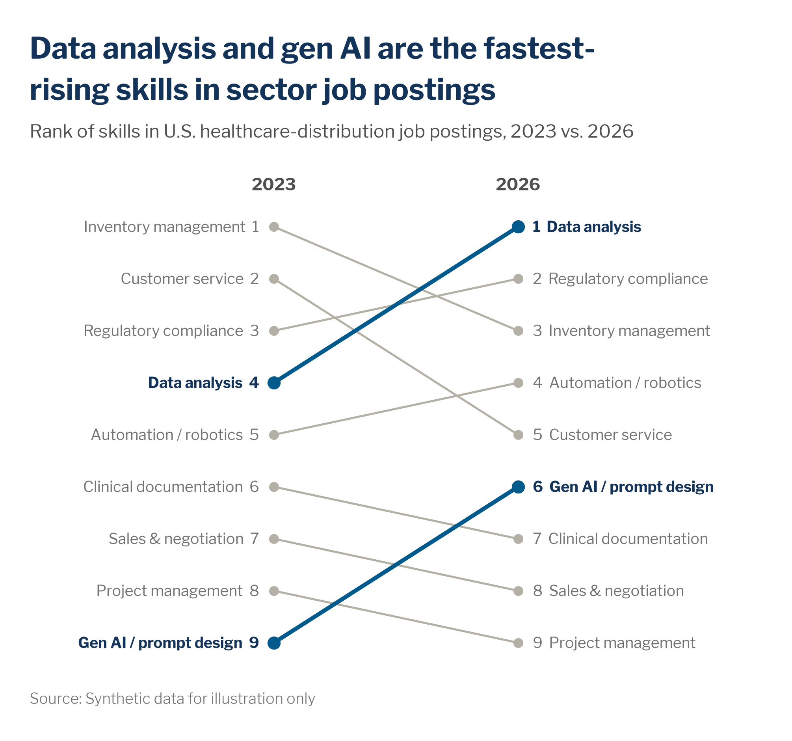

# Slope and bump charts

> **Question type:** Ranking (change in rank or value between periods)
> **Use for:** who moved up or down between two points (slope) or across a few periods (bump) · **Avoid when:** the size of the values matters more than the order, or there are many periods (→ use a [line chart](line.md) or a [sorted bar](bar.md))



## When to use
- **Slope chart** (2 points): the change between a *before* and an *after* for 5–10 items. For example, rank of skills in postings in 2023 vs. 2026, or time-to-productivity before vs. after an onboarding redesign. It works with ranks or with values on one shared scale.
- **Bump chart** (3–6 points): how rank order evolves, such as business units by internal fill rate each fiscal year.
- One or two items **cross** the others (climb from last to first, or fall), and that crossing is the story.
- **Social posts and inline print**: a slope chart reads at thumbnail size and fits a single text column.

## When not to use
- The gaps between items matter more than their order. Ranks hide distance → use a [sorted bar](bar.md) or a [dot plot / dumbbell](dot-plot-dumbbell.md).
- More than ~6 periods, or you need the shape of the trend between them → use a [line chart](line.md).
- More than ~10 items, so the crossings turn into spaghetti → show only the top N, or use [small multiples](small-multiples.md).
- A single period → use a [sorted bar](bar.md).

## McKesson spec

| Element | Rule |
|---|---|
| Color | All items in `chart.context` `#B4B0A5` (lines and markers). The item the headline is about is `chart.focus` `#005A8C`. At most one contrasting mover (`limits.highlighted_series` = 2): `chart.accent` navy `#143359`, or `semantic.negative` orange `#EF8200` when that mover is a decline, as in the bump example below. Orange never marks a plain highlight. On dark social cards use `chart.focus_on_dark` `#66C4FF` and `chart.context_on_dark` `#5A7194` on Deep Navy `#0B3266`. |
| Labels | Put names at **both ends**: left in starting order, right in ending order. No legend. Slope charts show the value (or rank) next to each name. Bump charts put the rank number inside circular markers, with the text color from `mv.text_on(fill)`. Highlighted names are bold: navy `#143359` for the focus and `semantic.negative_text` `#A75B00` for an orange (declining) item (orange text is below 3:1 contrast). Put bold period headers (`2023`, `FY26`) above each column. |
| Axes / gridlines | No axes and no gridlines. For ranks, put 1 at the top and space ranks evenly. For value slopes, use one linear scale shared by both columns (it doesn't have to start at 0). The column positions are the time axis, spaced evenly. |
| Sort / order | Rank 1 is at the top, with labels following the order on each side. Draw context lines first and highlighted lines last, so they sit on top. For top-N lists, say "Top N" in the subtitle and show items entering or leaving with a "new" marker or a stub that drops off. |
| Proportions | Line weights come from `chart.line`: focus 2.25 pt / 2 px, context 1.25 px. Bump markers are ~18–22 px circles with 1.5 px white outlines. Slope charts work narrow (4:3, 1:1 or one print column); bump charts use 16:9 with even column spacing. |
| Limits | Slope charts take ≤ ~10 items; bump charts ≤ ~8 items × 3–6 periods. Highlight ≤ 2 items. Don't rank groups with fewer than 10 people, and footnote the metric definition so ranks aren't over-read. |

## Do / don't

| Do | Don't |
|---|---|
| Highlight the one or two movers the headline names and grey the rest | Color every line differently. Crossings become impossible to follow |
| Label names at both ends, in rank order | Use a legend or label only one side |
| Use numbered circular rank markers and period headers above the columns | Rely on a y-axis with tick marks to say what the rank is |
| Footnote what the rank is based on, and say when the gaps are small | Imply a big difference between rank 3 and rank 4 when the values are 0.2 points apart |
| Make social or standalone versions self-contained: headline, subtitle, footnote, source and the McKesson logo on the image | Post a slope chart that only makes sense next to the article text |
| Use the post text to repeat the insight in the headline | Make the reader decode which line matters |
| Size an inline print version to one text column, next to the paragraph it supports | Blow a 5-item slope chart up to a full page |

## Workforce examples
- **Headline:** "Data analysis and gen AI are the fastest-rising skills in sector job postings" — *Subtitle:* "Rank of skills in U.S. healthcare-distribution job postings, 2023 vs. 2026" — data: sector-level external job-postings feed, `examples/data/skills_demand_rank.csv` (slope chart above, gallery `slope()`).
- **Headline:** "Technology climbed from last to first in internal fill rate, while Oncology slid from third to last" — *Subtitle:* "Rank of business units by internal fill rate, FY22–FY26 (1 = highest share of open roles filled internally)" — data: firm/BU-level Workday Recruiting requisitions (bump chart, snippet below). It supports a talent-marketplace business case.
- **Headline:** "After the onboarding redesign, new pharmacists reach full productivity 5 weeks sooner, the biggest gain of any role" — *Subtitle:* "Median weeks to full productivity for new hires, FY24 vs. FY26 cohort, by role" — data: individual-level productivity ramps aggregated to role cohorts (n ≥ 10 per cohort). Value slope chart on one shared scale, with pharmacists in focus blue.

## Build it

### Python — matplotlib + `mckviz`
A bump chart; for the two-point slope chart, see `slope()` in [`gallery_matplotlib.py`](../../examples/python/gallery_matplotlib.py).
```python
# verified runnable (from the repo root)
import matplotlib

matplotlib.use("Agg")
import matplotlib.pyplot as plt

import mckviz as mv

mv.use()
C = mv.colors

years = ["FY22", "FY23", "FY24", "FY25", "FY26"]
# Rank of business units by internal fill rate (1 = highest share of open roles filled internally)
ranks = {
    "Technology":                [6, 5, 3, 2, 1],
    "U.S. Pharmaceutical":       [1, 1, 2, 1, 2],
    "Medical-Surgical":          [2, 3, 1, 3, 3],
    "RxTS":                      [4, 2, 4, 4, 4],
    "Corporate":                 [5, 6, 6, 5, 5],
    "Oncology & Multispecialty": [3, 4, 5, 6, 6],
}
colors = dict(zip(ranks, mv.highlight(ranks, focus="Technology")))
colors["Oncology & Multispecialty"] = C.negative     # slid to last: orange means worse
x = range(len(years))

fig, ax = plt.subplots(figsize=(10, 5.6))
for name, r in ranks.items():
    col, hi = colors[name], colors[name] != C.context
    ax.plot(x, r, color=col, lw=2.25 if hi else 1.25, zorder=3 if hi else 2)
    ax.scatter(x, r, s=330, color=col, edgecolors="white", linewidths=1.5, zorder=4 if hi else 2)
    for xi, ri in zip(x, r):
        ax.text(xi, ri, str(ri), ha="center", va="center", fontsize=9, fontweight="bold", color=mv.text_on(col), zorder=5)
    kw = dict(va="center", fontsize=11 if hi else 10, fontweight="bold" if hi else "normal",
              color=C.negative_text if col == C.negative else C.headline if hi else C.text_muted)
    ax.text(-0.18, r[0], name, ha="right", **kw)
    ax.text(len(years) - 1 + 0.18, r[-1], name, ha="left", **kw)
for xi, yr in zip(x, years):
    ax.text(xi, 0.3, yr, ha="center", va="bottom", fontsize=11, fontweight="bold", color=C.text)
ax.set_ylim(6.5, 0.2)
ax.set_xlim(-0.3, len(years) - 0.7)
ax.axis("off")
mv.titles(fig, "Technology climbed from last to first in internal fill rate, while Oncology slid from third to last",
          "Rank of business units by internal fill rate, FY22\u2013FY26 (1 = highest share of open roles filled internally)")
mv.source(fig, "Source: Workday Recruiting, requisitions closed FY22\u2013FY26; U.S. regular roles. Synthetic data for illustration",
          footnote="Internal fill rate = roles filled by internal candidates \u00f7 all roles filled. Ranks hide gaps: FY26 rates span 22\u201348%.")
mv.save(fig, "out/bump.png")
```

### Python — Plotly / HTML
```python
# verified: builds without error
import plotly.graph_objects as go

import mckviz as mv

mv.use()
C = mv.colors
years = ["FY22", "FY23", "FY24", "FY25", "FY26"]
ranks = {
    "Technology":                [6, 5, 3, 2, 1],
    "U.S. Pharmaceutical":       [1, 1, 2, 1, 2],
    "Medical-Surgical":          [2, 3, 1, 3, 3],
    "RxTS":                      [4, 2, 4, 4, 4],
    "Corporate":                 [5, 6, 6, 5, 5],
    "Oncology & Multispecialty": [3, 4, 5, 6, 6],
}
colors = dict(zip(ranks, mv.pl_highlight(ranks, focus="Technology")))
colors["Oncology & Multispecialty"] = C.negative     # slid to last: orange means worse
fig = go.Figure()
for name in sorted(ranks, key=lambda n: colors[n] != C.context):   # context first, highlights on top
    col, hi = colors[name], colors[name] != C.context
    fig.add_scatter(x=years, y=ranks[name], mode="lines+markers+text", text=[str(r) for r in ranks[name]],
                    textfont={"color": mv.text_on(col), "size": 11}, textposition="middle center",
                    line={"color": col, "width": 3 if hi else 1.5},
                    marker={"size": 22, "color": col, "line": {"color": "white", "width": 1.5}},
                    hovertemplate=name + ": rank %{y} in %{x}<extra></extra>")
    for x, r, anchor, shift in ((years[0], ranks[name][0], "right", -18), (years[-1], ranks[name][-1], "left", 18)):
        fig.add_annotation(x=x, y=r, text=f"<b>{name}</b>" if hi else name, xanchor=anchor, xshift=shift, showarrow=False,
                           font={"color": C.negative_text if col == C.negative else C.headline if hi else C.text_muted})
fig.update_yaxes(autorange="reversed", visible=False)
fig.update_xaxes(side="top", showgrid=False, showline=False)
fig.update_layout(showlegend=False, margin={"l": 190, "r": 190})
mv.pl_finish(fig, "Technology climbed from last to first in internal fill rate, while Oncology slid from third to last",
             "Rank of business units by internal fill rate, FY22\u2013FY26 (1 = highest)",
             source_text="Source: Workday Recruiting, requisitions closed FY22\u2013FY26; U.S. regular roles")
fig.show()
```
Put the underlying rate in the hover text (`customdata`) so readers can see the gaps that ranks hide. For a 1:1 social card, set `width=height=1080`, use the Deep Navy background with `focus_on_dark`, and add the logo and source to the image itself.

### Excel and PowerPoint
1. **Theme:** install the `dist/office` color and font XMLs and Libre Franklin, then apply **Page Layout → Colors / Fonts → McKesson Data Viz** in Excel, or **Design → Variants ▾ → Colors / Fonts** in PowerPoint.
2. Arrange the data with periods across the columns and one row per item (ranks or values). Select it and click **Insert → Insert Line or Area Chart → Line with Markers**. If items end up on the x-axis, click **Chart Design → Switch Row/Column**.
3. For ranks: **Vertical axis → Format Axis → Values in reverse order**, Bounds 0.5 to n + 0.5, then **Labels: None** and **Line: No line**. Delete the gridlines, the legend and the chart title. For a value slope, keep one fixed min/max scale.
4. Context series: **Ctrl+1 → Fill & Line → Line → Solid, Hex `B4B0A5`, 1 pt**. Under **Marker → Built-in, Circle, Size 14**, set **Fill `#B4B0A5`** and **Border White 1.5 pt**. Press **F4** to repeat on the next series.
5. Focus series: **Accent 1 `#005A8C`**, **2.25 pt**, markers in the same color. Declining series: **Accent 6 `#EF8200`** (orange because it fell; use **Accent 2 `#143359`** navy for a contrast that isn't worse). In **Select Data**, move the highlighted series to the bottom of the list so they draw on top.
6. Rank numbers: **+ (Chart Elements) → Data Labels → More Options → Value, Position: Center**, in Libre Franklin Bold 9 pt (white on blue and navy, `#143359` on grey and orange).
7. Names: select a series' **first point → Add Data Label → Series Name, Position: Left**, and its **last point → Series Name, Position: Right**. Use bold `#143359` (focus) or `#A75B00` (declining, orange) and `#737373` for context. Put period headers on the top axis, or use text boxes, in bold.
8. Paste into PowerPoint with **Use Destination Theme & Embed Workbook**. For inline print, set the chart width to one text column.

### Power BI
- Apply the theme `dist/powerbi/mckesson-dataviz-theme.json`.
- Build a **Line chart** with X = fiscal year (categorical), Y = a rank measure, e.g. `Rank = RANKX(ALLSELECTED(BU[BU]), [Internal fill %],, DESC, Dense)`, and Legend = BU. Set **Y-axis → Invert range** on, then turn the Y-axis title and values off.
- In **Format → Lines** (per series), set context to `#B4B0A5` and the focus series to `#005A8C`, width 3. Turn **Markers** on (circle, size 8–10) and **Data labels** on, showing the rank. Turn **Series labels** on and the legend off.
- Put the underlying rate in the tooltip. Exclude small groups from ranking with `Rank (safe) = IF([Headcount] < 10, BLANK(), [Rank])`.

### R — ggplot2 (optional)
```r
library(ggplot2); library(dplyr)
source("dist/r/theme_mck.R")

# Synthetic data for illustration (replace with yours): rank of each business unit by internal fill rate
bus <- c("Corporate", "Medical-Surgical", "Oncology & Multispecialty", "RxTS", "Technology", "U.S. Pharmaceutical")
ranks <- rbind(FY22 = c(1, 2, 3, 4, 6, 5), FY23 = c(1, 3, 2, 4, 5, 6), FY24 = c(2, 1, 4, 5, 3, 6),
               FY25 = c(3, 1, 5, 4, 2, 6), FY26 = c(3, 2, 6, 4, 1, 5))           # one row per year, columns = bus
df <- data.frame(bu = rep(bus, times = nrow(ranks)), fy = rep(rownames(ranks), each = length(bus)),
                 rank = as.vector(t(ranks)))

cols <- mck_highlight(unique(df$bu), focus = "Technology")
cols["Oncology & Multispecialty"] <- mck_colors$negative                   # slid to last: orange means worse
df <- df |>
  mutate(hi = bu %in% c("Technology", "Oncology & Multispecialty"),
         num_col = ifelse(bu == "Technology", "white", mck_colors$headline),     # text_on() logic
         lab_col = case_when(bu == "Technology" ~ mck_colors$headline,
                             bu == "Oncology & Multispecialty" ~ mck_colors$negative_text, TRUE ~ mck_colors$muted)) |>
  arrange(hi)
first <- filter(df, fy == min(fy)); last <- filter(df, fy == max(fy))
ggplot(df, aes(fy, rank, group = bu, colour = bu)) +
  geom_line(aes(linewidth = hi)) +
  geom_point(size = 7, shape = 21, aes(fill = bu), colour = "white", stroke = 1) +
  geom_text(aes(label = rank), colour = df$num_col, size = 3, fontface = "bold") +
  geom_text(data = first, aes(label = bu), colour = first$lab_col, hjust = 1, nudge_x = -0.15, size = 3.5) +
  geom_text(data = last, aes(label = bu), colour = last$lab_col, hjust = 0, nudge_x = 0.15, size = 3.5) +
  scale_y_reverse(breaks = NULL) +
  scale_colour_manual(values = cols, guide = "none") + scale_fill_manual(values = cols, guide = "none") +
  scale_linewidth_manual(values = c(`FALSE` = 0.45, `TRUE` = 1.05), guide = "none") +
  scale_x_discrete(position = "top", expand = expansion(add = 1.6)) +
  labs(x = NULL, y = NULL,
       title = "Technology climbed from last to first in internal fill rate, while Oncology slid from third to last",
       subtitle = "Rank of business units by internal fill rate, FY22–FY26 (1 = highest)",
       caption = "Source: Workday Recruiting, requisitions closed FY22–FY26; U.S. regular roles")
```
Use white rank numbers on blue and navy markers only. On orange `#EF8200` and grey `#B4B0A5` markers, map the text color to `#143359` (as `mv.text_on()` does).

## QA specifics
- [ ] There are ≤ 2 highlighted items, and they're exactly the ones the headline names. Everything else is `#B4B0A5`.
- [ ] Every item is labelled at both ends in rank order, with no legend, and no labels collide where ranks tie or lines cross.
- [ ] Rank 1 is at the top, the period headers are present, and the columns are evenly spaced.
- [ ] Value slopes use one shared scale on both sides, and the gaps between items are stated or footnoted when ranks hide them.
- [ ] Top-N lists say "Top N" and show how items entering or leaving the list are handled.
- [ ] Social and standalone versions include the headline, subtitle, footnote, source and logo, and are readable at phone size without zooming.

## Inspiration
- [p076 — Social media](../../reference/inspiration-mckinsey/pages/p076-social-media.md)
- [p078 — Social media considerations](../../reference/inspiration-mckinsey/pages/p078-social-media-considerations.md)
- [p086 — Print](../../reference/inspiration-mckinsey/pages/p086-print.md)
