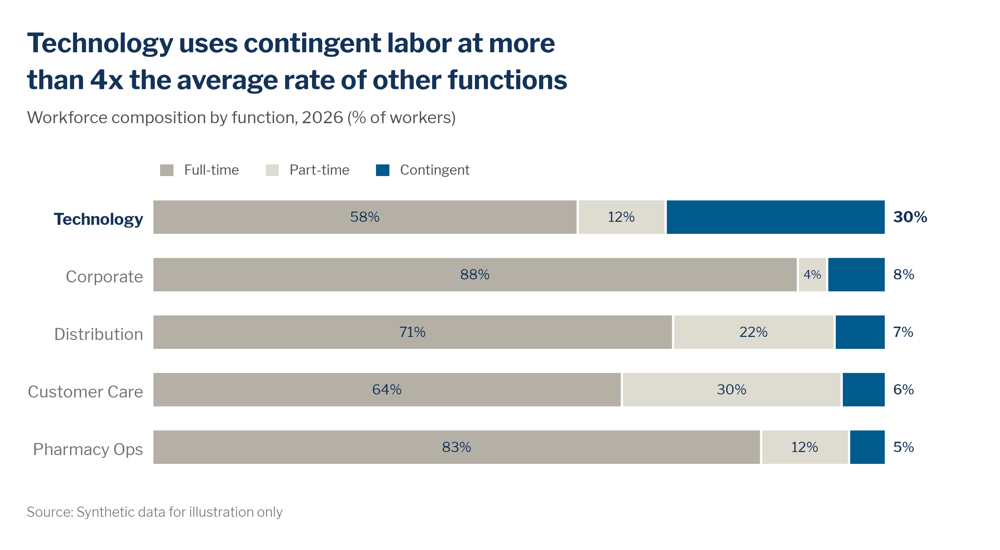

# Stacked and 100% stacked bars

> **Question type:** Part-to-whole · Magnitude
> **Use for:** how a total, or a set of totals, breaks down into ≤ 5 parts across groups · **Avoid when:** readers must compare the middle segments precisely → use [grouped bars](bar.md) or [small multiples](small-multiples.md)



## When to use
- **100% stacked bars:** to compare the **mix** across groups when the share is the story and the group sizes are not (workforce type by function, proficiency levels by team, survey response by business unit).
- **Stacked bars/columns (absolute):** when the reader needs **both the total and its breakdown** (planned FTE by sourcing lever by year, hires by channel by quarter).
- **Columns** for a few periods (≤ ~8 years or quarters). **Horizontal bars** for named groups (functions, sites, peers).
- **Ordered segments** (tenure bands, proficiency 1–5, agree/disagree scales) work well, because the segment order carries meaning.

## When not to use
- Several middle segments must be compared precisely across bars: only the segments on a common edge are easy to compare → use [grouped bars](bar.md) or [small multiples](small-multiples.md).
- There is only **one** whole → use a single 100% bar, or a [donut](donut-pie.md) with ≤ 5 parts.
- Composition over many periods → use a [stacked area](stacked-area.md) chart. For a bridge from one total to another → use a [waterfall](waterfall.md).
- Many parts or a hierarchy (skills portfolio, cost by org level) → use a [treemap](treemap.md).
- More than 5 segments that all matter → regroup them, or split the chart.

## McKesson spec

| Element | Rule |
|---|---|
| Color | **Default: greys plus one story color.** The segment the headline is about gets `chart.focus` `#005A8C` (or `chart.accent` navy `#143359` for a single exception next to a blue group). Never orange as the story color unless the segment means worse (e.g., a shortfall). Other segments use `chart.context` `#B4B0A5` and `chart.context_light` `#DEDBD1`. Use the categorical order (`#005A8C`, `#143359`, `#66C4FF`, `#00AF9D`, `#00737A`) only when every segment must be told apart; the white separators keep blue and navy apart. Ordered segments use sequential blue steps (`#B6E2FA` → `#143359`), or the diverging orange–blue scale with the neutral midpoint `#EFEDE7` for agree/disagree scales. Put a 1–1.5 pt **white separator** between segments. |
| Labels | Center segment labels inside segments that are wide enough (≥ ~8%). Use `mv.text_on()`: white on blue/navy, navy on greys and light fills. Drop labels below ~4%. Put the story segment's values **outside the bar end**, bold, in Navy `#143359` (or `#A75B00` for an orange "worse" segment). Absolute stacks get a **bold navy total** above or beside each stack. Bold the focus group's category label. |
| Axes / gridlines | With segment labels and totals: no value axis and no gridlines. **Exception:** when segments are too thin to label, keep a light value axis with gridlines in `chart.grid` `#E6E4DE` at round steps, with the unit in the subtitle. Keep a thin zero baseline in `chart.axis` `#8C8C8C`. |
| Sort / order | Put the **story segment on a common edge**: the baseline for absolute stacks, the first or last segment for 100% bars. Never put it in the middle. Sort bars by the story segment's share (100%) or by total (absolute), unless time or a natural order applies. Keep segment order and colors identical across bars, charts and the deck. |
| Proportions | Bar : gap ≈ 2 : 1 (Excel Gap Width 50%, Series Overlap 100%; matplotlib `height≈0.62–0.67`). 100% bars span the full width: no 0–100 axis needed. |
| Limits | **≤ 5 segments** (`chart.limits.stacked_segments`); group the rest into "Other" in `#DEDBD1`. ≤ 2 highlighted segments. Every bar is based on **n ≥ 10** people. Show "n = …" or the total beside 100% bars when the group sizes differ a lot. |
| Key / legend | Prefer direct labels: name the segments on the first bar, or beside the last column. Otherwise use **one horizontal key, top-left**, in stack order (left → right = baseline → end). |

## Do / don't

| Do | Don't |
|---|---|
| Put the segment you're talking about on the baseline (or at either end of a 100% bar) | Bury the story segment in the middle of the stack, where nothing aligns |
| Grey out the non-story segments and color only the one the headline names | Use five equally strong colors when only one segment matters |
| Keep ≤ 5 segments and group the tail into "Other" | Stack 8–10 thin slivers no one can read |
| Order the key exactly like the stack and place it top-left | Use a legend in a different order from the segments, or at the bottom |
| Label segments directly; if they can't be labelled, keep a light gridded axis so values are readable | Show unlabelled segments with no axis at all |
| Say "share" or "proportionally" in the headline when using 100% bars | Imply absolute differences from a 100% chart |
| On live slides, build up: totals first → story segment vs. grey "Other" → full breakdown, adding each key entry when its segment appears | Show the full 5-segment chart and legend on the first click |

## Workforce examples
- **Firm, internal:** *Headline:* "Technology uses contingent labor at more than 4x the average rate of other functions". *Subtitle:* "Workforce composition by function, 2026 (% of workers)". *Data:* [`examples/data/workforce_mix.csv`](../../examples/data/workforce_mix.csv), HRIS plus vendor-management (contingent) records.
- **SWP plan, firm/team:** *Headline:* "Reskilling closes about 40% of the FY28 Data & AI gap; external hiring still has to cover nearly half". *Subtitle:* "Planned sources to close the Data & AI capability gap, FY26–FY28 (FTE)". *Data:* the strategic workforce plan scenario model. Absolute stacked columns: *Build (reskill)* on the baseline in `#005A8C`; *Buy*, *Borrow* and *Automate* in greys; navy totals on top.
- **Sector, external:** *Headline:* "Technology and data roles make up 9% of our workforce, well below the 14% peer median". *Subtitle:* "Workforce mix by role family, McKesson vs. five healthcare-distribution and pharmacy peers, 2026 (% of employees)". *Data:* external workforce estimates from public professional profiles and job postings. The *Tech & data* segment goes first (left edge) in focus blue, and the McKesson row label is bold.

## Build it

### Python — matplotlib + `mckviz`
```python
# verified runnable (from the repo root)
import matplotlib
matplotlib.use("Agg")
import matplotlib.pyplot as plt
import pandas as pd

import mckviz as mv

mv.use()
df = pd.read_csv("examples/data/workforce_mix.csv").sort_values("contingent_pct", ascending=False)
focus = "Technology"
ratio = df.contingent_pct[df.function == focus].iloc[0] / df.contingent_pct[df.function != focus].mean()

fig, ax = plt.subplots(figsize=(10, 4.8))
# Story segment first: on the baseline in focus blue, the rest in context greys, white separators,
# values inside segments >= label_min, segment names over the top bar (no legend), worker counts at the right.
mv.hstack(ax, df.function, [("Contingent", df.contingent_pct), ("Full-time", df.employee_ft_pct),
                            ("Part-time", df.employee_pt_pct)],
          focus={focus}, label_min=5, base=df.workers, base_label="Workers")

mv.titles(fig, f"Technology uses contingent labor at more than {int(ratio)}x the average rate of other functions",
          "Workforce composition by function, 2026 (% of workers)")
mv.source(fig, "Source: Synthetic data for illustration only",
          footnote="Contingent = agency temps, independent contractors and SOW workers on assignment at period end.")
mv.lint(fig, strict=True)
mv.save(fig, "out/stacked-100.png", dpi=200)
```
`mv.hstack` takes the parts in stack order; `story="Contingent"` moves a segment to the baseline if you list it elsewhere, and `colors=` overrides the greys (for example sequential steps for an ordered scale). For **absolute** stacks (columns), use `ax.bar(..., bottom=running, edgecolor="white", linewidth=1.5)` with the story series first (on the baseline), and add totals with `ax.text(x, total, f"{total:,.0f}", ha="center", va="bottom", fontweight="bold", color=C.total)`.

### Python — Plotly / HTML
```python
# verified: builds without error
from pathlib import Path

import pandas as pd
import plotly.graph_objects as go

import mckviz as mv

mv.use()  # registers + activates the "mck" Plotly template
C = mv.colors

df = pd.read_csv(Path("examples/data/workforce_mix.csv")).sort_values("contingent_pct", ignore_index=True)
parts = [("employee_ft_pct", "Full-time", C.context), ("employee_pt_pct", "Part-time", C.context_light),
         ("contingent_pct", "Contingent", C.focus)]
fig = go.Figure()
for col, name, color in parts:
    fig.add_bar(y=df.function, x=df[col], name=name, orientation="h", marker_color=color,
                marker_line={"color": "white", "width": 1.5},
                text=[f"{v:.0f}%" if v >= 4 else "" for v in df[col]], textposition="inside",
                insidetextanchor="middle", hovertemplate="%{y}: %{x:.0f}% " + name.lower() + "<extra></extra>")
fig.update_layout(barmode="stack", bargap=0.38,
                  legend={"orientation": "h", "x": 0, "xanchor": "left", "y": 1.02, "yanchor": "bottom",
                          "traceorder": "normal"})   # key top-left, in stack order
fig.update_xaxes(visible=False, range=[0, 100])
fig.update_yaxes(showgrid=False, ticksuffix="  ")
mv.pl_finish(fig, "Technology uses contingent labor at more than 4x the average rate of other functions",
             "Workforce composition by function, 2026 (% of workers)", "Source: Synthetic data for illustration only")
Path("out").mkdir(exist_ok=True)
fig.write_html("out/stacked-100.html", include_plotlyjs="cdn")
```
If the data are counts rather than shares, use `barnorm="percent"` in `update_layout` and put the counts and n in `hovertemplate`. Suppress groups with n < 10 before plotting.

### Excel and PowerPoint
1. Apply the **McKesson Data Viz** theme colors and fonts (Libre Franklin). Install them from `dist/office/` as described in [bar.md](bar.md#excel-and-powerpoint).
2. Select the data, then **Insert › Charts › Insert Column or Bar Chart › 100% Stacked Bar** (or **Stacked Column** for absolute values). For horizontal bars, set **Format Axis › Categories in reverse order** so the sheet order runs top-down.
3. **Chart Design › Select Data › Legend Entries (Series)**: use the ▲▼ arrows so the story series is **first** (baseline/left) or **last** (right end). Never leave it in the middle.
4. **Format Data Series › Series Options › Gap Width 50%**, Series Overlap 100%. For each series, set **Fill › Solid** (story `005A8C`, or `143359` for a navy exception; others `B4B0A5` and `DEDBD1`) and **Border › Solid line, White, 1.5 pt**.
5. **Chart Elements (+) › Data Labels › Center**. Click a tiny segment's label twice and press Delete for anything below ~4%. Set the labels to Libre Franklin 11–12 pt, navy on grey and white on blue.
6. Delete the gridlines and the value axis (100% charts). For absolute stacks whose segments can't all be labelled, keep the axis and set the gridlines to `E6E4DE`, 0.75 pt.
7. Legend: **Format Legend › Legend Position › Top**, then drag it to the left edge so it aligns with the headline. Check that the key order matches the stack.
8. Totals for absolute stacked columns: add a **Total** series (sum of segments), then **Change Series Chart Type › Line** for that series. Set **Line: No line**, **Marker: None**, and **Data Labels › Above**, bold Navy `143359`. Delete "Total" from the legend.
9. PowerPoint build-up (2–5 slides; keep the headline, axis and bar order identical). Slide 1: totals only, one color, labelled. Slide 2: the story segment vs. one grey "Other" segment, with only the focus bar's segment colored. Slide 3: the full breakdown, with the key entries added. To **mask** rather than hide bars, set the other bars' fill **Transparency 60%** and keep the focus bar solid.

### Power BI
- Apply [`dist/powerbi/mckesson-dataviz-theme.json`](../../dist/powerbi/mckesson-dataviz-theme.json) (**View › Themes › Browse for themes**).
- Use the **100% stacked bar chart** (or **Stacked column chart**). Set **Legend › Position: Top left**, **Data labels** on, **Gridlines** off, and the value axis off.
- Set the series colors under **Format › Bars › Colors** (story series `#005A8C`, or `#143359` for a navy exception; others `#B4B0A5`/`#DEDBD1`). Set the segment order with the order of the legend field's sort column.
- Absolute stacks: turn on **Total labels** (bold, `#143359`).
- To sort bars by the story segment's share, add a `Contingent %` measure to **Tooltips**, then **⋯ › Sort axis › Contingent %**.
- Minimum n: add a visual-level filter `Headcount ≥ 10`, or blank the measure: `Mix % (safe) = IF([Headcount] < 10, BLANK(), [Mix %])`.

### R — ggplot2 (optional)
```r
library(ggplot2); library(dplyr); library(tidyr); library(readr)
source("dist/r/theme_mck.R")

mix <- read_csv("examples/data/workforce_mix.csv") |>
  mutate(fn = reorder(`function`, contingent_pct)) |>
  pivot_longer(ends_with("_pct"), names_to = "type", values_to = "pct") |>
  mutate(type = factor(type, levels = c("employee_ft_pct", "employee_pt_pct", "contingent_pct"),
                       labels = c("Full-time", "Part-time", "Contingent")))

ggplot(mix, aes(pct, fn, fill = type)) +
  geom_col(width = 0.62, color = "white", linewidth = 0.6, position = position_stack(reverse = TRUE)) +
  geom_text(aes(label = ifelse(pct >= 4, paste0(pct, "%"), "")),
            position = position_stack(vjust = 0.5, reverse = TRUE), size = 3.2,
            color = ifelse(mix$type == "Contingent", "white", mck_colors$headline)) +   # text_on() logic
  scale_fill_manual(values = c("Full-time" = mck_colors$context, "Part-time" = mck_colors$context_light,
                               "Contingent" = mck_colors$focus)) +
  labs(title = "Technology uses contingent labor at more than 4x the average rate of other functions",
       subtitle = "Workforce composition by function, 2026 (% of workers)",
       caption = "Source: Synthetic data for illustration only", x = NULL, y = NULL) +
  theme_mck() +   # legend top-left, in level (= stack) order
  theme(axis.text.x = element_blank(), panel.grid = element_blank(), axis.line.x = element_blank())
```

### HTML / JavaScript — Plotly + `mck-viz.js`
100% stacked bars with the story segment (Contingent) on the right edge in focus blue, the other segments grey, white separators, segment labels in `mck.textOn()` ink, and an HTML key top-left in stack order (`.mck-legend`). Copy `dist/web/mck-viz.css` and `dist/web/mck-viz.js` next to the page (offline or locked-down intranet: also `dist/web/vendor/plotly.min.js`, see [formats.md](../formats.md#web-and-html-articles-microsites-internal-tools)). `mck-viz.js` carries the tokens, the Plotly template and the helpers (`mck.tok`, `mck.fmtNum`, `mck.plotlyLayout`, ...), so no hex value is typed in the page.

```html
<!doctype html>
<html lang="en">
<head>
<meta charset="utf-8">
<meta name="viewport" content="width=device-width, initial-scale=1">
<title>Workforce mix</title>
<link href="https://fonts.googleapis.com/css2?family=Libre+Franklin:wght@300;400;500;600;700&display=swap" rel="stylesheet">
<link rel="stylesheet" href="mck-viz.css">   <!-- dist/web/mck-viz.css, copied next to this page -->
<script src="mck-viz.js"></script>           <!-- dist/web/mck-viz.js: tokens, helpers and the Plotly template -->
<script src="https://cdn.plot.ly/plotly-4.1.1.min.js" charset="utf-8"></script>   <!-- offline: vendor/plotly.min.js -->
<style>
  body { margin: 0; padding: 24px 16px; background: var(--mck-surface-subtle); }
  .mck-chart { margin: 0 auto; }
  .mck-plot { height: 300px; }
  @media (max-width: 600px) { body { padding: 0; } }
</style>
</head>
<body>
<figure class="mck-chart" aria-labelledby="mix-headline">
  <h2 class="mck-headline" id="mix-headline">Technology uses contingent labor at more than 4x the average rate of other functions</h2>
  <p class="mck-subtitle">Workforce composition by function, 2026 (% of workers)</p>
  <div class="mck-legend" id="mix-key" aria-hidden="true"></div>   <!-- key top-left, in stack order -->
  <div class="mck-plot" id="mix-chart" role="img" aria-label="100% stacked bar chart. Contingent workers are 30% of
       Technology and 5 to 8% of the other four functions; full-time employees are 58 to 88%."></div>
  <table class="sr-only" id="mix-table"></table>
  <noscript><p class="mck-subtitle">Contingent share: Technology 30%, Corporate 8%, Distribution 7%, Customer Care 6%,
    Pharmacy Ops 5%.</p></noscript>
  <figcaption class="mck-footnote" id="mix-note">Source: Synthetic data for illustration only</figcaption>
</figure>
<script>
const { tok, fmtNum, textOn } = mck;
const raw = [   // DATA: shares in % (each row sums to 100) and the head count behind them
  { fn: "Distribution", ft: 71, pt: 22, cont: 7, n: 14200 }, { fn: "Pharmacy Ops", ft: 83, pt: 12, cont: 5, n: 9600 },
  { fn: "Technology", ft: 58, pt: 12, cont: 30, n: 4100 }, { fn: "Customer Care", ft: 64, pt: 30, cont: 6, n: 3400 },
  { fn: "Corporate", ft: 88, pt: 4, cont: 8, n: 5300 },
];
const [rows, note] = mck.suppressSmall(raw, "n", { otherLabel: null });   // no bar may rest on fewer than 10 people
if (note) document.getElementById("mix-note").insertAdjacentText("afterbegin", note + " ");
rows.sort((a, b) => b.cont - a.cont);                       // sorted by the story segment; "stacked" draws top to bottom
const STORY = "Technology";
const parts = [   // stack order = key order; the story segment sits on the common right edge, in focus blue
  { key: "ft", name: "Full-time", color: tok("chart-context") },
  { key: "pt", name: "Part-time", color: tok("chart-context-light") },
  { key: "cont", name: "Contingent", color: tok("chart-focus"), story: true },
];
document.getElementById("mix-key").innerHTML =
  parts.map(p => `<span style="--swatch:${p.color}">${p.name}</span>`).join("");

const fns = rows.map(r => r.fn);
const minLabel = window.matchMedia("(max-width: 600px)").matches ? 15 : 8;   // drop labels that would not fit
const traces = parts.map(p => ({
  type: "bar", orientation: "h", name: p.name, y: fns, x: rows.map(r => r[p.key]),
  marker: { color: p.color, line: { color: tok("surface-default"), width: 1.5 } },     // white separators
  text: rows.map(r => (p.story ? `<b>${fmtNum(r[p.key], { kind: "pct", decimals: 0 })}</b>`
                               : r[p.key] >= minLabel ? fmtNum(r[p.key], { kind: "pct", decimals: 0 }) : "")),
  textposition: p.story ? "outside" : "inside", insidetextanchor: "middle", textangle: 0, constraintext: "none",
  textfont: { color: p.story ? tok("text-headline") : textOn(p.color) },             // white on dark, navy on light
  hovertemplate: `%{y}: %{x:.0f}% ${p.name.toLowerCase()}<extra></extra>`,
}));
mck.ready(() => Plotly.newPlot("mix-chart", traces, mck.plotlyLayout("stacked", {   // after the font loads
  margin: { r: 48 },                                          // room for the story values outside the bar end
  yaxis: { tickvals: fns, ticktext: fns.map(f => (f === STORY ? `<b>${f}</b>` : f)), tickfont: { color: tok("text-primary") } },
}), mck.plotConfig));
mck.srTable("mix-table", "Workforce composition by function, 2026 (%)", ["Function", "Full-time", "Part-time", "Contingent", "Workers"],
            rows.map(r => [r.fn, r.ft, r.pt, r.cont, fmtNum(r.n, { kind: "plain" })]));
</script>
</body>
</html>
```
If the data are counts, add `barnorm: "percent"` to the layout and put the counts in `hovertemplate`. `mck.suppressSmall(rows, "n", {otherLabel: null})` drops any bar resting on fewer than 10 people and returns the footnote.

## QA specifics
- [ ] ≤ 5 segments; the story segment sits on a common edge (baseline, first or last), never in the middle.
- [ ] Only the story segment(s) are colored (≤ 2); the rest are context greys, with white separators between segments.
- [ ] The key (if any) is top-left and in exactly the stack order; segment colors are identical across bars and charts.
- [ ] 100% bars sum to 100% (check rounding), and the headline talks about **share**, not size. Group sizes or n are shown when they differ a lot.
- [ ] Absolute stacks show totals; the value axis starts at 0, and unlabelled segments have a light gridded axis.
- [ ] No bar is based on fewer than 10 people; tiny segments (< ~4%) are unlabelled but still drawn, or grouped into "Other".

## Inspiration
- [p029 — Stacked bar chart](../../reference/inspiration-mckinsey/pages/p029-stacked-bar-chart.md)
- [Bar chart spreads (hi-res)](../../reference/inspiration-mckinsey/pages/hires-bar-chart-spreads.md)
- [p082 — Presentations](../../reference/inspiration-mckinsey/pages/p082-presentations.md)
