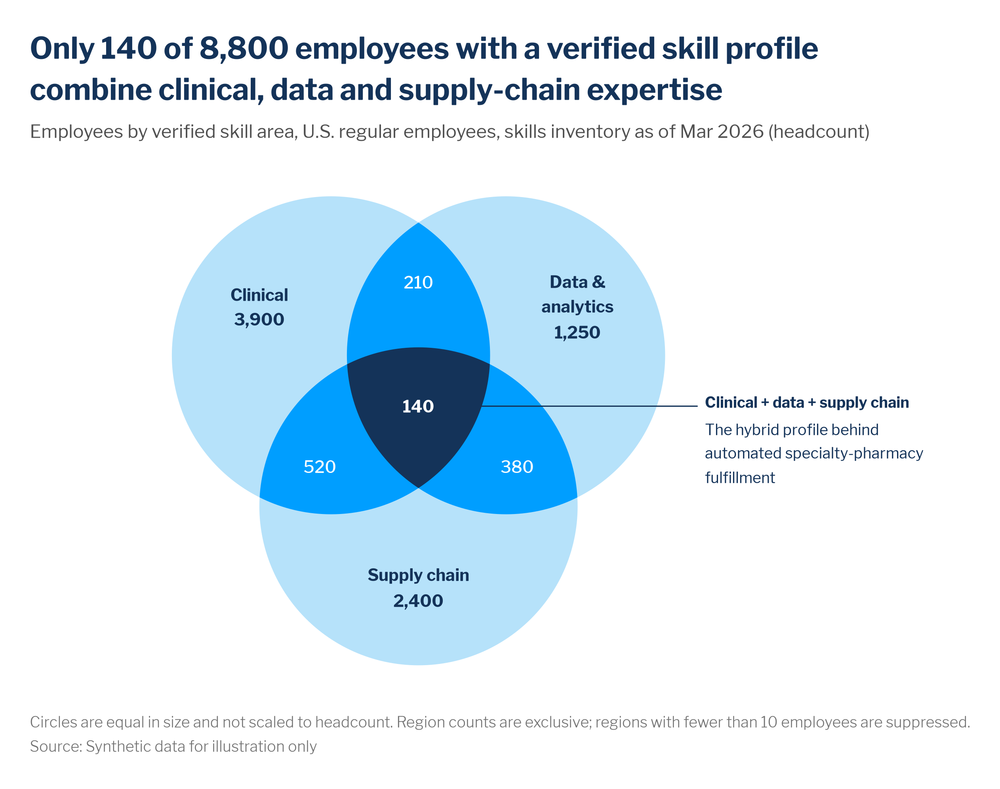

# Venn diagrams

> **Question type:** Relationships & flows (overlap between 2–3 groups)
> **Use for:** showing how 2–3 groups overlap, such as people who hold several skills, roles that sit where capabilities meet, or employees in more than one program, when the **overlap itself** is the point · **Avoid when:** you need to compare sizes precisely, or have 4+ groups → use a sorted [bar](bar.md) of the combinations



## When to use
- The message is about **who sits in more than one group**: "only 140 people combine all three skills", "most mentors are also ERG leads", "half of our succession candidates are on two slates".
- **Count Venn:** each region shows its **exclusive** count (people in exactly that combination). The circles are equal and don't encode size; the numbers do.
- **Concept Venn:** no numbers. It explains how roles or capabilities relate (e.g., Analytics ∩ IT = Data scientist). Use it in strategy and operating-model decks, with the descriptions outside the circles.
- **Variants:**
  - **Two-set Venn:** two circles. Often a [100% stacked bar](stacked-bar.md) ("only A / both / only B") says the same thing more precisely.
  - **Combination bars (UpSet-style):** with 4+ sets, or when sizes must be compared, use a sorted bar per combination with a dot matrix underneath that marks the sets in each combination.

## When not to use
- **Four or more sets** → use combination bars. Four-set Venns need ellipses, and nobody can read 15 regions.
- Precise size comparison → use a [bar](bar.md). Area-proportional Venns can't be drawn exactly for 3 sets, and readers misjudge circle overlap.
- People moving **between** states over time (one group at a time) → use a [Sankey](sankey.md). A Venn is for being in several groups **at once**.
- Parts of one whole with no overlap → use a [100% stacked bar](stacked-bar.md) or a [treemap](treemap.md).

## McKesson spec

| Element | Rule |
|---|---|
| Color | One hue that **darkens with each level of overlap**, from `color.sequential.blue`: 1 set `#B6E2FA` (step 2), 2 sets `#009EFF` (step 4), 3 sets `#143359` (step 6). Overlaps are **never lighter** than single sets. Fill exact regions, not transparent circles stacked on each other, so the tones are the brand values. No outlines, gradients or shadows. To call out one region that isn't the center, keep the ramp and add the callout leader line to it. Don't add a new hue. |
| Labels | Set names go **inside** their single-set region, bold, with the count beneath. Overlap regions hold only their count. Text color comes from `mv.text_on(fill)`: navy on light blue, white on mid and dark blue. Descriptions go **outside** the diagram, connected by a thin `chart.annotation` `#143359` 0.75 pt leader line, with a bold 2–5 word title and 1–3 short lines. Never put sentences inside the circles. State in a footnote that the counts are exclusive. |
| Axes / gridlines | None. Equal aspect ratio, so the circles stay round. |
| Sort / order | Put the set the headline leads with top-left, then read clockwise. Keep the same set positions across a deck. |
| Proportions | Equal circles, with centers on an equilateral triangle, about 1.1 radii apart, so every region is big enough for a 4-digit count. Use regular shapes only, no blobs. The diagram takes ≤ 60% of the width, and the rest holds the annotations. |
| Limits | 2–3 sets. Every region with **fewer than 10 people** shows "n<10" (or is merged and footnoted), and no region can be derived from the set totals by subtraction. Sets are defined in the subtitle or a footnote ("verified skill = manager-validated in the skills inventory"). |

## Do / don't

| Do | Don't |
|---|---|
| Darken the fill with each overlap level (light → mid → navy) | Make the overlaps lighter than the single sets, or use a different hue per circle |
| Fill each region with an exact token color | Stack semi-transparent circles and accept whatever muddy tones the blend produces |
| Keep descriptions outside, with thin leader lines | Fill the circles with sentences |
| Use equal, regular circles and print the counts | Scale circles to size and imply the overlap areas are accurate |
| Switch to combination bars for 4+ sets | Draw a 4-set ellipse Venn, or irregular blob shapes |
| Show exclusive counts and say so | Mix "total in set" and "only in set" numbers in one diagram |

## Workforce examples
- **Firm level, internal (count Venn):** *Headline:* "Only 140 of 8,800 employees with a verified skill profile combine clinical, data and supply-chain expertise". *Subtitle:* "Employees by verified skill area, U.S. regular employees, skills inventory as of Mar 2026 (headcount)". *Data:* [`examples/data/skills_overlap.csv`](../../examples/data/skills_overlap.csv), one row per skill combination with exclusive counts. Built below.
- **Program level, internal (two sets):** *Headline:* "Two-thirds of our mentors also lead an employee resource group, so the same 300 people carry both programs". *Subtitle:* "Active mentors and ERG leaders, U.S., FY26 (people)". *Data:* the learning system and the ERG roster, joined on employee ID and aggregated. Consider a 100% bar first.
- **Operating model (concept Venn, no numbers):** *Headline:* "Workforce intelligence sits where people analytics, finance and strategy meet". *Subtitle:* "Capabilities of the SWP operating model". The overlaps name roles (workforce planner, people-data engineer, HR business partner), and the descriptions sit outside with leader lines.

## Build it

### Python — matplotlib + `mckviz`
```python
# verified runnable (from the repo root)
import tempfile
from pathlib import Path

import matplotlib
matplotlib.use("Agg")
import matplotlib.pyplot as plt
import numpy as np
import pandas as pd
from matplotlib.patches import Polygon

import mckviz as mv

mv.use()
C = mv.colors


def circle(cx, cy, r=1.0, k=240):                                     # counter-clockwise polygon
    t = np.linspace(0, 2 * np.pi, k, endpoint=False)
    return np.c_[cx + r * np.cos(t), cy + r * np.sin(t)]


def clip(subject, clipper):                                           # polygon ∩ convex polygon (Sutherland-Hodgman)
    def inside(p, a, b):
        return (b[0] - a[0]) * (p[1] - a[1]) - (b[1] - a[1]) * (p[0] - a[0]) >= 0

    def cross(p, q, a, b):
        d1, d2 = q - p, b - a
        t = ((a[0] - p[0]) * d2[1] - (a[1] - p[1]) * d2[0]) / (d1[0] * d2[1] - d1[1] * d2[0])
        return p + t * d1

    out = subject
    for a, b in zip(clipper, np.roll(clipper, -1, axis=0)):
        pts, out = out, []
        for p, q in zip(pts, np.roll(pts, -1, axis=0)):
            if inside(q, a, b):
                if not inside(p, a, b):
                    out.append(cross(p, q, a, b))
                out.append(q)
            elif inside(p, a, b):
                out.append(cross(p, q, a, b))
        out = np.array(out)
    return out


df = pd.read_csv(Path("examples/data/skills_overlap.csv"))        # one row per combination, exclusive counts
keys = ["clinical", "data_analytics", "supply_chain"]
circ = dict(zip(keys, [circle(-0.55, 0.32), circle(0.55, 0.32), circle(0.0, -0.63)]))
shade = mv.SEQUENTIAL["blue"]
tone = {1: shade[1], 2: shade[3], 3: shade[5]}                        # darker as more sets overlap


def count(*on):
    m = np.logical_and.reduce([df[k] == (k in on) for k in keys])
    return int(df.employees[m].sum())


fig, ax = plt.subplots(figsize=(10, 6.2))
pairs = [clip(circ[a], circ[b]) for i, a in enumerate(keys) for b in keys[i + 1:]]
trio = clip(pairs[0], circ["supply_chain"])
for polys, level in (([circ[k] for k in keys], 1), (pairs, 2), ([trio], 3)):   # paint light -> dark
    for p in polys:
        ax.add_patch(Polygon(p, color=tone[level], lw=0))

labels = [(-1.0, 0.62, "Clinical", ("clinical",), 1), (1.0, 0.62, "Data &\nanalytics", ("data_analytics",), 1),
          (0.0, -1.15, "Supply chain", ("supply_chain",), 1),
          (0.0, 0.78, None, ("clinical", "data_analytics"), 2), (-0.62, -0.38, None, ("clinical", "supply_chain"), 2),
          (0.62, -0.38, None, ("data_analytics", "supply_chain"), 2), (0.0, 0.0, None, tuple(keys), 3)]
for x, y, name, on, level in labels:
    n = count(*on)
    num = f"{n:,}" if n >= 10 else "n<10"                             # suppress small regions
    ax.text(x, y, f"{name}\n{num}" if name else num, ha="center", va="center", fontsize=10, linespacing=1.3,
            color=mv.text_on(tone[level]), fontweight="bold" if name or level == 3 else "medium")

note = dict(fontsize=9, color=C.annotation, va="top")                 # description outside, with a leader line
ax.plot([0.12, 1.75], [0.0, 0.0], color=C.annotation, lw=0.75)
ax.text(1.8, 0.08, "Clinical + data + supply chain", fontweight="bold", **note)
ax.text(1.8, -0.08, "The hybrid profile behind\nautomated specialty-pharmacy\nfulfillment", linespacing=1.3, **note)
ax.set_xlim(-2.3, 3.2)
ax.set_ylim(-1.75, 1.45)
ax.set_aspect("equal")
ax.axis("off")

mv.titles(fig, f"Only {count(*keys)} of {int(df.employees.sum()):,} employees with a verified skill profile combine "
               "clinical, data and supply-chain expertise",
          "Employees by verified skill area, U.S. regular employees, skills inventory as of Mar 2026 (headcount)")
mv.source(fig, "Source: Synthetic data for illustration only",
          footnote="Circles are equal in size and not scaled to headcount. Region counts are exclusive; "
                   "regions with fewer than 10 employees are suppressed.")
mv.save(fig, Path(tempfile.gettempdir()) / "ck_venn.png", dpi=200)
```
- **Two sets:** use `circle(-0.5, 0)` and `circle(0.5, 0)` with tones 1 and 2. Put the descriptions left and right.
- **Concept Venn:** drop the counts, and put the role names in the overlaps in the same `mv.text_on` colors.
- `clip()` handles any convex clipper. That is all a circle Venn needs, with no extra dependency. If `shapely` is already in your environment, `Point(x, y).buffer(1).intersection(...)` does the same.

### Python — Plotly / HTML
```python
# verified: builds without error
import tempfile
from pathlib import Path

import numpy as np
import pandas as pd
import plotly.graph_objects as go

import mckviz as mv

mv.use()  # registers + activates the "mck" Plotly template
C = mv.colors


def circle(cx, cy, r=1.0, k=240):                                     # counter-clockwise polygon
    t = np.linspace(0, 2 * np.pi, k, endpoint=False)
    return np.c_[cx + r * np.cos(t), cy + r * np.sin(t)]


def clip(subject, clipper):                                           # polygon ∩ convex polygon (Sutherland-Hodgman)
    def inside(p, a, b):
        return (b[0] - a[0]) * (p[1] - a[1]) - (b[1] - a[1]) * (p[0] - a[0]) >= 0

    def cross(p, q, a, b):
        d1, d2 = q - p, b - a
        t = ((a[0] - p[0]) * d2[1] - (a[1] - p[1]) * d2[0]) / (d1[0] * d2[1] - d1[1] * d2[0])
        return p + t * d1

    out = subject
    for a, b in zip(clipper, np.roll(clipper, -1, axis=0)):
        pts, out = out, []
        for p, q in zip(pts, np.roll(pts, -1, axis=0)):
            if inside(q, a, b):
                if not inside(p, a, b):
                    out.append(cross(p, q, a, b))
                out.append(q)
            elif inside(p, a, b):
                out.append(cross(p, q, a, b))
        out = np.array(out)
    return out


def svg(poly):
    return "M " + " L ".join(f"{x:.4f},{y:.4f}" for x, y in poly) + " Z"


df = pd.read_csv(Path("examples/data/skills_overlap.csv"))
keys = ["clinical", "data_analytics", "supply_chain"]
circ = dict(zip(keys, [circle(-0.55, 0.32), circle(0.55, 0.32), circle(0.0, -0.63)]))
shade = mv.SEQUENTIAL["blue"]
tone = {1: shade[1], 2: shade[3], 3: shade[5]}                        # darker as more sets overlap


def count(*on):
    m = np.logical_and.reduce([df[k] == (k in on) for k in keys])
    return int(df.employees[m].sum())


fig = go.Figure()
pairs = [clip(circ[a], circ[b]) for i, a in enumerate(keys) for b in keys[i + 1:]]
trio = clip(pairs[0], circ["supply_chain"])
for polys, level in (([circ[k] for k in keys], 1), (pairs, 2), ([trio], 3)):   # paint light -> dark
    for p in polys:
        fig.add_shape(type="path", path=svg(p), fillcolor=tone[level], line_width=0, layer="below")

labels = [(-1.0, 0.62, "<b>Clinical</b>", ("clinical",), 1), (1.0, 0.62, "<b>Data &<br>analytics</b>", ("data_analytics",), 1),
          (0.0, -1.15, "<b>Supply chain</b>", ("supply_chain",), 1),
          (0.0, 0.78, "", ("clinical", "data_analytics"), 2), (-0.62, -0.38, "", ("clinical", "supply_chain"), 2),
          (0.62, -0.38, "", ("data_analytics", "supply_chain"), 2), (0.0, 0.0, "", tuple(keys), 3)]
for x, y, name, on, level in labels:
    n = count(*on)
    num = f"{n:,}" if n >= 10 else "n<10"                             # suppress small regions
    text = f"{name}<br><b>{num}</b>" if name else (f"<b>{num}</b>" if level == 3 else num)
    fig.add_annotation(x=x, y=y, text=text, showarrow=False, align="center",
                       font={"size": 14, "color": mv.text_on(tone[level])})
fig.add_shape(type="line", x0=0.12, x1=1.75, y0=0, y1=0, line={"color": C.annotation, "width": 1})
fig.add_annotation(x=1.8, y=0.1, xanchor="left", yanchor="top", align="left", showarrow=False,
                   text="<b>Clinical + data + supply chain</b><br>The hybrid profile behind<br>"
                        "automated specialty-pharmacy<br>fulfillment", font={"size": 13, "color": C.annotation})
fig.update_xaxes(visible=False, range=[-2.3, 3.4])
fig.update_yaxes(visible=False, range=[-1.75, 1.6], scaleanchor="x")   # equal aspect: circles stay round
fig.update_layout(width=900, height=620, hovermode=False)
mv.pl_finish(fig, f"Only {count(*keys)} of {int(df.employees.sum()):,} employees with a verified skill profile combine "
                  "clinical,<br>data and supply-chain expertise",            # Plotly titles don't wrap: break with <br>
             "Employees by verified skill area, U.S. regular employees, skills inventory as of Mar 2026 (headcount)",
             source_text="Source: Synthetic data for illustration only",
             footnote="Circles are equal in size and not scaled to headcount. Region counts are exclusive.")
fig.write_html(Path(tempfile.gettempdir()) / "ck_venn.html", include_plotlyjs="cdn")
```
Turn hover off (`hovermode=False`). The counts are already printed, and hover on a region invites people to drill into small combinations. On narrow screens, move the description under the diagram and drop the leader line.

### Excel and PowerPoint
Excel has no Venn chart. Build it in PowerPoint with shapes (SmartArt's **Basic Venn** uses transparency, so the overlaps come out as blended, off-brand tones).
1. Install the theme once (see [bar.md › Excel and PowerPoint](bar.md#excel-and-powerpoint), step 1).
2. **Insert › Shapes › Oval.** Hold **Shift** while you drag to draw a circle about 5 cm wide, then set **Shape Format › Size** to exactly 5 × 5 cm. Duplicate it twice (**Ctrl + D**). Arrange the three circles on a triangle, overlapping by about half a radius, and use **Arrange › Align** to center the bottom circle under the other two.
3. **Make the overlap shapes:** select two circles, **Ctrl + C**, **Ctrl + V** (now you have copies), then **Shape Format › Merge Shapes › Intersect**. Repeat for each pair. For the center, intersect copies of all three circles.
4. Fills: single circles **Shape Fill › More Colors › Hex** `B6E2FA`, pair overlaps `009EFF`, center `143359`. Set **Shape Outline › No Outline** on all. Stack them in this order: circles at the back, pairs in front, center on top (**Arrange › Bring to Front**).
5. Text: set names in Libre Franklin Bold 14 pt Navy `#143359` with the count beneath. Overlap counts are white (`FFFFFF`) on the mid and dark fills. Put any description outside in a text box (12 pt Navy, a bold first line), with a **Line** shape at 0.75 pt in `#143359` running to the region.
6. Group everything (**Ctrl + G**) so it moves as one piece. The headline goes in the title placeholder and the source at 9 pt `#737373` bottom-left. Build-up: show the single circles first, then the overlaps, then the callout.

### Power BI
- Power BI has no Venn visual, and the marketplace Venn visuals draw transparent overlaps. For a dashboard, show the combinations as a sorted **bar chart** (one bar per combination, such as "Clinical + Data", with the focus combination in `#005A8C`), or embed the static PNG from the Python build as an **Image** on a narrative page.
- If you show combinations, compute them in the model (one row per person with flags, then a combination key column), and apply the minimum-n rule in the measure: `People (safe) = IF(COUNTROWS(People) < 10, BLANK(), COUNTROWS(People))`.

### R — ggplot2 (optional)
```r
library(ggplot2); library(dplyr); library(readr); library(sf)
source("dist/r/theme_mck.R")

df <- read_csv("examples/data/skills_overlap.csv")
circ <- function(x, y) st_buffer(st_point(c(x, y)), 1, nQuadSegs = 60)
A <- circ(-0.55, 0.32); B <- circ(0.55, 0.32); S <- circ(0, -0.63)
regions <- st_sf(level = c(1, 1, 1, 2, 2, 2, 3),
                 geometry = st_sfc(A, B, S, st_intersection(A, B), st_intersection(A, S), st_intersection(B, S),
                                   st_intersection(st_intersection(A, B), S)))
n <- function(c, d, s) sum(df$employees[df$clinical == c & df$data_analytics == d & df$supply_chain == s])
labs_df <- tibble(x = c(-1, 1, 0, 0, -0.62, 0.62, 0), y = c(0.62, 0.62, -1.15, 0.78, -0.38, -0.38, 0),
                  label = c(paste0("Clinical\n", n(1, 0, 0)), paste0("Data &\nanalytics\n", n(0, 1, 0)),
                            paste0("Supply chain\n", n(0, 0, 1)), n(1, 1, 0), n(1, 0, 1), n(0, 1, 1), n(1, 1, 1)),
                  colour = c(rep(mck_colors$headline, 3), rep("white", 4)))

ggplot() +
  geom_sf(data = regions, aes(fill = factor(level)), colour = NA) +          # drawn in order: light -> dark
  geom_text(data = labs_df, aes(x, y, label = label, colour = colour), size = 3.6, lineheight = 0.9) +
  scale_fill_manual(values = mck_sequential[c(2, 4, 6)], guide = "none") +
  scale_colour_identity() +
  labs(title = "Only 140 of 8,800 employees with a verified skill profile combine clinical, data and supply-chain expertise",
       subtitle = "Employees by verified skill area, U.S. regular employees, skills inventory as of Mar 2026 (headcount)",
       caption = "Circles are equal in size and not scaled to headcount. Region counts are exclusive.\nSource: Synthetic data for illustration only") +
  theme_void(base_family = "Libre Franklin") +                                # no axes; titles styled below
  theme(plot.title = element_text(face = "bold", colour = mck_colors$headline, size = 18),
        plot.caption = element_text(hjust = 0, colour = mck_colors$muted))
```

## QA specifics
- [ ] 2–3 sets, drawn as equal, regular circles. With 4+ sets, the chart is a combination bar instead.
- [ ] The fill darkens with each overlap level (`#B6E2FA` → `#009EFF` → `#143359`). Regions are filled with exact colors, not transparency.
- [ ] Every region shows its **exclusive** count, the footnote says so, and the counts add up to the total quoted in the headline.
- [ ] No region under 10 people is shown, and none can be recovered from the set totals.
- [ ] Descriptions sit outside the circles with thin leader lines. The text in each region is readable on its fill.
- [ ] The sets are defined (source system, what counts as "has the skill", and the as-of date).

## Inspiration
- [p060 — Venn diagram](../../reference/inspiration-mckinsey/pages/p060-venn-diagram.md)
- [p061 — Venn diagram best practice](../../reference/inspiration-mckinsey/pages/p061-venn-diagram-best-practice.md)
